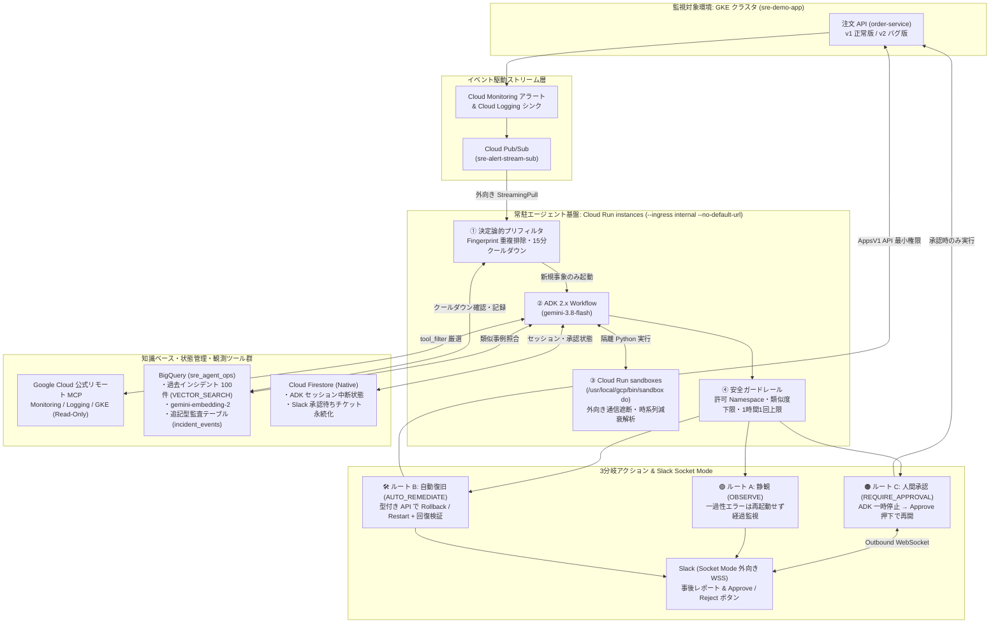

# Agentic SRE ハンズオン — Cloud Run instances × GKE による常駐自律型システム運用エージェント

Cloud Monitoring や Cloud Logging のイベントストリームを 24 時間 365 日常時待ち受け、異常検知時に**「マルチシグナル相関分析」「隔離サンドボックスでの統計解析」「過去 100 件のインシデント履歴（ベクトル検索）との照合」**を自律実行し、**静観・GKE 自動復旧・Slack Interactive 承認連携**を安全に使い分ける本番志向の Agentic SRE ハンズオンリポジトリです。

---

## 1. 全体アーキテクチャと設計の特徴

監視対象の GKE クラスタが障害に陥っても監視エージェント自体が共倒れしないよう、常駐 SRE エージェントは別基盤の **Cloud Run instances（＋ Cloud Run sandboxes）** 上で稼働させます（Out-of-Band 監視）。また、外部からの着信エンドポイントを完全に無効化（`--ingress internal --no-default-url`）したまま、外向き通信のみで Pub/Sub 購読と双方向 Slack 承認ボタンを実現します。



### おもちゃのデモと本リポジトリの設計の違い

| 観点 | 一般的なデモ実装の課題 | 本ハンズオンの本番設計パターン |
|---|---|---|
| **常時監視コスト** | 毎分 LLM に生ログを送りトークン費用が破綻する | Cloud Monitoring / Log Sink で異常時のみ Pub/Sub 発火し、コード側のクールダウン判定で重複呼び出しを排除 |
| **一過性エラー対応** | 通信瞬断でも毎回 Pod を再起動し、再接続ストームで悪化させる | 隔離サンドボックスでエラー率の減衰傾きを計算し、過去履歴と照合して**「何もしない（静観）」**を自律選択 |
| **変更操作の安全性** | LLM に自由な `kubectl` シェルコマンドを生成させクラスタ破壊リスクがある | 読取は公式リモート MCP（Read-Only）、変更は許可 Namespace 固定・1 時間 1 回上限・事後回復確認付きの型付き関数に分離 |
| **承認コールバック & 再開耐性** | Slack Webhook 受信用に未認証公開 URL が必要、また承認待ち中のコンテナ再起動で状態が消える | 常駐 instance から **Slack Socket Mode** で外向き接続し、ADK セッション＋承認チケットを **Firestore** へ永続化して再起動後も再開可能 |

---

## 2. ハンズオンカリキュラム（所要時間: 約 3.5〜4 時間）

上から順番に進めることで、ゼロから全コンポーネントを構築し、3 つの実戦障害シナリオで動作を検証できます。各章には **Cloud Shell 用の手順** と **AI コーディングエージェント（Google Antigravity / Claude Code / Gemini CLI）用の指示プロンプト** の両方を記載しています。

### 開始前の前提条件（実施者に必要な IAM ロール）
* **検証用サンドボックスプロジェクトの場合**: 実施ユーザーに **オーナー（`roles/owner`）** が付与されていれば全章そのまま実行できます。
* **⚠️ `roles/editor`（編集者）のみでは完走できません**: IAM バインディング付与・GKE `RoleBinding` 作成・Pub/Sub トピック IAM 設定・Secret Manager 操作で権限不足となります。`roles/owner` を使わずに事前定義ロールで最小権限付与を行う場合の一覧と付与コマンドは、[00-overview-and-architecture.md](docs/00-overview-and-architecture.md) の「Step 2.0」を参照してください。

| 章 | ドキュメント | 所要時間 | 構築・検証する内容 |
|---|---|---|---|
| **00** | [00-overview-and-architecture.md](docs/00-overview-and-architecture.md) | 20 分 | 全体設計、できること・不向きなことの境界、GCP API・IAM 事前準備 |
| **01** | [01-target-gke-and-alerting.md](docs/01-target-gke-and-alerting.md) | 35 分 | 監視対象 GKE アプリ（`order-service`）構築、最小権限 RBAC、Logging シンク → Pub/Sub 連携 |
| **02** | [02-bigquery-vector-kb.md](docs/02-bigquery-vector-kb.md) | 30 分 | BigQuery スキーマ作成、本番想定の過去インシデント **100 件** 投入、`gemini-embedding-2` 一括ベクトル化と類似検索 |
| **03** | [03-diagnostic-agent-and-sandbox.md](docs/03-diagnostic-agent-and-sandbox.md) | 40 分 | 公式リモート MCP 並列調査と、Cloud Run sandboxes（`sandbox do`）による隔離データ解析の実装 |
| **04** | [04-auto-remediation-and-slack-hitl.md](docs/04-auto-remediation-and-slack-hitl.md) | 45 分 | ADK 2.x `Workflow`、型付き GKE 復旧＋事後検証、Slack Socket Mode による一時停止・承認再開の実装 |
| **05** | [05-deploy-cloud-run-instance-and-drills.md](docs/05-deploy-cloud-run-instance-and-drills.md) | 45 分 | Cloud Run instance（`internal` + URL 無効化）への常駐デプロイと、3 大障害シナリオ訓練 |
| **06** | [06-optional-hardening-and-cleanup.md](docs/06-optional-hardening-and-cleanup.md) | 25 分 | 【任意】GKE Sandbox（`microVM`）構成、Model Armor ログ攻撃遮断、`pass^3` 信頼性評価、クリーンアップ手順 |

---

## 3. ローカル環境でのクイックテスト（クラウド課金 \$0）

Google Cloud へデプロイする前に、手元の Python 3.11+ 仮想環境で 100 件知識ベース検索・ADK 2.x ワークフロー 3 分岐・Slack 承認再開ロジックの単体/結合テストを実行できます。

```bash
python3 -m venv .venv
source .venv/bin/activate
pip install -e ".[dev]"
pytest -v
```

---

## 4. Google Cloud 利用料金の目安（東京 `asia-northeast1`・無料枠控除前の定価基準）

本ハンズオンはイベント駆動（異常発生時のみ起動）かつ軽量構成のため、無料枠を一切考慮しない定価計算でも、実施後に第 6 章のクリーンアップを行えば **総額 1 ドル未満（約 \$0.70〜\$0.80）** で完走できます。

### A. ハンズオン実施時・クリーンアップ未実施で放置した場合の料金

| ケース | 想定状況 | 概算コスト (USD) | 定価ベースの内訳 |
|---|---|---:|---|
| **① 通常実施（推奨）** | 約 4 時間実施し、終了後に第 6 章の削除手順を実行 | **約 \$0.70〜\$0.80** | GKE クラスタ管理手数料 4 時間（\$0.40）＋ GKE Pod 4 時間（\$0.13）＋ Cloud Run instance 2 時間（\$0.03）＋ Cloud Build・100 件ベクトル化・障害訓練 3 回分の Gemini 推論（\$0.14〜\$0.24） |
| **② 1 ヶ月放置（未削除）** | 削除せず 730 時間稼働させたまま放置 | **約 \$108 / 月** | GKE クラスタ管理手数料（\$73.00）＋ 監視対象 GKE Autopilot Pod 2 台（\$23.25）＋ 常駐 Cloud Run instance 1 台（\$11.56）＋ Artifact Registry・Secret Manager 保管（約 \$0.20）。平時の Pub/Sub・BigQuery スキャン・Gemini 推論は \$0.00 |

* **無料枠に関する補足**: 上記はすべて無料枠を差し引かない定価（オンデマンド価格）です。請求先アカウントで 1 台目の GKE Autopilot クラスタ管理手数料の無料枠（月最大 \$74.40 割引）などが残っている環境では、上記から自動割引され、①通常実施時は **約 \$0.30〜\$0.40**、②1 ヶ月放置時は **約 \$35 / 月** となります。
* **環境を残して待機課金だけ抑える方法**: 数日後に再デモしたい場合は、`gcloud beta run instances stop` と `kubectl scale deployment/order-service -n sre-demo-app --replicas=0` を実行しておくことで、Pod・インスタンスの稼働課金（月 \$34.81 相当）を停止できます。GKE クラスタ管理手数料（\$0.10/時間）まで完全に止める場合はクラスタ自体を削除してください。

### B. 本番システムへ導入・常時運用した際の月額コスト目安（規模別 3 パターン）

既存の監視対象システム（GKE クラスタ等）に対して、**本リポジトリの常駐 SRE エージェント基盤一式を追加導入して 24 時間 365 日稼働させた場合の増分コスト**（無料枠控除前の定価基準）です。15 分クールダウン重複排除により、同一障害のエラーログ連発時でも LLM 呼び出しは初回のみに抑止される前提で試算しています。

| 運用規模 | 監視対象・実質トリアージ発火件数 | エージェント常駐基盤 | 月額コスト目安 (USD) | 定価ベースの主な内訳 |
|---|---|---|---:|---|
| **小規模** | 1〜3 サービス監視 ／ **月 30 件**（平均 1 件/日） ／ 知識ベース 500 件 | Cloud Run instance 1 台（`2 vCPU / 2 GiB`） | **約 \$13〜\$14 / 月** | 常駐基盤 \$11.56 ＋ `gemini-3.8-flash` 推論 \$1.02〜\$2.03 ＋ BigQuery・Pub/Sub・Firestore・Secret Manager 等 \$0.30 |
| **中規模** | 10〜30 サービス監視 ／ **月 300 件**（平均 10 件/日） ／ 知識ベース 2,000 件 | Cloud Run instance 1 台（`2 vCPU / 4 GiB`） | **約 \$35〜\$48 / 月** | 常駐基盤 \$21.71 ＋ `gemini-3.8-flash` 推論 \$12.40〜\$24.78 ＋ BigQuery・Pub/Sub・Firestore・Secret Manager 等 \$0.62 |
| **大規模** | 50〜100+ サービス監視 ／ **月 1,500 件**（平均 50 件/日） ／ 知識ベース 10,000 件 | Cloud Run instances 冗長 2 台（各 `4 vCPU / 8 GiB`） | **約 \$165〜\$240 / 月** | 常駐基盤 \$86.83 ＋ `gemini-3.8-flash` 推論 \$73.28〜\$146.40 ＋ BigQuery・Pub/Sub・Firestore・ログ保管等 \$3.42 |

* **推論単価の前提**: `gemini-3.8-flash` の導入価格（入力 \$0.75・出力 \$3.75 / 100 万トークン）〜標準価格（入力 \$1.50・出力 \$7.50 / 100 万トークン）およびリモート MCP ツール往復（1 件あたり入力 2.5 万〜3.5 万・出力 4,000〜6,000 トークン想定）で算出しています。
* **発展構成選択時の補足**: 大規模環境で第 6 章オプション A の専用 GKE Standard `microVM` クラスタ（`n4-standard-4` 等）を構築してエージェントを常駐させる場合は、専用ノード常駐費と GKE クラスタ管理手数料が加わり **約 \$360〜\$470 / 月** が目安となります。またオプション B の Model Armor を有効化する場合は検査対象テキスト量に応じた従量費が加算されます。

---

## 5. ディレクトリ構成

```text
.
├── AGENTS.md                        # AI コーディングエージェント用の安全・設計ガードレール
├── .env.example                     # 環境変数テンプレート
├── pyproject.toml                   # Python パッケージ・テスト設定
├── target-app/                      # 監視対象 GKE マイクロサービス & 3 種障害注入スクリプト
├── bigquery/                        # BigQuery DDL・リモートモデル・本番想定インシデント 100 件 JSONL
├── sre-agent/                       # Cloud Run instances 常駐エージェント本体 (ADK 2.x)
├── appendix/                        # 付録: GKE Standard microVM マニフェスト / Model Armor / pass^3 評価
├── tests/                           # ローカル自動テストスイート
└── docs/                            # 全 7 章のステップバイステップ Codelab 教材
```

---

## Links and References

* [Create and manage Cloud Run instances](https://docs.cloud.google.com/run/docs/instances/create-and-manage-instances) — 常駐シングルトン実行環境 Cloud Run instances のライフサイクルと対応リージョン
* [Configure sandboxes for instances (Cloud Run)](https://docs.cloud.google.com/run/docs/configuring/instances/sandboxes) — Cloud Run instances における隔離サンドボックスの有効化手順
* [Code execution in Cloud Run](https://docs.cloud.google.com/run/docs/code-execution) — `/usr/local/gcp/bin/sandbox` CLI の実行方法とセキュリティ境界
* [Isolate workloads by using GKE Sandbox](https://docs.cloud.google.com/kubernetes-engine/docs/how-to/sandbox-pods) — GKE Sandbox（`microVM` / `gVisor`）の設定ガイド
* [Use the GKE, Cloud Monitoring, and Cloud Logging MCP servers](https://docs.cloud.google.com/mcp/overview) — Google Cloud リモート MCP サーバーの概要と IAM 設定
* [Agent Development Kit (ADK) Documentation](https://adk.dev/) — ADK Python 2.x のグラフワークフローと Human-in-the-Loop 仕様
* [Cloud Run pricing](https://cloud.google.com/run/pricing) / [GKE pricing](https://cloud.google.com/kubernetes-engine/pricing) — Cloud Run および GKE Autopilot の公式料金表
