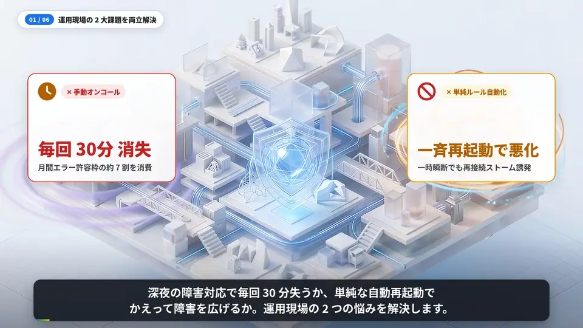
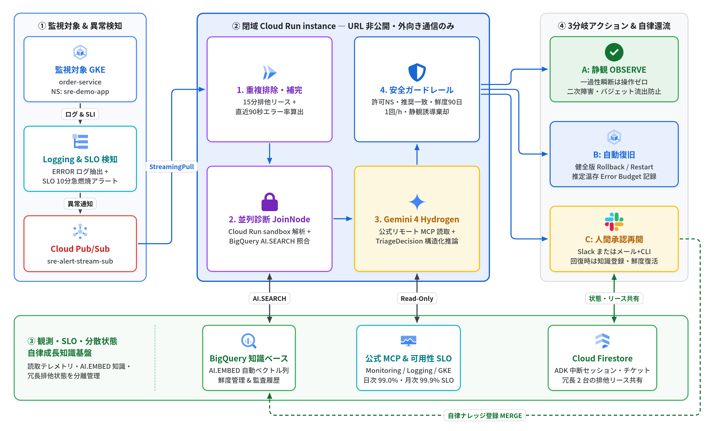
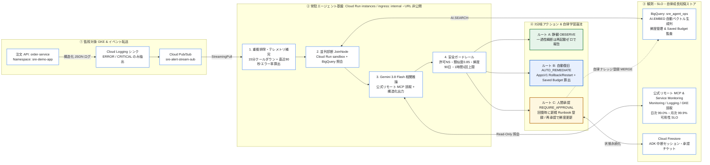

# Agentic SRE ハンズオン — Cloud Run instances × GKE による常駐自律型システム運用エージェント

Cloud Logging / Cloud Monitoring のイベントストリームを 24 時間常時待ち受け、異常検知時に**「マルチシグナル相関分析」「隔離サンドボックスでの統計解析」「BigQuery 自律埋め込み知識ベース（`AI.EMBED` / `AI.SEARCH`）との照合」**を実行し、**静観・GKE 自動復旧・Slack 承認連携・解決ナレッジの自律昇格・Error Budget 温存効果の定量計測**までを一気通貫で構築するハンズオンリポジトリです。



> **全体概要動画**: 上記は全 6 シーンの要点を約 22 秒に凝縮した自動ループプレビューです。日本語ナレーション・BGM・チャプター付きのフル HD 完全版（約 80 秒）は [docs/videos/overview-demo.mp4](docs/videos/overview-demo.mp4)（外部字幕: [overview-demo.srt](docs/videos/overview-demo.srt)）から視聴・ダウンロードできます。

---

## 1. 全体アーキテクチャと設計の特徴

監視対象の GKE クラスタが障害に陥っても監視エージェントが共倒れしないよう、エージェント本体は別基盤の **Cloud Run instances（＋ Cloud Run sandboxes）** 上で常駐稼働させます（Out-of-Band 監視）。外部からの着信 URL を完全に無効化（`--ingress internal --no-default-url`）したまま、外向き通信のみで Pub/Sub 購読と双方向 Slack 承認を実現します。Slack を使えない場合は、メール通知と承認コマンドの代替ルートを選べます。



<details>
<summary>詳細: Mermaid ソースを表示</summary>



</details>

### 一般的なデモ実装と本リポジトリの本番設計の違い

| 観点 | 一般的なデモ実装の課題 | 本ハンズオンの本番設計パターン |
|---|---|---|
| **常時監視コスト** | 毎分 LLM に生ログを送りトークン費用が増大する | Log Sink で異常時のみ Pub/Sub 発火し、15 分クールダウン重複排除で同一障害の連続呼び出しを遮断 |
| **一過性エラー対応** | 通信瞬断でも毎回 Pod を再起動し、再接続ストームで悪化させる | 隔離サンドボックスでエラー率の減衰傾きを計算し、過去事例と照合して**「静観（OBSERVE）」**を自律選択 |
| **変更操作の安全性** | LLM に自由な `kubectl` シェル文字列を生成させ破壊リスクがある | 読取は公式リモート MCP（Read-Only）、変更は許可 Namespace・1 時間 1 回上限・事後回復検証付きの型付き関数に限定 |
| **承認連携と再開耐性** | Webhook 受信用に公開 URL が必要で、再起動時に承認待ち状態が消える | **Slack Socket Mode** で外向き接続し、ボタン押下直後に実行中表示へ即時更新。状態は **Firestore** に永続化して再起動後も再開可能。Slack を使えない場合は、メール通知と承認コマンドで同じ再開処理を使用 |
| **ナレッジ蓄積と鮮度管理** | 初期データ検索止まり、または古い手順が無検証で自動実行され続ける | 承認解決済みの初見障害を **`AI.EMBED` 自動埋め込み列**へ登録して次回自動復旧へ昇格。**90 日未検証の手順は人間再承認へ自動降格**し、却下・未回復手順は即凍結 |
| **導入効果の定量評価** | 「便利になった」という定性評価止まりで信頼性への貢献が測れない | **Cloud Monitoring Service Monitoring SLO**（日次 99.0%・月次 99.9%）を構築し、訓練前後の実測バジェット消費と**自動復旧で温存した Error Budget 分数**を可視化 |

---

## 2. ハンズオンの進め方（2 つのコース）

目的に合わせて 2 つのコースから選べます。できあがる環境の構成は同じで、違うのは自分で手を動かす範囲です。

| コース | 所要時間 | 進め方 | 向いている場面 |
|---|---|---|---|
| **クイックスタート**: [quickstart.md](docs/quickstart.md) | 目安 60〜90 分 | 環境構築をスクリプトに任せ、エージェントのデプロイと障害訓練に時間を使う。通知はメール、承認はコマンドで行う | まず動くものを見て、エージェントの判断の違いを体験したい |
| **フル版**: 下表の第 0 章〜第 6 章 | 約 4 時間 | 章ごとにコマンドを実行して全コンポーネントを構築し、コードと設計を確かめる。通知と承認は Slack が標準 | 設計とコードを理解し、自分の環境へ応用したい |

### フル版のカリキュラム（所要時間: 約 4 時間）

上から順番に進めることで、ゼロから全コンポーネントを構築し、4 つの障害シナリオと Error Budget 温存効果を実機検証できます。各章末には AI コーディングエージェント（Google Antigravity / Claude Code / Gemini CLI）用の指示プロンプトも用意しています。

### 開始前の前提条件（実施者に必要な IAM ロール）
* **検証用サンドボックスプロジェクトの場合**: 実施ユーザーに **オーナー（`roles/owner`）** が付与されていれば全章そのまま完走できます。
* **⚠️ `roles/editor`（編集者）のみでは完走できません**: IAM 付与・GKE `RoleBinding`・SLO 作成・Secret Manager 操作で権限不足となります。最小権限ロール一式で実施する場合は [00-overview-and-architecture.md](docs/00-overview-and-architecture.md) の「Step 2.0」を参照してください。

| 章 | ドキュメント | 所要時間 | 構築・検証する内容 |
|---|---|---|---|
| **00** | [00-overview-and-architecture.md](docs/00-overview-and-architecture.md) | 20 分 | 全体設計と適用境界、Google Cloud API 有効化、用途別 3 つの最小権限 SA 作成 |
| **01** | [01-target-gke-and-alerting.md](docs/01-target-gke-and-alerting.md) | 40 分 | 監視対象 GKE・定常トラフィック Pod、最小権限 RBAC、Log Sink → Pub/Sub、**可用性 SLO 構築** |
| **02** | [02-bigquery-vector-kb.md](docs/02-bigquery-vector-kb.md) | 30 分 | BigQuery `AI.EMBED` 自動埋め込みテーブル作成、過去インシデント **100 件** 投入、`AI.SEARCH` 検証 |
| **03** | [03-diagnostic-agent-and-sandbox.md](docs/03-diagnostic-agent-and-sandbox.md) | 35 分 | 公式リモート MCP 厳選接続と、Cloud Run sandboxes（`sandbox do`）による隔離統計解析 |
| **04** | [04-auto-remediation-and-slack-hitl.md](docs/04-auto-remediation-and-slack-hitl.md) | 45 分 | ADK 2.x グラフ制御、型付き復旧、Slack Socket Mode 連携、メール通知と承認コマンドの代替ルート、鮮度管理、**Saved Error Budget 算出** |
| **05** | [05-deploy-cloud-run-instance-and-drills.md](docs/05-deploy-cloud-run-instance-and-drills.md) | 50 分 | 閉域 Cloud Run instance 常駐デプロイ、**4 大障害訓練・自己学習検証・訓練前後の Error Budget 比較** |
| **06** | [06-optional-hardening-and-cleanup.md](docs/06-optional-hardening-and-cleanup.md) | 20 分 | 【任意】GKE Sandbox（`microVM`）、Model Armor ログ防御、`pass^3` 評価ゲート、クリーンアップ手順 |

---

## 3. ローカル環境でのクイックテスト（クラウド課金 \$0）

Google Cloud へデプロイする前に、手元の Python 3.11+ 仮想環境で重複排除・サンドボックス隔離・100 件検索・ADK 2.x 3 分岐・Slack 再開・鮮度管理・Error Budget 温存計算・メール通知と承認コマンド・クイックスタートのスクリプトの全 93 テストを実行できます。

```bash
python3 -m venv .venv
source .venv/bin/activate
pip install -e ".[dev]"
pytest -v
```

---

## 4. Google Cloud 利用料金の目安（東京 `asia-northeast1`・無料枠控除前の定価基準）

イベント駆動（異常発生時のみ LLM 起動）かつ軽量構成のため、実施後に第 6 章のクリーンアップを行えば、無料枠を差し引かない定価計算でも **総額 1 ドル未満（約 \$0.72〜\$0.86）** で完走できます。

### A. ハンズオン実施時・クリーンアップ未実施で放置した場合の料金

| ケース | 想定状況 | 概算コスト (USD) | 定価ベースの内訳 |
|---|---|---:|---|
| **① 通常実施（推奨）** | 約 4 時間実施し、終了後に第 6 章の削除手順を実行 | **約 \$0.72〜\$0.86** | GKE クラスタ管理手数料 4 時間（\$0.40）＋ GKE Pod 群 4 時間（\$0.14）＋ Cloud NAT 4 時間（\$0.02）＋ Cloud Run instance 2 時間（\$0.03）＋ Cloud Build・100 件自動ベクトル化・障害訓練 4 シナリオ分の Gemini 推論（\$0.14〜\$0.24） |
| **② クイックスタート** | 約 90 分で実施し、終了後に `quickstart/cleanup.sh` を実行 | **約 \$0.37〜\$0.47** | GKE クラスタ管理手数料 1.5 時間（\$0.15）＋ GKE Pod 群 1.5 時間（\$0.05）＋ Cloud NAT 1.5 時間（\$0.01）＋ Cloud Run instance 1 時間（\$0.02）＋ Cloud Build・100 件自動ベクトル化・障害訓練の Gemini 推論（\$0.14〜\$0.24） |
| **③ 1 ヶ月放置（未削除）** | 削除せず 730 時間稼働させたまま放置 | **約 \$115 / 月** | GKE クラスタ管理手数料（\$73.00）＋ GKE Autopilot Pod 群（\$25.60）＋ 常駐 Cloud Run instance 1 台（\$11.56）＋ Cloud NAT 待機（約 \$4.00）＋ Artifact Registry・Secret Manager・ログメトリクス（約 \$0.40）。平時の Pub/Sub・Gemini 推論は \$0.00 |

* **無料枠に関する補足**: 上記はすべて無料枠控除前のオンデマンド定価です。請求先アカウントで 1 台目の GKE Autopilot クラスタ管理手数料の無料枠や Cloud Logging 月 50 GiB 無料枠が残っている環境では自動割引され、①通常実施時は **約 \$0.32〜\$0.42**、②クイックスタートは **約 \$0.22〜\$0.32**、③1 ヶ月放置時は **約 \$38 / 月** となります。
* **代替ルートのメール通知に関する補足**: 通知メールは Application Integration の連携の実行として課金され、定価は実行 1,000 回あたり \$0.50 です。フル版の訓練 1 周で送る 9 通［クイックスタートはテストメール込み合計 8 通］は \$0.01 未満のため、上表の概算には含めていません。無料枠は月 400 回までです。
* **環境を残して待機課金だけ抑える方法**: 数日後に再デモする場合は `gcloud beta run instances stop` と `kubectl scale deployment order-service order-traffic-generator -n sre-demo-app --replicas=0` でコンテナ稼働課金を停止できます。GKE クラスタ管理手数料（\$0.10/時間）まで止める場合はクラスタを削除してください。

### B. 本番システムへ導入・常時運用した際の月額増分コスト目安（規模別 3 パターン）

既存の監視対象システムに対し、**常駐 SRE エージェント基盤一式を追加導入して 24 時間 365 日稼働させた場合の増分コスト**（無料枠控除前の定価基準・15 分クールダウン有効前提）です。

| 運用規模 | 監視対象・実質トリアージ発火件数 | エージェント常駐基盤 | 月額コスト目安 (USD) | 定価ベースの主な内訳 |
|---|---|---|---:|---|
| **小規模** | 1〜3 サービス監視 ／ **月 30 件**（平均 1 件/日） ／ 知識ベース 500 件 | Cloud Run instance 1 台（`2 vCPU / 2 GiB`） | **約 \$13〜\$14 / 月** | 常駐基盤 \$11.56 ＋ `gemini-3.8-flash` 推論 \$1.02〜\$2.03 ＋ BigQuery・Pub/Sub・Firestore・SLO 監視等 \$0.35 |
| **中規模** | 10〜30 サービス監視 ／ **月 300 件**（平均 10 件/日） ／ 知識ベース 2,000 件 | Cloud Run instance 1 台（`2 vCPU / 4 GiB`） | **約 \$35〜\$48 / 月** | 常駐基盤 \$21.71 ＋ `gemini-3.8-flash` 推論 \$12.40〜\$24.78 ＋ BigQuery・Pub/Sub・Firestore・SLO 監視等 \$0.70 |
| **大規模** | 50〜100+ サービス監視 ／ **月 1,500 件**（平均 50 件/日） ／ 知識ベース 10,000 件 | Cloud Run instances 冗長 2 台（各 `4 vCPU / 8 GiB`） | **約 \$165〜\$240 / 月** | 常駐基盤 \$86.83 ＋ `gemini-3.8-flash` 推論 \$73.28〜\$146.40 ＋ BigQuery・Pub/Sub・Firestore・ログ保管等 \$3.50 |

* **推論単価の前提**: `gemini-3.8-flash`（入力 \$0.75〜\$1.50・出力 \$3.75〜\$7.50 / 100 万トークン）およびリモート MCP ツール往復（1 件あたり入力 2.5 万〜3.5 万・出力 4,000〜6,000 トークン想定）で算出しています。
* **発展構成選択時の補足**: 第 6 章オプション A の専用 GKE Standard `microVM` クラスタ（`n4-standard-4` 等）で常駐させる場合は **約 \$360〜\$470 / 月** が目安となります。

---

## 5. 自社環境への段階導入ロードマップ（コード変更ゼロ・環境変数のみで切替）

本リポジトリのエージェントは、コードを書き換えずに環境変数と RBAC だけで「観測のみ → 承認実行＋知識蓄積 → 限定自動復旧」の 3 段階ロールアウトをそのまま実践できます。設定値の詳細は [06-optional-hardening-and-cleanup.md](docs/06-optional-hardening-and-cleanup.md) の第 4 節を参照してください。

1. **STEP 1（観測・通知のみ）**: `ALLOWED_K8S_NAMESPACES=""`（GKE `RoleBinding` 未付与）で起動し、変更操作ゼロで診断精度を評価
2. **STEP 2（人間承認＋自律学習）**: `ALLOWED_K8S_NAMESPACES="対象NS"` かつ `MAX_AUTO_ACTIONS_PER_HOUR="0"` とし、承認された復旧だけを実測検証して `AI.EMBED` 知識ベースへ自動蓄積
3. **STEP 3（限定自動復旧）**: `MAX_AUTO_ACTIONS_PER_HOUR="1"` かつ `ALLOW_DRILL_COOLDOWN_RESET="false"` で既知障害を即時切り戻し（DB・未知・90 日超過手順は承認維持）

---

## 6. ディレクトリ構成

```text
.
├── AGENTS.md                        # AI コーディングエージェント用の安全・設計ガードレール
├── .env.example                     # 環境変数テンプレート
├── pyproject.toml                   # Python パッケージ・テスト設定
├── target-app/                      # 監視対象 GKE アプリ・定常負荷マニフェスト・障害注入 & SLO 管理スクリプト
│   ├── k8s/                         # namespace / order-service (v1, v2-buggy) / traffic-generator
│   └── scripts/                     # 4種障害注入・リセット・SLO 管理・通知メール設定・承認コマンド
├── bigquery/                        # BigQuery AI.EMBED 自動埋め込み DDL・初期シード 100 件 JSONL
├── sre-agent/                       # Cloud Run instances 常駐エージェント本体 (ADK 2.x + SLO 効果計測)
├── quickstart/                      # クイックスタート用: 環境構築・エージェントのデプロイ・後片付けのスクリプト
├── appendix/                        # 付録: GKE Standard microVM / Model Armor / pass^3 評価スクリプト
├── tests/                           # ローカル自動テストスイート (全 93 件)
└── docs/                            # クイックスタート・全 7 章 Codelab 教材・構成図 (images/)・概要解説動画 (videos/)
```

---

## Links and References

* [Create and manage Cloud Run instances](https://docs.cloud.google.com/run/docs/instances/create-and-manage-instances) — 常駐シングルトン実行環境 Cloud Run instances のライフサイクルと対応リージョン
* [Configure sandboxes for instances (Cloud Run)](https://docs.cloud.google.com/run/docs/configuring/instances/sandboxes) — Cloud Run instances における隔離サンドボックスの有効化手順
* [Autonomous embedding generation in BigQuery](https://docs.cloud.google.com/bigquery/docs/autonomous-embedding-generation) — `AI.EMBED` 自動埋め込み生成列と `AI.SEARCH` による自律知識ベースの構築方法
* [Concepts in service monitoring (Cloud Monitoring)](https://docs.cloud.google.com/stackdriver/docs/solutions/slo-monitoring) — SLI・SLO・Error Budget と Windows-based / Request-based SLO の設計指針
* [Use the GKE, Cloud Monitoring, and Cloud Logging MCP servers](https://docs.cloud.google.com/mcp/overview) — Google Cloud 公式リモート MCP サーバーの概要と IAM 設定
* [Agent Development Kit (ADK) Documentation](https://adk.dev/) — ADK Python 2.x のグラフワークフローと Human-in-the-Loop 仕様
* [Send Email task (Application Integration)](https://docs.cloud.google.com/application-integration/docs/configure-send-email-task) — 代替ルートの通知メールを送るメール送信タスクの仕様
