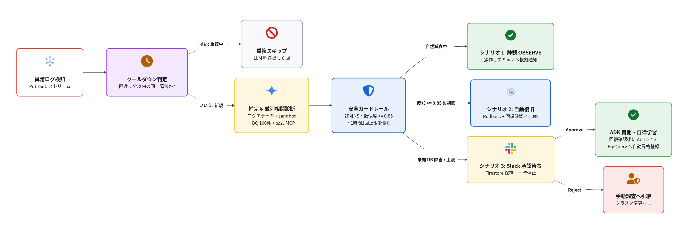
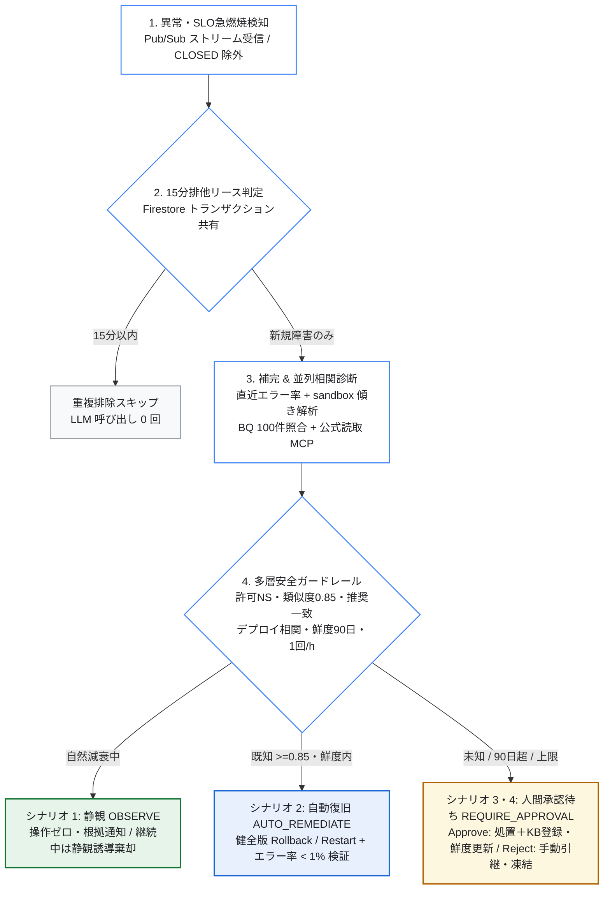
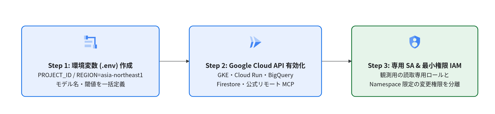
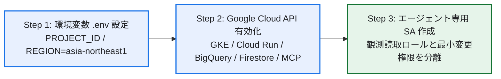

# 第 0 章：全体アーキテクチャと事前準備 (`00-overview-and-architecture.md`)

**所要時間**: 約 20 分  
**到達目標**: 本ワークショップで作る常駐自律型 SRE エージェントの全体像と適用境界を理解し、検証用 Google Cloud プロジェクトの API と最小権限サービスアカウントを準備する。

---

## 1. このワークショップで体験する自律運用と自己成長ループ

本番システムの運用では「すべてのアラートで Pod を再起動すればよい」わけではありません。誤った自動再起動は障害をかえって拡大させます。本ハンズオンでは、以下の判断フロー・解決ナレッジ自律蓄積・Error Budget 温存計測をゼロから構築します。



<details>
<summary>詳細: Mermaid ソースを表示</summary>



</details>

### なぜこの設計が機能するのか／何が不向きなのか

* **機能する 5 つの設計ポイント**:
  1. **監視基盤の分離（Out-of-Band 常駐）**: 監視対象 GKE とは別の **Cloud Run instances** 上で動くため、GKE 障害時も外部から復旧 API を呼べます。
  2. **公開 URL ゼロの双方向連携**: `--ingress internal --no-default-url` で着信を遮断し、外向き通信のみで Pub/Sub 購読と承認連携（Slack Socket Mode またはメール通知＋承認コマンド）を行います。
  3. **調査と変更の権限分離**: 統計計算は通信・認証を遮断した **Cloud Run sandboxes（`sandbox do`）** に閉じ込め、GKE 変更は許可 Namespace と回数上限付きの型付き API のみに絞ります。
  4. **鮮度管理付きの自己成長知識ベース**: 初見障害は承認後に**事後エラー率 1.0% 未満へ回復した場合のみ** BigQuery `AI.EMBED` 列へ自動登録し、90 日超過時は再承認へ降格・失敗時は凍結します。
  5. **Error Budget 温存効果の定量記録**: Service Monitoring SLO と連動し、実測 SLO 残量と手動対応基準（既定 30 分仮定）に対する推定温存分数を自動記録します。
* **対象外・不向きな領域（設計上の境界線）**:
  1. **全量生ログの直接 LLM 監視**: 平常時の大量ログをそのまま LLM へ送るとコストと遅延が破綻するため、一次抽出は Cloud Logging シンクと SLO アラートで行います。
  2. **DB 障害の無断自動修復**: 行ロック競合やスキーマ不整合でアプリを無断再起動すると被害が広がるため、必ず `REQUIRE_APPROVAL` で人間へ引き継ぎます。
  3. **対応リージョンと製品ステージ**: Cloud Run instances / sandboxes は Preview 機能であり、対応リージョンの **`asia-northeast1`（東京）** を使用します（`us-central1` 等は非対応）。SLA 付き GA 基盤が必要な場合は [第 6 章](06-optional-hardening-and-cleanup.md) の GKE Standard `microVM` を選択してください。

---

## 2. 事前準備ステップ（Cloud Shell または手元端末）



<details>
<summary>詳細: Mermaid ソースを表示</summary>



</details>

### Step 2.0 実施者（作業ユーザー）に必要な Google Cloud IAM ロールの確認

本ハンズオンではサービスアカウントへの IAM 付与、Kubernetes RBAC、および SLO 作成を行うため、**編集者（`roles/editor`）だけでは途中で権限不足になります**。以下のいずれかが付与されていることを確認してください。

* **方法 A（個人検証プロジェクト向け・最短）**: 対象プロジェクトの **オーナー（`roles/owner`）**
* **方法 B（最小権限の事前定義ロール一式を使う場合）**: プロジェクト管理者に以下のロール付与を依頼します。

| 事前定義ロール | 使用する章と用途 |
|---|---|
| `roles/serviceusage.serviceUsageAdmin` | 第 0 章：Google Cloud API の有効化と利用 |
| `roles/iam.serviceAccountAdmin` | 第 0・6 章：専用サービスアカウントの作成・削除 |
| `roles/iam.serviceAccountUser` | 第 1・5 章：Cloud Build 実行および Cloud Run instance への SA アタッチ |
| `roles/resourcemanager.projectIamAdmin` | 第 0・2 章：各専用 SA および BigQuery Connection SA への最小権限付与 |
| `roles/datastore.owner` | 第 0 章：Firestore `(default)` Native データベースの作成 |
| `roles/artifactregistry.admin` | 第 1・6 章：コンテナイメージ用リポジトリの作成・削除 |
| `roles/cloudbuild.builds.editor` / `roles/storage.admin` | 第 1・5 章：`gcloud builds submit` によるコンテナビルド |
| `roles/compute.networkAdmin` | 第 1・6 章：専用カスタム VPC・サブネット・Cloud NAT の作成・削除 |
| `roles/container.admin` | 第 1・5・6 章：GKE Autopilot 作成・削除、`Role` / `RoleBinding` 作成 |
| `roles/pubsub.admin` | 第 1・6 章：Pub/Sub トピック・サブスクリプション作成、Sink 権限付与 |
| `roles/logging.admin` | 第 1・5・6 章：Logging シンクおよびログベースメトリクス作成・ログ閲覧 |
| `roles/monitoring.editor` | 第 1・5・6 章：Service Monitoring サービス・可用性 SLO の作成と残量照会 |
| `roles/bigquery.admin` | 第 2・5・6 章：データセット・Cloud Resource Connection・`AI.EMBED` テーブル管理 |
| `roles/run.admin` | 第 5・6 章：Cloud Run instance のデプロイ・停止・削除 |
| `roles/secretmanager.admin` | 第 4・6 章：Slack 連携トークンの登録・削除（Slack 省略時は不要） |
| `roles/integrations.integrationAdmin` | 第 4・6 章：通知メール用の連携の登録・削除（Slack を使う場合は不要） |

```bash
# 方法 B の場合のみ：プロジェクト管理者がハンズオン実施ユーザーへ最小ロール一式を付与するコマンド例
export HANDSON_USER_EMAIL="your-email@example.com"
export GOOGLE_CLOUD_PROJECT="your-handson-project-id"

for ROLE in \
  roles/serviceusage.serviceUsageAdmin \
  roles/iam.serviceAccountAdmin \
  roles/iam.serviceAccountUser \
  roles/resourcemanager.projectIamAdmin \
  roles/datastore.owner \
  roles/artifactregistry.admin \
  roles/cloudbuild.builds.editor \
  roles/storage.admin \
  roles/compute.networkAdmin \
  roles/container.admin \
  roles/pubsub.admin \
  roles/logging.admin \
  roles/monitoring.editor \
  roles/bigquery.admin \
  roles/run.admin \
  roles/secretmanager.admin \
  roles/integrations.integrationAdmin; do
  gcloud projects add-iam-policy-binding "${GOOGLE_CLOUD_PROJECT}" \
    --member="user:${HANDSON_USER_EMAIL}" \
    --role="${ROLE}" \
    --condition=None \
    --quiet
done
```

メール通知と承認コマンドの代替ルートは、オーナー権限でのみ検証しています。方法 B の最小ロール構成では、Application Integration のリージョンの有効化に追加の権限が必要になる可能性があります。

### Step 2.1 リポジトリの取得と環境変数の設定

検証用の Google Cloud プロジェクト ID を指定して `.env` を作成します（本番プロジェクトは指定しないでください）。

```bash
git clone "https://github.com/tyorikan/agentic-sre-handson.git"
cd agentic-sre-handson

cp .env.example .env
# エディタで GOOGLE_CLOUD_PROJECT をご自身の検証用プロジェクト ID に書き換えます
source .env

gcloud config set project "${GOOGLE_CLOUD_PROJECT}"
export GOOGLE_CLOUD_QUOTA_PROJECT="${GOOGLE_CLOUD_PROJECT}"

# ローカル端末で実施する場合のみ：Python 管理スクリプト用のユーザ認証情報を設定します（Cloud Shell では不要）
gcloud auth application-default login
gcloud auth application-default set-quota-project "${GOOGLE_CLOUD_PROJECT}"
```

### Step 2.2 Google Cloud API の有効化と Firestore 作成

必要な API を一括有効化し、ADK セッション・承認チケット永続化用の Firestore Native データベース（`(default)`）を作成します。

```bash
gcloud services enable \
  compute.googleapis.com \
  container.googleapis.com \
  run.googleapis.com \
  bigquery.googleapis.com \
  bigqueryconnection.googleapis.com \
  firestore.googleapis.com \
  pubsub.googleapis.com \
  monitoring.googleapis.com \
  logging.googleapis.com \
  aiplatform.googleapis.com \
  developerknowledge.googleapis.com \
  artifactregistry.googleapis.com \
  cloudbuild.googleapis.com \
  secretmanager.googleapis.com \
  --project="${GOOGLE_CLOUD_PROJECT}"

if ! gcloud firestore databases describe --database="(default)" --project="${GOOGLE_CLOUD_PROJECT}" >/dev/null 2>&1; then
  gcloud firestore databases create \
    --location="${GOOGLE_CLOUD_REGION}" \
    --type=firestore-native \
    --project="${GOOGLE_CLOUD_PROJECT}"
fi
```

### Step 2.3 用途別に分離した 3 つの最小権限サービスアカウント作成

既定の Compute Engine サービスアカウントが無効化された組織環境でも動作し、かつ過剰権限（`roles/editor` 等）を排除するため、用途別に 3 つの専用サービスアカウントを作成します。

1. **`sre-cloudbuild-sa`**（ビルド専用）：ソース取得・Artifact Registry 書込・ビルドログ出力のみ
2. **`sre-gke-node-sa`**（GKE ノード専用）：ログ・メトリクス送信とコンテナイメージ取得のみ
3. **`sre-autonomous-agent-sa`**（SRE エージェント専用）：観測・MCP 読取、BigQuery・Firestore 読み書き、Pub/Sub 購読、モデル推論、GKE 到達のみ。GKE 内の変更範囲は第 1 章の Kubernetes RBAC で `sre-demo-app` に限定します。

```bash
export SRE_BUILD_SA_NAME="sre-cloudbuild-sa"
export SRE_BUILD_SA_EMAIL="${SRE_BUILD_SA_NAME}@${GOOGLE_CLOUD_PROJECT}.iam.gserviceaccount.com"
export GKE_NODE_SA_NAME="sre-gke-node-sa"
export GKE_NODE_SA_EMAIL="${GKE_NODE_SA_NAME}@${GOOGLE_CLOUD_PROJECT}.iam.gserviceaccount.com"
export SRE_AGENT_SA_NAME="sre-autonomous-agent-sa"
export SRE_AGENT_SA_EMAIL="${SRE_AGENT_SA_NAME}@${GOOGLE_CLOUD_PROJECT}.iam.gserviceaccount.com"

gcloud iam service-accounts create "${SRE_BUILD_SA_NAME}" \
  --display-name="Cloud Build Least-Privilege SA" \
  --project="${GOOGLE_CLOUD_PROJECT}"

gcloud iam service-accounts create "${GKE_NODE_SA_NAME}" \
  --display-name="GKE Autopilot Node Least-Privilege SA" \
  --project="${GOOGLE_CLOUD_PROJECT}"

gcloud iam service-accounts create "${SRE_AGENT_SA_NAME}" \
  --display-name="Autonomous SRE Agent Service Account" \
  --project="${GOOGLE_CLOUD_PROJECT}"

# SA 作成直後の IAM 伝播待ち（即時実行時の does not exist エラーを防ぐため待機＋リトライ）
sleep 10

grant_roles() {
  local sa_email="$1"
  shift
  for role in "$@"; do
    for attempt in 1 2 3 4 5; do
      if gcloud projects add-iam-policy-binding "${GOOGLE_CLOUD_PROJECT}" \
        --member="serviceAccount:${sa_email}" \
        --role="${role}" \
        --condition=None \
        --quiet >/dev/null; then
        break
      fi
      echo "IAM 伝播待機中 (${sa_email} -> ${role}, attempt=${attempt})..."
      sleep 5
    done
  done
}

grant_roles "${SRE_BUILD_SA_EMAIL}" \
  roles/storage.objectViewer \
  roles/artifactregistry.writer \
  roles/logging.logWriter

grant_roles "${GKE_NODE_SA_EMAIL}" \
  roles/container.defaultNodeServiceAccount \
  roles/artifactregistry.reader

grant_roles "${SRE_AGENT_SA_EMAIL}" \
  roles/monitoring.viewer \
  roles/logging.viewer \
  roles/mcp.toolUser \
  roles/serviceusage.serviceUsageConsumer \
  roles/bigquery.dataEditor \
  roles/bigquery.jobUser \
  roles/bigquery.connectionUser \
  roles/datastore.user \
  roles/pubsub.subscriber \
  roles/aiplatform.user \
  roles/container.clusterViewer \
  roles/secretmanager.secretAccessor
```

### 動作確認

以下のコマンドでサービスアカウントに最小ロール一式が付与されていれば準備完了です。

```bash
gcloud projects get-iam-policy "${GOOGLE_CLOUD_PROJECT}" \
  "--flatten=bindings[].members" \
  "--filter=bindings.members:serviceAccount:${SRE_AGENT_SA_EMAIL}" \
  "--format=table(bindings.role)"
```

---

## 🤖 AI コーディングエージェントを使う場合の指示プロンプト

```markdown
`AGENTS.md` と `.env` を読み込み、第0章（`docs/00-overview-and-architecture.md`）の事前準備を実行してください。
- 対象プロジェクトが `.env` の `GOOGLE_CLOUD_PROJECT` であることを最初に表示して確認すること。
- API 有効化・Firestore 作成・3 つの専用 SA 作成と IAM 付与コマンドを実行前に提示し、私の `y` 承認を得てから実行すること。
```

---

## Links and References

* [Create and manage Cloud Run instances](https://docs.cloud.google.com/run/docs/instances/create-and-manage-instances) — Cloud Run instances の概要と対応リージョン
* [Google Cloud MCP servers overview](https://docs.cloud.google.com/mcp/overview) — `roles/mcp.toolUser` を用いた公式リモート MCP サーバーの利用方法
* [Developer Knowledge MCP server](https://developers.google.com/knowledge/mcp) — 初見エラー調査で参照する Google 公式ドキュメント検索 MCP の仕様
* [IAM least privilege best practices](https://docs.cloud.google.com/iam/docs/using-iam-securely) — サービスアカウントの最小権限設計ガイド
* [Set up Application Default Credentials for a local development environment](https://docs.cloud.google.com/docs/authentication/set-up-adc-local-dev-environment) — ローカル端末と Cloud Shell における ADC の設定方法

次へ進む 👉 [第 1 章：監視対象 GKE・イベントストリーム・可用性 SLO の構築](01-target-gke-and-alerting.md)
