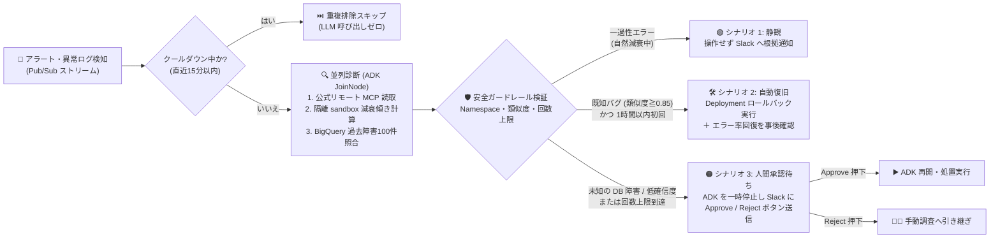
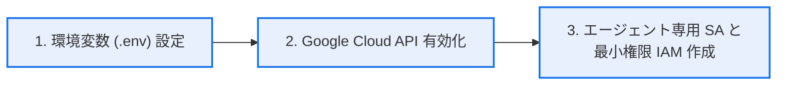

# 第 0 章：全体アーキテクチャと事前準備 (`00-overview-and-architecture.md`)

**所要時間**: 約 20 分  
**到達目標**: 本ワークショップで作る常駐自律型 SRE エージェントの全体像と設計根拠（「なぜ機能するのか」「何が不向きなのか」）を理解し、検証用 Google Cloud プロジェクトの API と IAM を準備する。

---

## 1. このワークショップで体験する 3 つの自律運用シナリオ

本番システムの運用では、「すべてのアラートで Pod を再起動すればよい」わけではありません。誤った自動操作は障害をかえって拡大させます。本ハンズオンでは、以下の判断フローをゼロから構築します。



### なぜこの設計が本番で機能するのか／何ができない・不向きなのか

* **本番で機能する理由**:
  1. **Out-of-Band（帯域外）常駐監視**: 監視対象の GKE クラスタとは独立した **Cloud Run instances** 上でエージェントを動かすため、GKE 側がノード枯渇や障害に陥ってもエージェントは巻き込まれず外部から復旧 API を実行できます。
  2. **攻撃対象面ゼロの双方向通信**: Cloud Run instance には `--ingress internal` と `--no-default-url` を設定し、インターネットからの着信を完全遮断します。Pub/Sub StreamingPull と Slack Socket Mode はどちらも**コンテナからの外向き TLS 通信**であるため、公開 URL を一切開けずにリアルタイム監視と承認ボタン連携が成立します。
  3. **調査の柔軟性と変更の厳格性の分離**: メトリクス統計計算などの動的スクリプトは外向き通信・認証情報を遮断した **Cloud Run sandboxes（`sandbox do`）** 内で実行し、GKE の変更操作は Namespace 固定・回数上限付きの型付き Python 関数のみに限定します。
* **できないこと・不向きなこと（設計上の明確な境界線）**:
  1. **全量アクセスログの直接 LLM 監視には不向き**: 毎秒数千行の生ログをすべて LLM に読ませるとコストと遅延が破綻します。一次検知は必ず Cloud Monitoring アラートや Cloud Logging のエラーフィルタシンクで行います。
  2. **DB スキーマ破損やロック競合の無断自動修復は行わない**: ステートフルな DB 障害でアプリを無断再起動するとロールバック負荷と再接続ラッシュで被害が拡大します。本設計ではこれらを自動的に `REQUIRE_APPROVAL` へ振り分け、1 分以内に診断証跡を揃えて人間へ判断を委ねます。
  3. **リージョンと製品ステージの制約**: Cloud Run instances および Cloud Run sandboxes は Preview 機能であり、`us-central1`・`us-east1`・`europe-west1` では利用できません。本ハンズオンでは対応リージョンである **`asia-northeast1`（東京）** を使用します。

---

## 2. 事前準備ステップ（Cloud Shell または手元端末）



### Step 2.1 リポジトリの取得と環境変数の設定

検証用の Google Cloud プロジェクト ID を指定して `.env` を作成します（本番プロジェクトは指定しないでください）。

```bash
git clone https://github.com/<your-account>/agentic-sre-handson.git
cd agentic-sre-handson

cp .env.example .env
# エディタで GOOGLE_CLOUD_PROJECT をご自身の検証用プロジェクト ID に書き換えます
source .env

gcloud config set project "${GOOGLE_CLOUD_PROJECT}"
```

### Step 2.2 必要な Google Cloud API の有効化

GKE、Cloud Run、BigQuery、Pub/Sub、Observability、Artifact Registry、Secret Manager、および Gemini Enterprise Agent Platform（`aiplatform.googleapis.com`）を有効化します。

```bash
gcloud services enable \
  container.googleapis.com \
  run.googleapis.com \
  bigquery.googleapis.com \
  bigqueryconnection.googleapis.com \
  pubsub.googleapis.com \
  monitoring.googleapis.com \
  logging.googleapis.com \
  aiplatform.googleapis.com \
  artifactregistry.googleapis.com \
  cloudbuild.googleapis.com \
  secretmanager.googleapis.com \
  --project="${GOOGLE_CLOUD_PROJECT}"
```

### Step 2.3 常駐 SRE エージェント専用のサービスアカウント作成

プロジェクト Owner のような過剰な権限は付与せず、ログ・メトリクス閲覧、リモート MCP 呼び出し（`roles/mcp.toolUser`）、BigQuery 読み書き、Pub/Sub 購読、モデル推論、および GKE API 到達に必要な最小ロールのみを付与します（GKE 内の具体的な操作範囲は次の第 1 章で Kubernetes RBAC により `sre-demo-app` Namespace のみに絞り込みます）。

```bash
export SRE_AGENT_SA_NAME="sre-autonomous-agent-sa"
export SRE_AGENT_SA_EMAIL="${SRE_AGENT_SA_NAME}@${GOOGLE_CLOUD_PROJECT}.iam.gserviceaccount.com"

gcloud iam service-accounts create "${SRE_AGENT_SA_NAME}" \
  --display-name="Autonomous SRE Agent Service Account" \
  --project="${GOOGLE_CLOUD_PROJECT}"

for ROLE in \
  roles/monitoring.viewer \
  roles/logging.viewer \
  roles/mcp.toolUser \
  roles/serviceusage.serviceUsageConsumer \
  roles/bigquery.dataEditor \
  roles/bigquery.jobUser \
  roles/bigquery.connectionUser \
  roles/pubsub.subscriber \
  roles/aiplatform.user \
  roles/container.clusterViewer \
  roles/secretmanager.secretAccessor; do
  gcloud projects add-iam-policy-binding "${GOOGLE_CLOUD_PROJECT}" \
    --member="serviceAccount:${SRE_AGENT_SA_EMAIL}" \
    --role="${ROLE}" \
    --condition=None \
    --quiet
done
```

### 動作確認

以下のコマンドでサービスアカウントと付与ロールが正しく表示されれば準備完了です。

```bash
gcloud projects get-iam-policy "${GOOGLE_CLOUD_PROJECT}" \
  "--flatten=bindings[].members" \
  "--filter=bindings.members:serviceAccount:${SRE_AGENT_SA_EMAIL}" \
  "--format=table(bindings.role)"
```

---

## 🤖 AI コーディングエージェントを使う場合の指示プロンプト

Google Antigravity / Claude Code / Gemini CLI を使って本章を実行する場合は、以下をそのまま渡してください。

```markdown
`AGENTS.md` と `.env` を読み込み、第0章（`docs/00-overview-and-architecture.md`）の事前準備を実行してください。
- 対象プロジェクトが `.env` の `GOOGLE_CLOUD_PROJECT` であることを最初に表示して確認すること。
- API 有効化と `sre-autonomous-agent-sa` サービスアカウント作成・IAM 付与のコマンドを実行前に提示し、私の `y` 承認を得てから実行すること。
```

---

## Links and References

* [Create and manage Cloud Run instances](https://docs.cloud.google.com/run/docs/instances/create-and-manage-instances) — Cloud Run instances の概要と対応リージョン
* [Google Cloud MCP servers overview](https://docs.cloud.google.com/mcp/overview) — `roles/mcp.toolUser` を用いた Google Cloud リモート MCP サーバーの利用方法
* [IAM least privilege best practices](https://docs.cloud.google.com/iam/docs/using-iam-securely) — サービスアカウントの最小権限設計ガイド

次へ進む 👉 [第 1 章：監視対象 GKE アプリとアラートストリームの構築](01-target-gke-and-alerting.md)
