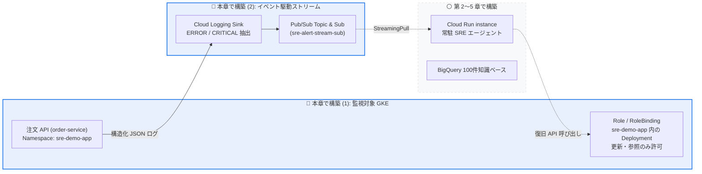
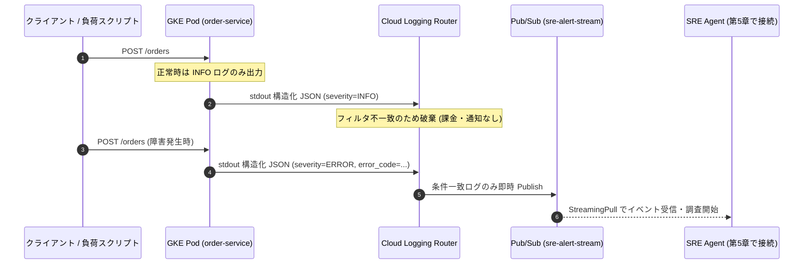

# 第 1 章：監視対象 GKE アプリとアラートストリームの構築 (`01-target-gke-and-alerting.md`)

**所要時間**: 約 35 分  
**到達目標**: 監視対象となる注文マイクロサービス（`order-service`）を GKE 上に構築し、最小権限の Kubernetes RBAC と「Cloud Logging エラーシンク → Cloud Pub/Sub」のイベント駆動ストリームを接続する。

---

## 1. この章で作る場所（現在地マップ）

色が付いている **GKE クラスタ（監視対象）** と **イベント駆動ストリーム層（Log Sink → Pub/Sub）** を構築します。



### なぜ「毎分ログ検索ポーリング」ではなく「Log Sink → Pub/Sub」にするのか？

常駐エージェントが `while True:` ループで毎分 Cloud Logging API を全件検索する設計にすると、平時でも API 呼び出しとトークン費用が発生し続け、障害発生から検知までのタイムラグも生じます。  
代わりに **Cloud Logging のログルーター（Sink）** を使えば、GKE から出力されるログのうち `severity >= ERROR` の異常ログだけを Google Cloud 基盤側でリアルタイムにフィルタリングし、ミリ秒〜数秒で **Cloud Pub/Sub** へ転送できます。平時の LLM 推論コストは完全にゼロになります。



---

## 2. GKE Autopilot クラスタと Artifact Registry の作成

監視対象のマイクロサービスを動かす GKE Autopilot クラスタと、コンテナイメージ置き場を作成します。

```bash
source .env

# 1. コンテナイメージ用 Artifact Registry リポジトリの作成
gcloud artifacts repositories create sre-handson \
  --repository-format=docker \
  --location="${GOOGLE_CLOUD_REGION}" \
  --description="Agentic SRE Hands-on container repository" \
  --project="${GOOGLE_CLOUD_PROJECT}"

# 2. 監視対象 GKE Autopilot クラスタの作成（約 5〜8 分かかります）
gcloud container clusters create-auto "${GKE_CLUSTER_NAME}" \
  --region="${GKE_CLUSTER_LOCATION}" \
  --project="${GOOGLE_CLOUD_PROJECT}"

# 3. kubectl 認証情報の取得
gcloud container clusters get-credentials "${GKE_CLUSTER_NAME}" \
  --region="${GKE_CLUSTER_LOCATION}" \
  --project="${GOOGLE_CLOUD_PROJECT}"
```

---

## 3. 最小権限 Kubernetes RBAC と監視対象アプリのデプロイ

### なぜ Kubernetes `ClusterRole` ではなく Namespace 限定の `Role` にするのか？

第 0 章でエージェントのサービスアカウントに付与した `roles/container.clusterViewer` は読み取り専用です。変更権限をプロジェクト全体の `roles/container.developer` で渡してしまうと、`kube-system` や他の本番システムの Namespace まで操作できてしまいます。  
そこで `target-app/k8s/namespace.yaml` では、**`sre-demo-app` Namespace 内の `deployments` と `replicasets` のみを更新できる Kubernetes `Role` と `RoleBinding`** を定義しています。Secret の読み取りや Namespace の削除は構造的に不可能です。

```bash
export SRE_AGENT_SA_EMAIL="sre-autonomous-agent-sa@${GOOGLE_CLOUD_PROJECT}.iam.gserviceaccount.com"
export TARGET_APP_IMAGE_URI="${GOOGLE_CLOUD_REGION}-docker.pkg.dev/${GOOGLE_CLOUD_PROJECT}/sre-handson/order-service"

# 1. サンプル注文 API (v1.0.0) のビルドとプッシュ
gcloud builds submit ./target-app \
  --tag="${TARGET_APP_IMAGE_URI}:v1.0.0" \
  --project="${GOOGLE_CLOUD_PROJECT}"

# 2. Namespace と SRE エージェント用 最小権限 RBAC の適用
sed "s|SRE_AGENT_SA_EMAIL|${SRE_AGENT_SA_EMAIL}|g" \
  ./target-app/k8s/namespace.yaml | kubectl apply -f -

# 3. 正常版 (v1.0.0) Deployment & Service のデプロイ
sed "s|TARGET_APP_IMAGE_URI|${TARGET_APP_IMAGE_URI}|g" \
  ./target-app/k8s/deployment-v1-healthy.yaml | kubectl apply -f -

kubectl rollout status deployment/order-service -n sre-demo-app --timeout=180s
```

### 権限境界の確認（Verification）

`kubectl auth can-i` を使って、SRE エージェントのサービスアカウントが「`sre-demo-app` の Deployment 更新はできるが、Pod 削除や `kube-system` の変更は拒否される」ことを確認します。

```bash
# 期待出力: yes
kubectl auth can-i patch deployments -n sre-demo-app --as="${SRE_AGENT_SA_EMAIL}"

# 期待出力: no（任意 Pod の直接削除や他 Namespace 操作は不可）
kubectl auth can-i delete pods -n sre-demo-app --as="${SRE_AGENT_SA_EMAIL}"
kubectl auth can-i patch deployments -n kube-system --as="${SRE_AGENT_SA_EMAIL}"
```

---

## 4. Pub/Sub トピックと Cloud Logging エラーシンクの構築

`sre-demo-app` Namespace から出力される `ERROR` 以上の構造化ログを自動検知して Pub/Sub へ流すパイプラインを作ります。

```bash
export ALERT_TOPIC="sre-alert-stream"

# 1. Pub/Sub トピックと Pull サブスクリプションの作成
gcloud pubsub topics create "${ALERT_TOPIC}" --project="${GOOGLE_CLOUD_PROJECT}"

gcloud pubsub subscriptions create "${ALERT_PUBSUB_SUBSCRIPTION}" \
  --topic="${ALERT_TOPIC}" \
  --ack-deadline=60 \
  --message-retention-duration=1h \
  --project="${GOOGLE_CLOUD_PROJECT}"

# 2. Cloud Logging シンクの作成（sre-demo-app の ERROR 以上のみ抽出）
gcloud logging sinks create sre-gke-error-sink \
  "pubsub.googleapis.com/projects/${GOOGLE_CLOUD_PROJECT}/topics/${ALERT_TOPIC}" \
  --log-filter='resource.type="k8s_container" AND resource.labels.namespace_name="sre-demo-app" AND severity>=ERROR' \
  --project="${GOOGLE_CLOUD_PROJECT}"

# 3. ログルーターの書き込み専用サービスアカウントに Pub/Sub Publisher 権限を付与
SINK_WRITER_IDENTITY=$(gcloud logging sinks describe sre-gke-error-sink \
  --project="${GOOGLE_CLOUD_PROJECT}" --format="value(writerIdentity)")

gcloud pubsub topics add-iam-policy-binding "${ALERT_TOPIC}" \
  --member="${SINK_WRITER_IDENTITY}" \
  --role="roles/pubsub.publisher" \
  --project="${GOOGLE_CLOUD_PROJECT}"
```

### 動作確認

Pod 一覧が `2/2 Running` であり、サブスクリプションが作成されていることを確認します。

```bash
kubectl get pods -n sre-demo-app
gcloud pubsub subscriptions describe "${ALERT_PUBSUB_SUBSCRIPTION}" --project="${GOOGLE_CLOUD_PROJECT}"
```

---

## 🤖 AI コーディングエージェントを使う場合の指示プロンプト

```markdown
`AGENTS.md` と `.env` を読み込み、第1章（`docs/01-target-gke-and-alerting.md`）の手順を実行してください。
- GKE Autopilot クラスタ作成、`order-service:v1.0.0` のビルド・デプロイ、最小権限 RBAC 適用、Pub/Sub と Logging Sink 作成の各状態変更コマンドは、実行前に提示して私の `y` 承認を得てから実行すること。
- 最後に `kubectl auth can-i` の 3 つの検証結果を報告すること。
```

---

## Links and References

* [GKE Autopilot overview](https://docs.cloud.google.com/kubernetes-engine/docs/concepts/autopilot-overview) — GKE Autopilot クラスタの運用モデル
* [Using RBAC authorization in GKE](https://docs.cloud.google.com/kubernetes-engine/docs/how-to/role-based-access-control) — Namespace スコープの最小権限 Role 設計
* [Route logs to supported destinations (Cloud Logging)](https://docs.cloud.google.com/logging/docs/routing/overview) — Cloud Logging シンクによる Pub/Sub へのリアルタイム転送

次へ進む 👉 [第 2 章：BigQuery ベクトル知識ベースと過去インシデント 100 件の構築](02-bigquery-vector-kb.md)
