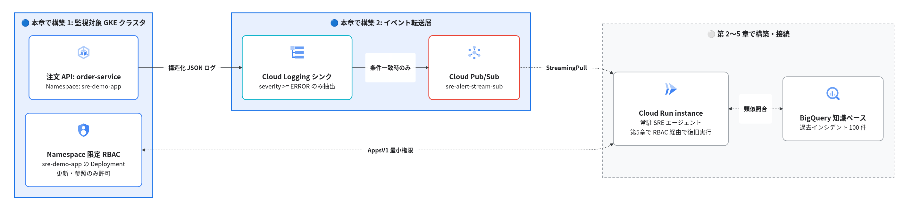
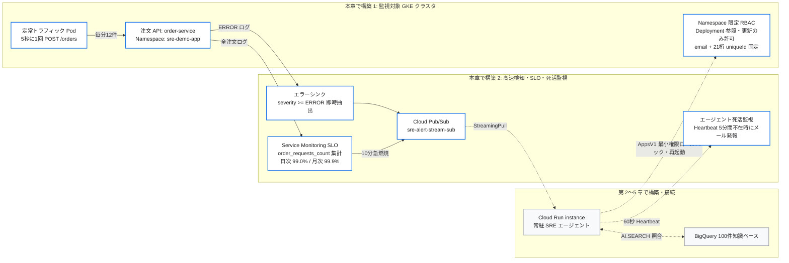
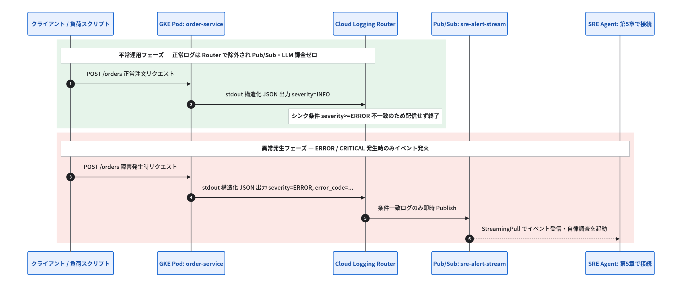
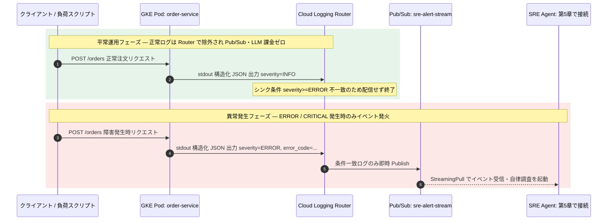

# 第 1 章：監視対象 GKE・イベントストリーム・可用性 SLO の構築 (`01-target-gke-and-alerting.md`)

**所要時間**: 約 40 分  
**到達目標**: 監視対象マイクロサービス（`order-service`）と軽量な定常トラフィック Pod を GKE 上に構築し、最小権限 RBAC、「Cloud Logging エラーシンク → Pub/Sub」の即時起動ストリーム、および **Cloud Monitoring Service Monitoring の可用性 SLO（日次 99.0% ＆ 月次 99.9%）** を構成する。

---

## 1. この章で作る場所（現在地マップ）

**監視対象 GKE クラスタ**、**異常時のみの即時イベントストリーム**、および **訓練前後の Error Budget 消費を測る公式 SLO モニタリング** を構築します。



<details>
<summary>詳細: Mermaid ソースを表示</summary>



</details>

### なぜ「高速検知ストリーム」と「SLO モニタリング」の 2 経路に分けるのか？

1. **数秒以内の即時起動＆平時課金ゼロ（Log Sink → Pub/Sub）**: 1 分単位のメトリクス集計を待たず、`severity >= ERROR` ログが出た瞬間に Pub/Sub へ転送します。平常時の `INFO` ログはログルーターで除外するため、平時の LLM 課金はゼロです。
2. **信頼性の定量評価（Service Monitoring SLO）**: 全注文ログ（正常 `201` と異常 `5xx`）を単一メトリクス `order_requests_count` で集計し、第 5 章の訓練で「自動復旧でどれだけ Error Budget 消費を抑えたか」を実測します。



<details>
<summary>詳細: Mermaid ソースを表示</summary>



</details>

---

## 2. 専用カスタム VPC・Cloud NAT・GKE Autopilot・Artifact Registry の作成

`default` VPC 自動作成無効やノード外部 IP 禁止（`vmExternalIpAccess: DENY`）などのセキュリティ組織ポリシーが有効な環境でもそのまま動作するよう、専用カスタム VPC・Cloud NAT とプライベートノード構成で GKE Autopilot クラスタを作成します。

```bash
source .env

export VPC_NAME="sre-handson-vpc"
export SUBNET_NAME="sre-handson-subnet"
export ROUTER_NAME="sre-handson-router"
export NAT_NAME="sre-handson-nat"
export GKE_NODE_SA_EMAIL="sre-gke-node-sa@${GOOGLE_CLOUD_PROJECT}.iam.gserviceaccount.com"

# 1. コンテナイメージ用 Artifact Registry リポジトリの作成
gcloud artifacts repositories create sre-handson \
  --repository-format=docker \
  --location="${GOOGLE_CLOUD_REGION}" \
  --description="Agentic SRE Hands-on container repository" \
  --project="${GOOGLE_CLOUD_PROJECT}"

# 2. 専用カスタム VPC とサブネット［Private Google Access 有効］の作成
gcloud compute networks create "${VPC_NAME}" \
  --subnet-mode=custom \
  --project="${GOOGLE_CLOUD_PROJECT}"

gcloud compute networks subnets create "${SUBNET_NAME}" \
  --network="${VPC_NAME}" \
  --region="${GOOGLE_CLOUD_REGION}" \
  --range="10.10.0.0/20" \
  --enable-private-ip-google-access \
  --project="${GOOGLE_CLOUD_PROJECT}"

# 3. プライベートノードからの外向きイメージ取得用 Cloud Router & Cloud NAT 作成
gcloud compute routers create "${ROUTER_NAME}" \
  --network="${VPC_NAME}" \
  --region="${GOOGLE_CLOUD_REGION}" \
  --project="${GOOGLE_CLOUD_PROJECT}"

gcloud compute routers nats create "${NAT_NAME}" \
  --router="${ROUTER_NAME}" \
  --region="${GOOGLE_CLOUD_REGION}" \
  --auto-allocate-nat-external-ips \
  --nat-all-subnet-ip-ranges \
  --project="${GOOGLE_CLOUD_PROJECT}"

# 4. 監視対象 GKE Autopilot クラスタの作成（約 5〜8 分）
gcloud container clusters create-auto "${GKE_CLUSTER_NAME}" \
  --region="${GKE_CLUSTER_LOCATION}" \
  --network="${VPC_NAME}" \
  --subnetwork="${SUBNET_NAME}" \
  --enable-private-nodes \
  --service-account="${GKE_NODE_SA_EMAIL}" \
  --project="${GOOGLE_CLOUD_PROJECT}"

# 5. kubectl 認証情報の取得
gcloud container clusters get-credentials "${GKE_CLUSTER_NAME}" \
  --region="${GKE_CLUSTER_LOCATION}" \
  --project="${GOOGLE_CLOUD_PROJECT}"
```

---

## 3. 最小権限 RBAC・監視対象アプリ・定常トラフィック Pod のデプロイ

エージェントにプロジェクト全体の変更権限を与えないよう、[target-app/k8s/namespace.yaml](../target-app/k8s/namespace.yaml) で以下を構成します。

* **Namespace 限定 RBAC**: `sre-demo-app` 内の `deployments` と `replicasets` の参照・更新のみを許可する `Role` / `RoleBinding` を作成します。
* **定常トラフィック生成 Pod**: SLO の時系列ベースラインを作るため、5 秒に 1 回（毎分 12 件）`POST /orders` を送る `order-traffic-generator` を配置します。

> [!TIP]
> Cloud Run のメタデータトークンで GKE API を呼ぶ際、GKE 側は SA メールアドレスではなく 21 桁の数値 `uniqueId` で主体を照合する場合があります。`RoleBinding` に両方を登録してどちらの経路でも認可されるようにします。

```bash
export SRE_BUILD_SA_EMAIL="sre-cloudbuild-sa@${GOOGLE_CLOUD_PROJECT}.iam.gserviceaccount.com"
export SRE_AGENT_SA_EMAIL="sre-autonomous-agent-sa@${GOOGLE_CLOUD_PROJECT}.iam.gserviceaccount.com"
export SRE_AGENT_SA_UNIQUE_ID=$(gcloud iam service-accounts describe "${SRE_AGENT_SA_EMAIL}" --project="${GOOGLE_CLOUD_PROJECT}" --format="value(uniqueId)")
export TARGET_APP_IMAGE_URI="${GOOGLE_CLOUD_REGION}-docker.pkg.dev/${GOOGLE_CLOUD_PROJECT}/sre-handson/order-service"

# 1. サンプル注文 API (v1.0.0) のビルドとプッシュ
gcloud builds submit ./target-app \
  --config=./target-app/cloudbuild.yaml \
  --substitutions="_IMAGE_URI=${TARGET_APP_IMAGE_URI}:v1.0.0" \
  --service-account="projects/${GOOGLE_CLOUD_PROJECT}/serviceAccounts/${SRE_BUILD_SA_EMAIL}" \
  --project="${GOOGLE_CLOUD_PROJECT}"

# 2. Namespace と SRE エージェント用 最小権限 RBAC の適用
sed -e "s|SRE_AGENT_SA_EMAIL|${SRE_AGENT_SA_EMAIL}|g" \
    -e "s|SRE_AGENT_SA_UNIQUE_ID|${SRE_AGENT_SA_UNIQUE_ID}|g" \
  ./target-app/k8s/namespace.yaml | kubectl apply -f -

# 3. 正常版 (v1.0.0) Deployment & Service と定常トラフィック生成 Pod のデプロイ
sed "s|TARGET_APP_IMAGE_URI|${TARGET_APP_IMAGE_URI}|g" \
  ./target-app/k8s/deployment-v1-healthy.yaml | kubectl apply -f -

kubectl rollout status deployment/order-service -n sre-demo-app --timeout=300s

kubectl apply -f ./target-app/k8s/traffic-generator.yaml
kubectl rollout status deployment/order-traffic-generator -n sre-demo-app --timeout=180s
```

### 権限境界の確認（Verification）

`kubectl auth can-i` で、`sre-demo-app` の Deployment 更新のみが許可され、Pod 削除や `kube-system` 変更は拒否されることを確認します。

```bash
kubectl auth can-i patch deployments -n sre-demo-app --as="${SRE_AGENT_SA_EMAIL}"   # 期待出力: yes
kubectl auth can-i delete pods -n sre-demo-app --as="${SRE_AGENT_SA_EMAIL}"         # 期待出力: no
kubectl auth can-i patch deployments -n kube-system --as="${SRE_AGENT_SA_EMAIL}"    # 期待出力: no
```

---

## 4. Pub/Sub トピックと Cloud Logging エラーシンクの構築

`sre-demo-app` から出力される `ERROR` 以上の構造化ログのみをリアルタイム抽出して Pub/Sub へ配信します。

```bash
export ALERT_TOPIC="sre-alert-stream"

gcloud pubsub topics create "${ALERT_TOPIC}" --project="${GOOGLE_CLOUD_PROJECT}"

gcloud pubsub subscriptions create "${ALERT_PUBSUB_SUBSCRIPTION}" \
  --topic="${ALERT_TOPIC}" \
  --ack-deadline=60 \
  --message-retention-duration=1h \
  --project="${GOOGLE_CLOUD_PROJECT}"

gcloud logging sinks create sre-gke-error-sink \
  "pubsub.googleapis.com/projects/${GOOGLE_CLOUD_PROJECT}/topics/${ALERT_TOPIC}" \
  --log-filter='resource.type="k8s_container" AND resource.labels.namespace_name="sre-demo-app" AND severity>=ERROR AND NOT textPayload=~"^INFO:"' \
  --project="${GOOGLE_CLOUD_PROJECT}"

SINK_WRITER_IDENTITY=$(gcloud logging sinks describe sre-gke-error-sink \
  --project="${GOOGLE_CLOUD_PROJECT}" --format="value(writerIdentity)")

gcloud pubsub topics add-iam-policy-binding "${ALERT_TOPIC}" \
  --member="${SINK_WRITER_IDENTITY}" \
  --role="roles/pubsub.publisher" \
  --project="${GOOGLE_CLOUD_PROJECT}"
```

---

## 5. Cloud Monitoring 可用性 SLO・Burn-Rate アラート・エージェント死活監視の構築

[target-app/scripts/setup_slo_monitoring.py](../target-app/scripts/setup_slo_monitoring.py) を実行し、アプリケーション無改修で公式の **Service Monitoring SLO** と **症状ベース検知・死活監視アラート** を一括登録します。

### このスクリプトが登録する 4 つの監視設定

1. **単一カウンタメトリクス（`order_requests_count`）**: 総件数と正常件数を別メトリクスにすると 1 分境界の集計ずれが起きるため、`outcome = EXTRACT(severity)` ラベル付きの 1 つのメトリクスで集計します。1 分間の `INFO` 比率 95% 以上を正常分とする **Windows-based SLI** を定義します。
2. **2 本の可用性 SLO**: 評価期間 `T_period` に対する許容停止枠（Error Budget）は `T_period × (1 - Goal)` で計算されます。
   * **日次 99.0% SLO（`order-availability-daily-99`）**: 許容枠は **14.4 分/日**。1〜2 分の障害訓練で残量が約 7〜14% 動くため、画面上で変化をすぐ確認できます。
   * **月次 99.9% SLO（`order-availability-monthly-999`）**: 30 日換算の許容枠は **43.2 分/月**。手動対応（30 分仮定で枠の約 70% 消費）と自動復旧（約 1.3 分で約 3% 消費）の差を定量比較します。
3. **SLO 急燃焼アラート（`select_slo_burn_rate` > 10 倍）**: ERROR ログを出さない症状悪化も検知できるよう、日次 SLO の 10 分間燃焼率アラートを `sre-alert-stream` トピックへ合流させます（復旧通知 `state="closed"` は自動スキップ）。なお、トラフィック自体が 0 件になった場合は比率が算出されないため、本番では外形監視（Uptime Check）も併用します。
4. **エージェント自身の死活監視（Heartbeat 不在検知）**: エージェントが 60 秒ごとに出す `sre_agent_heartbeat_count` が **5 分間途絶した場合**、Pub/Sub ではなく人間向けメール通知チャネル（`NOTIFY_EMAIL_TO` 設定時）へ直接発報します。

```bash
python3 -m venv .venv
source .venv/bin/activate
pip install -e ".[dev]"

# ログメトリクス・Service Monitoring・可用性 SLO 2本・Burn-Rate アラート・死活監視アラートを一括作成
python3 ./target-app/scripts/setup_slo_monitoring.py
```

### 動作確認

Pod 一覧（`order-service` 2 台 ＋ `order-traffic-generator` 1 台）が `Running` であり、約 2 分後に `check_slo_budget.py` で達成率 `100.000%`・Error Budget 残量 `100.00%` が表示されることを確認します。

```bash
kubectl get pods -n sre-demo-app
sleep 120
python3 ./target-app/scripts/check_slo_budget.py
```

---

## 🤖 AI コーディングエージェントを使う場合の指示プロンプト

```markdown
`AGENTS.md` と `.env` を読み込み、第1章（`docs/01-target-gke-and-alerting.md`）の手順を実行してください。
- GKE Autopilot クラスタ作成、`order-service:v1.0.0` と `order-traffic-generator` のデプロイ、最小権限 RBAC、Pub/Sub・Logging Sink 作成、および `setup_slo_monitoring.py` の各状態変更コマンドは、実行前に提示して私の `y` 承認を得てから実行すること。
- 最後に `kubectl auth can-i` の 3 つの検証結果と `check_slo_budget.py` の初期ベースライン出力を報告すること。
```

---

## Links and References

* [GKE Autopilot overview](https://docs.cloud.google.com/kubernetes-engine/docs/concepts/autopilot-overview) — GKE Autopilot クラスタの運用モデル
* [Using RBAC authorization in GKE](https://docs.cloud.google.com/kubernetes-engine/docs/how-to/role-based-access-control) — Namespace スコープの最小権限 Role 設計
* [Route logs to supported destinations (Cloud Logging)](https://docs.cloud.google.com/logging/docs/routing/overview) — Cloud Logging シンクによる Pub/Sub へのリアルタイム転送
* [Concepts in service monitoring (Cloud Monitoring)](https://docs.cloud.google.com/stackdriver/docs/solutions/slo-monitoring) — Windows-based / Request-based SLI と Error Budget の評価仕様
* [Using logs-based metrics for SLIs](https://docs.cloud.google.com/stackdriver/docs/solutions/slo-monitoring/sli-metrics/logs-based-metrics) — ログベース カウンタメトリクスを用いた可用性 SLO の構築手順

次へ進む 👉 [第 2 章：BigQuery 自律埋め込み知識ベースと過去インシデント 100 件の構築](02-bigquery-vector-kb.md)
