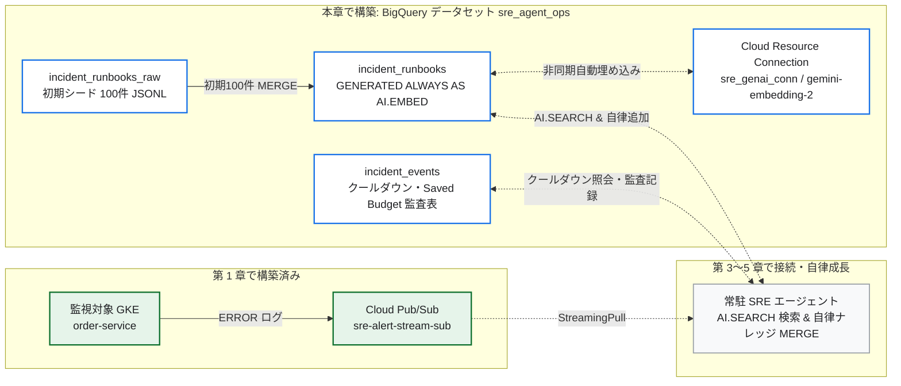
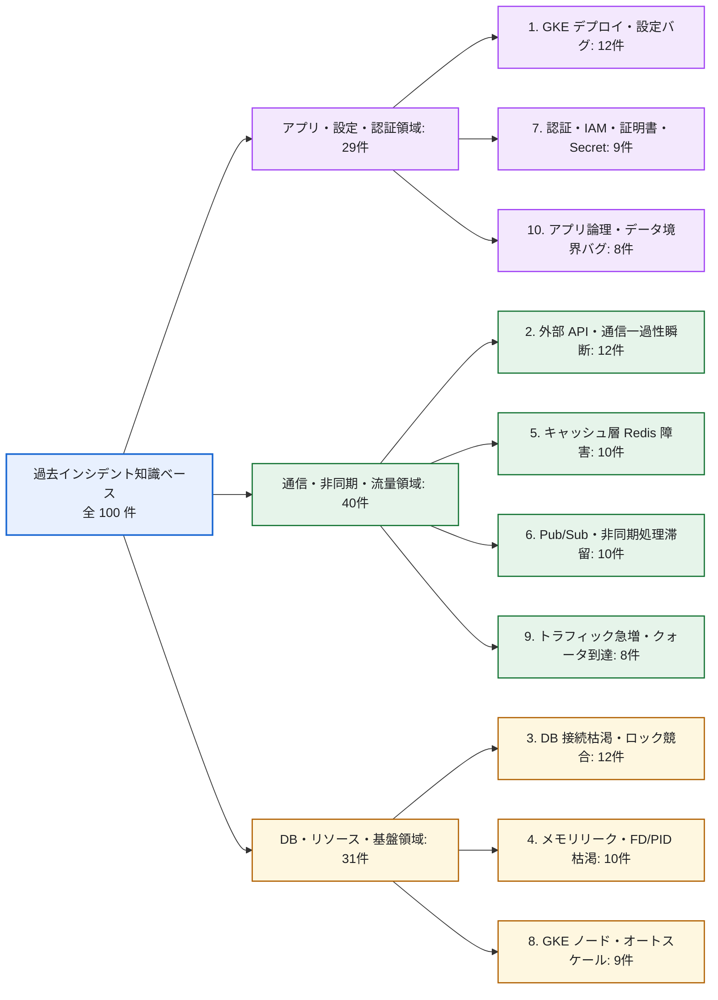

# 第 2 章：BigQuery 自律埋め込み知識ベース（`AI.EMBED` / `AI.SEARCH`）と過去インシデント 100 件の構築 (`02-bigquery-vector-kb.md`)

**所要時間**: 約 30 分  
**到達目標**: サーバーレスで常時課金ゼロの BigQuery 上に**自律埋め込み生成（Autonomous Embedding Generation）**対応の過去インシデント知識ベースと判断監査テーブルを構築し、初期シード **100 件** の自動ベクトル化と `AI.SEARCH` による類似障害照合を検証する。

---

## 1. この章で作る場所（現在地マップ）

**BigQuery 知識ベース・状態管理基盤（`sre_agent_ops`）** を構築します。専用の常駐ベクトル DB や定期埋め込みバッチを組むことなく、標準 SQL の生成列（`GENERATED ALWAYS AS (AI.EMBED(...))`）だけで初期 100 件と運用中に追加される新規 Runbook の自動ベクトル維持が完結します。


<details>
<summary>詳細: Mermaid ソースを表示</summary>



</details>

---

## 2. 構造化属性付きベクトル検索と鮮度管理の仕組み

本番運用では、**表面上の HTTP ステータスが同じでも、取るべき行動が正反対になる事象**が頻発します。

* **デプロイ直後**の必須環境変数欠落による 5xx 急増 → **即時ロールバック（`AUTO_REMEDIATE`）**
* **外部決済ゲートウェイ側**の TLS 瞬断による 503 急増 → **再起動による再接続ストームを避けて静観（`OBSERVE`）**
* **DB の長時間行ロック待ち**による接続プール枯渇 500 → **無断再起動で DB を落とさないよう人間承認へ回す（`REQUIRE_APPROVAL`）**

[seed_runbooks_100.jsonl](../bigquery/seed_runbooks_100.jsonl) には、10 カテゴリ・計 100 件の本番想定インシデント履歴が収録されています。


<details>
<summary>詳細: Mermaid ソースを表示</summary>



</details>

### スキーマ設計の 3 つの要点（`01_schema.sql`）

1. **自動ベクトル生成列（`GENERATED ALWAYS AS (AI.EMBED(...))`）**: `search_document` 列を含む行を `INSERT` / `MERGE` するだけで、BigQuery が非同期ジョブで `gemini-embedding-2` を呼び出してベクトルを自動生成・維持します。
2. **ベクトル再計算ゼロの鮮度更新**: `last_verified_at` や `verified_count`、`recommended_action` のみを `UPDATE` しても `search_document` 列は変わらないため、埋め込み再計算コストも検索空白も一切発生しません。
3. **コサイン類似度への正規化**: `AI.SEARCH(..., distance_type => 'COSINE')` が返すコサイン距離 $d \in [0, 2]$ を、しきい値判定（`0.85` 以上で既知事象）に使いやすいコサイン類似度 $s \in [0, 1]$ へ変換します。

$$s = \max\bigl(0.0,\; \min(1.0,\; 1.0 - d)\bigr)$$

---

## 3. Cloud Resource Connection 作成・初期 100 件投入・`AI.SEARCH` 検証

### Step 3.1 Cloud Resource Connection とテーブル群の作成

BigQuery が `gemini-embedding-2` を呼び出すための接続リソース（`sre_genai_conn`）を作成し、接続専用サービスアカウントへ `roles/aiplatform.user` を付与してから [bigquery/01_schema.sql](../bigquery/01_schema.sql) を適用します。

```bash
source .env

if ! bq show --connection --location="${GOOGLE_CLOUD_REGION}" "${GOOGLE_CLOUD_PROJECT}.${GOOGLE_CLOUD_REGION}.${BQ_CONNECTION_ID:-sre_genai_conn}" >/dev/null 2>&1; then
  bq mk --connection \
    --connection_type=CLOUD_RESOURCE \
    --location="${GOOGLE_CLOUD_REGION}" \
    --project_id="${GOOGLE_CLOUD_PROJECT}" \
    "${BQ_CONNECTION_ID:-sre_genai_conn}"
fi

BQ_CONN_SA=$(bq show --format=json --connection \
  --location="${GOOGLE_CLOUD_REGION}" \
  "${GOOGLE_CLOUD_PROJECT}.${GOOGLE_CLOUD_REGION}.${BQ_CONNECTION_ID:-sre_genai_conn}" \
  | python3 -c "import sys, json; print(json.load(sys.stdin)['cloudResource']['serviceAccountId'])")

echo "BigQuery Connection SA: ${BQ_CONN_SA}"

gcloud projects add-iam-policy-binding "${GOOGLE_CLOUD_PROJECT}" \
  --member="serviceAccount:${BQ_CONN_SA}" \
  --role="roles/aiplatform.user" \
  --condition=None \
  --quiet

# 付与したロールがエンドポイントまで反映される前にデータを投入すると、初回の自動埋め込みジョブが権限エラーで止まるため、同期呼び出しで反映を確認する
for i in $(seq 1 18); do
  if bq query \
    --project_id="${GOOGLE_CLOUD_PROJECT}" \
    --location="${GOOGLE_CLOUD_REGION}" \
    --use_legacy_sql=false \
    --quiet \
    "ASSERT (SELECT AI.EMBED('warmup', connection_id => '${GOOGLE_CLOUD_PROJECT}.${GOOGLE_CLOUD_REGION}.${BQ_CONNECTION_ID:-sre_genai_conn}', endpoint => '${SRE_EMBEDDING_MODEL}').status) = '' AS 'IAM propagation pending'" >/dev/null 2>&1; then
    echo "BigQuery Connection SA の IAM 反映を確認しました。"
    break
  fi
  if [[ "${i}" == "18" ]]; then
    echo "エラー: IAM の反映を確認できませんでした。1 分ほど待ってから再実行してください。" >&2
    false
  fi
  echo "[試行 ${i}/18] IAM の反映を待機しています..."
  sleep 10
done

sed -e "s|__PROJECT_ID__|${GOOGLE_CLOUD_PROJECT}|g" \
    -e "s|__REGION__|${GOOGLE_CLOUD_REGION}|g" \
  ./bigquery/01_schema.sql | bq query \
    --project_id="${GOOGLE_CLOUD_PROJECT}" \
    --location="${GOOGLE_CLOUD_REGION}" \
    --use_legacy_sql=false
```

### Step 3.2 初期インシデント 100 件（JSONL）のステージングロード

```bash
bq load \
  --project_id="${GOOGLE_CLOUD_PROJECT}" \
  --location="${GOOGLE_CLOUD_REGION}" \
  --source_format=NEWLINE_DELIMITED_JSON \
  --replace \
  "${BQ_DATASET}.incident_runbooks_raw" \
  ./bigquery/seed_runbooks_100.jsonl

# 件数内訳の確認（合計 100 件: REQUIRE_APPROVAL=40, AUTO_REMEDIATE=35, OBSERVE=25）
bq query \
  --project_id="${GOOGLE_CLOUD_PROJECT}" \
  --location="${GOOGLE_CLOUD_REGION}" \
  --use_legacy_sql=false \
  'SELECT recommended_action, COUNT(*) AS count FROM `sre_agent_ops.incident_runbooks_raw` GROUP BY 1 ORDER BY 2 DESC'
```

### Step 3.3 `incident_runbooks` への投入と非同期 `AI.EMBED` 完了・`AI.SEARCH` 検証

[bigquery/02_seed_and_verify_ai_search.sql](../bigquery/02_seed_and_verify_ai_search.sql) で 100 件を `MERGE` 投入し、バックグラウンド埋め込み生成の完了を確認してから `AI.SEARCH` を試します。

```bash
bq query \
  --project_id="${GOOGLE_CLOUD_PROJECT}" \
  --location="${GOOGLE_CLOUD_REGION}" \
  --use_legacy_sql=false \
  < ./bigquery/02_seed_and_verify_ai_search.sql

for i in $(seq 1 12); do
  EMBEDDED_COUNT=$(bq query \
    --project_id="${GOOGLE_CLOUD_PROJECT}" \
    --location="${GOOGLE_CLOUD_REGION}" \
    --use_legacy_sql=false \
    --format=csv --quiet \
    'SELECT COUNTIF(embedding IS NOT NULL AND embedding.status = "") FROM `sre_agent_ops.incident_runbooks`' | tail -n 1)
  echo "[試行 ${i}/12] 埋め込み完了件数: ${EMBEDDED_COUNT} / 100"
  if [[ "${EMBEDDED_COUNT}" == "100" ]]; then
    break
  fi
  sleep 10
done

bq query \
  --project_id="${GOOGLE_CLOUD_PROJECT}" \
  --location="${GOOGLE_CLOUD_REGION}" \
  --use_legacy_sql=false \
  'SELECT
     base.runbook_id,
     base.title,
     base.recommended_action,
     base.remediation_type,
     ROUND(GREATEST(0.0, LEAST(1.0, 1.0 - distance)), 4) AS similarity_score
   FROM AI.SEARCH(
     TABLE `sre_agent_ops.incident_runbooks`,
     "search_document",
     "サービス: order-service / エラーコード: CONFIG_KEY_ERROR_500 / KeyError: PAYMENT_CURRENCY_PRECISION 環境変数未設定でデプロイ直後から HTTP 500 が急増",
     distance_type => "COSINE",
     top_k => 3
   )
   ORDER BY distance ASC'
```

### 動作確認（Verification）

1. `埋め込み完了件数: 100 / 100` に到達していること（`embedding.status = ""` が正常完了）。
2. `AI.SEARCH` の最上位に `INC-001`（`AUTO_REMEDIATE` / `ROLLBACK_DEPLOYMENT`）が高い類似度スコアで一致すること。

---

## 4. 自社環境への導入用カタログ（240 件）と既存手順書の取り込み

ハンズオンでは訓練シナリオ（`order-service` 等）に合わせた `seed_runbooks_100.jsonl` を使いますが、自社環境の PoC や本番導入では、架空のサービス名を含まない汎用障害パターン集と既存手順書の取り込みスクリプトを使用します。

### 4.1 ハンズオン用 100 件と導入用 240 件の使い分け

| データファイル | 件数・内訳 | 主な用途と特徴 |
|---|---|---|
| [bigquery/seed_runbooks_100.jsonl](../bigquery/seed_runbooks_100.jsonl) | 100 件（`AUTO_REMEDIATE` 35 / `REQUIRE_APPROVAL` 40 / `OBSERVE` 25） | **ハンズオン訓練専用**。`order-service` 等の訓練用サービス名と検証済み経過日数を含む |
| [bigquery/seed_runbooks_production_starter.jsonl](../bigquery/seed_runbooks_production_starter.jsonl) | 240 件・8 分類（`REQUIRE_APPROVAL` 217 / `OBSERVE` 23 / **`AUTO_REMEDIATE` 0**） | **自社 PoC・本番の初期土台**。固有サービス名を含まず、すべて「未検証」として登録 |

* **同じデータセットに両方を入れたままにしない**: 似た障害パターンが検索結果で競合するため、ハンズオンと自社検証ではデータセットまたはプロジェクトを分けてください。
* **導入前の確認推奨**: 汎用 240 件は一般的な GKE・データベース・ネットワーク・IAM・非同期処理の典型パターンをまとめた下書きであり、個別環境で動作検証された記録ではありません。投入前に SRE チームで自社構成に当てはまらない行の除外や手順の調整を行うことを推奨します。

### 4.2 導入用 240 件の投入手順

[bigquery/03_seed_production_starter.sql](../bigquery/03_seed_production_starter.sql) は、一過性の静観（`OBSERVE`）以外の全行を SQL でも強制的に `REQUIRE_APPROVAL` とし、`last_verified_at = NULL`・`verified_count = 0`（未検証）で登録します。承認通知（Slack / メール）では、未検証の事例に一致した際に `この環境では未検証` と明示されます。

```sh
bq load \
  --project_id="${GOOGLE_CLOUD_PROJECT}" \
  --location="${GOOGLE_CLOUD_REGION}" \
  --source_format=NEWLINE_DELIMITED_JSON \
  --replace \
  "${BQ_DATASET}.incident_runbooks_raw" \
  ./bigquery/seed_runbooks_production_starter.jsonl

bq query \
  --project_id="${GOOGLE_CLOUD_PROJECT}" \
  --location="${GOOGLE_CLOUD_REGION}" \
  --use_legacy_sql=false \
  < ./bigquery/03_seed_production_starter.sql
```

### 4.3 既存の運用手順書（Markdown / テキスト）の取り込み

手元にある障害対応手順書や Postmortem（`.md` / `.txt`）は、[bigquery/import_markdown_runbooks.py](../bigquery/import_markdown_runbooks.py) で同じ 15 項目の JSONL へ一括変換できます。取り込み直後の誤自動実行を防ぐため、`recommended_action` は常に `REQUIRE_APPROVAL`、`historical_mttr_minutes` は `0` に固定されます。

```sh
# 一覧表示のみ（ファイル書き出しなし）
python3 ./bigquery/import_markdown_runbooks.py \
  --input ./my_runbooks \
  --dry-run

# JSONL へ書き出し（内容を人が確認してから 03_seed_production_starter.sql と同じ手順で投入）
python3 ./bigquery/import_markdown_runbooks.py \
  --input ./my_runbooks \
  --output ./bigquery/custom_runbooks.jsonl
```

* Gemini API を呼ばずに見出しルールだけで変換する場合は `--offline` を付与します（操作種別はすべて `MANUAL_INTERVENTION` になります）。

### 4.4 実運用での学習と自動復旧への切り替え

初期投入データの使われ方は、アラートとの類似度によって 2 通りに分かれます。

1. **類似度が `0.85` 未満で一致した場合（汎用 240 件での典型挙動）**: 固有サービス名を持たない汎用エントリは、`AI.SEARCH` の実測で類似度が概ね `0.78〜0.84` になります。トリアージ時の参考手順として上位 3 件に渡された上で、人間が承認して回復確認に成功すると、そのサービス固有の `AUTO-*` Runbook が自動登録されます（Rollback / Restart 実行時は次回から `AUTO_REMEDIATE` 対象）。
2. **類似度が `0.85` 以上で一致した場合（自社サービス名入りの手順書を取り込んだ場合など）**: 承認・回復確認時には `last_verified_at` と `verified_count` のみが更新され、**自動では `AUTO_REMEDIATE` へ昇格しません**。自動化の範囲を人が管理できるよう、実績を確認した手順だけを以下の SQL で明示的に昇格させます。

```sql
-- 承認実行と事後回復確認が 2 回以上成功している昇格候補の確認
SELECT runbook_id, title, remediation_type, verified_count, last_verified_at
FROM `sre_agent_ops.incident_runbooks`
WHERE recommended_action = 'REQUIRE_APPROVAL'
  AND remediation_type IN ('ROLLBACK_DEPLOYMENT', 'RESTART_DEPLOYMENT')
  AND verified_count >= 2
ORDER BY verified_count DESC;

-- 運用者が確認した特定の Runbook を自動復旧対象へ切り替える（search_document 不変のため再埋め込み不要）
UPDATE `sre_agent_ops.incident_runbooks`
SET recommended_action = 'AUTO_REMEDIATE'
WHERE runbook_id = 'CUST-XXXXXXXX'
  AND remediation_type IN ('ROLLBACK_DEPLOYMENT', 'RESTART_DEPLOYMENT')
  AND verified_count >= 1;
```

---

## 🤖 AI コーディングエージェントを使う場合の指示プロンプト

```markdown
`AGENTS.md` と `.env` を読み込み、第2章（`docs/02-bigquery-vector-kb.md`）の手順を実行してください。
- Cloud Resource Connection (`sre_genai_conn`) 作成・IAM 付与、`bigquery/01_schema.sql`、`bq load`、`02_seed_and_verify_ai_search.sql` は実行前にコマンドを提示し、私の `y` 承認後に実行すること。
- バックグラウンド `AI.EMBED` により 100 件すべてのベクトル生成完了と、テスト `AI.SEARCH` の上位 3 件を表形式で報告すること。
```

---

## Links and References

* [Autonomous embedding generation in BigQuery](https://docs.cloud.google.com/bigquery/docs/autonomous-embedding-generation) — `GENERATED ALWAYS AS (AI.EMBED(...))` による自動埋め込み列の仕組みと権限要件
* [The AI.SEARCH function](https://docs.cloud.google.com/bigquery/docs/reference/standard-sql/bigqueryml-syntax-ai-search) — 自動埋め込みテーブルに対する `AI.SEARCH` の構文と `distance_type` 仕様
* [Create a Cloud resource connection and grant permissions](https://docs.cloud.google.com/bigquery/docs/permissions-for-ai-functions) — BigQuery 生成 AI 関数用の接続作成と IAM 設定手順

次へ進む 👉 [第 3 章：公式リモート MCP 並列調査と Cloud Run sandboxes 隔離解析](03-diagnostic-agent-and-sandbox.md)
