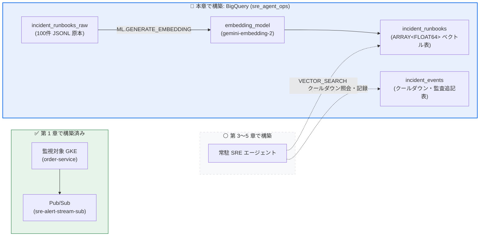
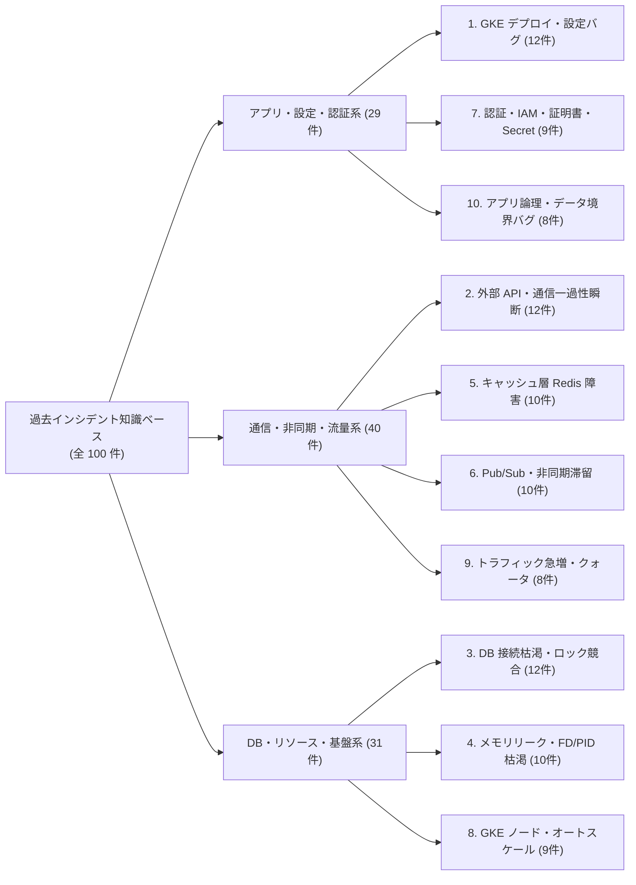

# 第 2 章：BigQuery ベクトル知識ベースと過去インシデント 100 件の構築 (`02-bigquery-vector-kb.md`)

**所要時間**: 約 30 分  
**到達目標**: サーバーレスで運用負荷ゼロの BigQuery 上に過去インシデント知識ベース（本番想定の **100 件**）を構築し、`gemini-embedding-2` による一括ベクトル生成と `VECTOR_SEARCH` による類似障害の照合を体験する。

---

## 1. この章で作る場所（現在地マップ）

色が付いている **BigQuery 知識ベース・状態管理基盤（`sre_agent_ops`）** を構築します。VPC コネクタや常時課金の DB インスタンスを立てることなく、IAM 認証と標準 SQL だけで類似インシデント検索とクールダウン監査を実現します。



---

## 2. なぜ単なるテキスト検索ではなく「構造化属性付きベクトル検索」にするのか？

本番の運用現場では、**表面上の HTTP ステータスコードが同じでも、取るべき行動が正反対になる事象**が頻繁に発生します。

* 例 A：**デプロイ直後**の環境変数欠落による 5xx 急増 → **即時ロールバックすべき（`AUTO_REMEDIATE`）**
* 例 B：**外部決済ゲートウェイ側**の TLS 瞬断による 503 急増 → **再起動するとコネクション再確立嵐になるため静観すべき（`OBSERVE`）**
* 例 C：**DB の長時間行ロック待ち**による接続プール枯渇 500 → **無断再起動すると DB が落ちるため人間承認に回すべき（`REQUIRE_APPROVAL`）**

本リポジトリの [seed_runbooks_100.jsonl](../bigquery/seed_runbooks_100.jsonl) には、以下 10 カテゴリ・計 100 件の本番インシデント履歴が収録されています。



各レコードには文章だけでなく、決定論的な制御に使える構造化カラム（`recommended_action`、`remediation_type`、`anti_patterns`［やってはいけない誤対応］、`verification_check`［回復判定条件］）を持たせています。

### コサイン距離とコサイン類似度の関係

BigQuery の `VECTOR_SEARCH(..., distance_type => 'COSINE')` は、2 つのベクトル間の**コサイン距離** $d \in [0, 2]$（完全に同じ向きなら $0$）を返します。エージェントのしきい値判定で直感的に扱えるよう、SQL 内で以下のようにコサイン類似度 $s \in [0, 1]$ へ変換して返却します。

$$s = \max\bigl(0.0,\; \min(1.0,\; 1.0 - d)\bigr)$$

---

## 3. テーブル作成・100 件データのロード・一括ベクトル生成

### Step 3.1 データセットとテーブルの作成

[bigquery/01_schema.sql](../bigquery/01_schema.sql) を実行し、`asia-northeast1` ロケーションにデータセットと 3 つのテーブルを作成します。

```bash
source .env

bq query \
  --project_id="${GOOGLE_CLOUD_PROJECT}" \
  --location="${GOOGLE_CLOUD_REGION}" \
  --use_legacy_sql=false \
  < ./bigquery/01_schema.sql
```

### Step 3.2 本番想定インシデント 100 件（JSONL）のロード

```bash
bq load \
  --project_id="${GOOGLE_CLOUD_PROJECT}" \
  --location="${GOOGLE_CLOUD_REGION}" \
  --source_format=NEWLINE_DELIMITED_JSON \
  --replace \
  "${BQ_DATASET}.incident_runbooks_raw" \
  ./bigquery/seed_runbooks_100.jsonl

# 件数と推奨アクション内訳の確認（合計 100 件: AUTO_REMEDIATE=35, REQUIRE_APPROVAL=40, OBSERVE=25）
bq query \
  --project_id="${GOOGLE_CLOUD_PROJECT}" \
  --location="${GOOGLE_CLOUD_REGION}" \
  --use_legacy_sql=false \
  'SELECT recommended_action, COUNT(*) AS count FROM `sre_agent_ops.incident_runbooks_raw` GROUP BY 1 ORDER BY 2 DESC'
```

### Step 3.3 `gemini-embedding-2` リモートモデル作成と一括ベクトル化

[bigquery/02_remote_model.sql](../bigquery/02_remote_model.sql) と [bigquery/03_generate_embeddings.sql](../bigquery/03_generate_embeddings.sql) を実行し、100 件すべてのインシデントに対して埋め込みベクトルを生成します。

```bash
# 1. リモートモデル (gemini-embedding-2) の作成
bq query \
  --project_id="${GOOGLE_CLOUD_PROJECT}" \
  --location="${GOOGLE_CLOUD_REGION}" \
  --use_legacy_sql=false \
  < ./bigquery/02_remote_model.sql

# 2. 100件の一括埋め込み生成と動作確認 VECTOR_SEARCH の実行
bq query \
  --project_id="${GOOGLE_CLOUD_PROJECT}" \
  --location="${GOOGLE_CLOUD_REGION}" \
  --use_legacy_sql=false \
  < ./bigquery/03_generate_embeddings.sql
```

> [!TIP]
> プロジェクトの組織ポリシーによって `CONNECTION DEFAULT` の自動権限付与が制限されている場合は、[bigquery/02_remote_model.sql](../bigquery/02_remote_model.sql) 末尾のコメントに記載された 3 行のコマンドで明示的な Cloud Resource Connection を作成してください。

### 期待される出力の確認（Verification）

`03_generate_embeddings.sql` の実行結果として、以下が確認できれば成功です。
1. `total_runbooks = 100`、`embedded_runbooks = 100` であること。
2. サンプル検索（「新リビジョンデプロイ直後から KeyError 環境変数未設定で HTTP 500 が急増」）の最上位に `INC-001`（`AUTO_REMEDIATE` / `ROLLBACK_DEPLOYMENT`）が高い類似度でヒットすること。

---

## 🤖 AI コーディングエージェントを使う場合の指示プロンプト

```markdown
`AGENTS.md` と `.env` を読み込み、第2章（`docs/02-bigquery-vector-kb.md`）の手順を実行してください。
- `bigquery/01_schema.sql`、`bq load`、`02_remote_model.sql`、`03_generate_embeddings.sql` は実行前にコマンドを提示し、私の `y` 承認後に実行すること。
- 100 件すべてにベクトルが生成されたことと、テスト `VECTOR_SEARCH` の上位 3 件の結果を表形式で報告すること。
```

---

## Links and References

* [Introduction to vector search in BigQuery](https://docs.cloud.google.com/bigquery/docs/vector-search-intro) — BigQuery における `VECTOR_SEARCH` の仕組みと距離指標
* [The ML.GENERATE_EMBEDDING function](https://docs.cloud.google.com/bigquery/docs/reference/standard-sql/bigqueryml-syntax-generate-embedding) — `gemini-embedding-2` リモートモデルを用いた埋め込み生成リファレンス

次へ進む 👉 [第 3 章：公式リモート MCP 並列調査と Cloud Run sandboxes 隔離解析](03-diagnostic-agent-and-sandbox.md)
