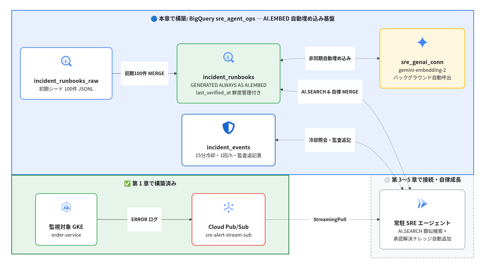
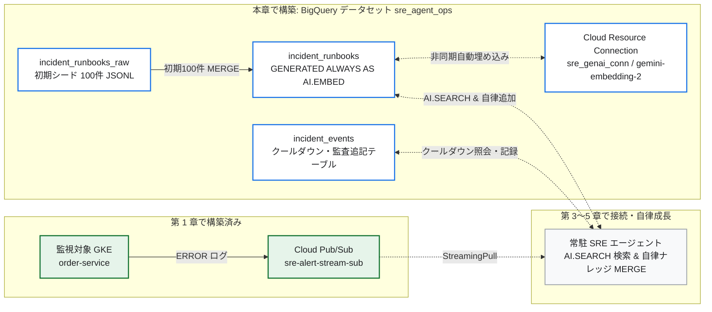
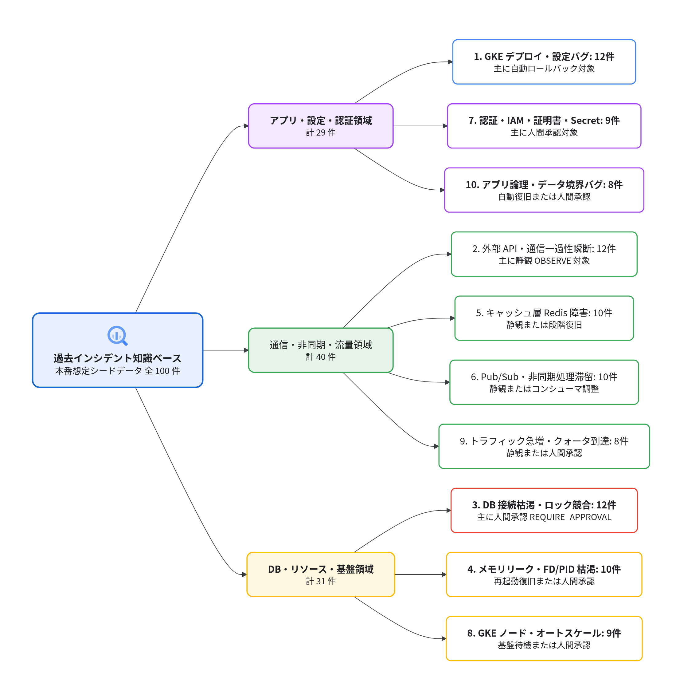
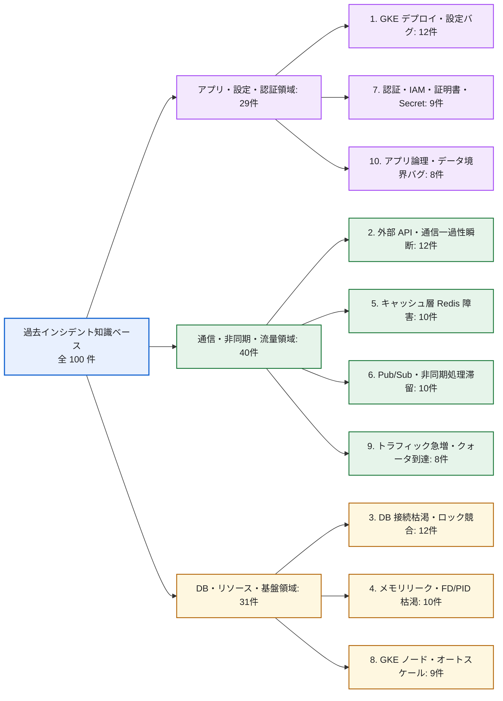

# 第 2 章：BigQuery 自律埋め込み知識ベース（`AI.EMBED` / `AI.SEARCH`）と過去インシデント 100 件の構築 (`02-bigquery-vector-kb.md`)

**所要時間**: 約 30 分  
**到達目標**: サーバーレスで運用負荷ゼロの BigQuery 上に**自律埋め込み生成（Autonomous Embedding Generation）**対応の過去インシデント知識ベースを構築し、初期シード **100 件** の自動ベクトル化・`AI.SEARCH` による類似障害照合・運用中の新規ナレッジ自動蓄積の仕組みを体験する。

---

## 1. この章で作る場所（現在地マップ）

色が付いている **BigQuery 知識ベース・状態管理基盤（`sre_agent_ops`）** を構築します。VPC コネクタや常時課金の専用ベクトル DB を立てることなく、標準 SQL の生成列（`GENERATED ALWAYS AS (AI.EMBED(...))`）だけで初期 100 件のベクトル化も、運用中に追加される新規 Runbook の自動ベクトル維持も完結します。



<details>
<summary>詳細: Mermaid ソースを表示</summary>



</details>

---

## 2. なぜ「構造化属性付きベクトル検索」＋「自律埋め込み生成（`AI.EMBED`）」にするのか？

本番の運用現場では、**表面上の HTTP ステータスコードが同じでも、取るべき行動が正反対になる事象**が頻繁に発生します。

* 例 A：**デプロイ直後**の環境変数欠落による 5xx 急増 → **即時ロールバックすべき（`AUTO_REMEDIATE`）**
* 例 B：**外部決済ゲートウェイ側**の TLS 瞬断による 503 急増 → **再起動するとコネクション再確立嵐になるため静観すべき（`OBSERVE`）**
* 例 C：**DB の長時間行ロック待ち**による接続プール枯渇 500 → **無断再起動すると DB が落ちるため人間承認に回すべき（`REQUIRE_APPROVAL`）**

本リポジトリの [seed_runbooks_100.jsonl](../bigquery/seed_runbooks_100.jsonl) には、以下 10 カテゴリ・計 100 件の本番インシデント履歴が収録されています。



<details>
<summary>詳細: Mermaid ソースを表示</summary>



</details>

各レコードには文章だけでなく、決定論的な制御と**情報の鮮度管理（Trust-Decay Lifecycle）**に使える以下の構造化カラムを持たせています。

* **対応方針・安全境界カラム**: `recommended_action`、`remediation_type`、`anti_patterns`［やってはいけない誤対応］、`verification_check`［回復判定条件］
* **鮮度・有効性ライフサイクル管理カラム**:
  * `created_at` / `last_verified_at`: Runbook の初回登録日時と、**直近で自動復旧または人間承認により実環境での回復が実証された日時**。初期シード JSONL では相対経過日数 `verified_age_days`（現役 88 件：`3〜60` 日、休眠 12 件：`120〜240` 日）から投入時点基準で自動算出するため、いつハンズオンを実施しても陳腐化しません。
  * `verified_count`: 実環境で回復確認に成功した累計回数。
  * `lifecycle_status`: `'ACTIVE'`（検索対象）または `'DEPRECATED'`（廃止済み・`AI.SEARCH` の事前フィルタで検索対象から除外）。
* **ベクトル再生成ゼロでの鮮度更新**: BigQuery の生成列（`AI.EMBED(search_document, ...)`）は `search_document` 列が変更されたときのみ再計算されます。そのため、復旧成功時に `last_verified_at` や `verified_count`、`recommended_action` だけを `UPDATE` しても埋め込みベクトルの再計算コストや検索空白は一切発生しません。

### 手動バッチ埋め込みと `GENERATED ALWAYS AS (AI.EMBED(...))` の違い

従来の方法では、`CREATE MODEL` でリモートモデルを定義し、データ追加のたびに `ML.GENERATE_EMBEDDING` バッチ SQL を再実行してベクトル列を手動更新する必要がありました。  
一方、本ハンズオンで採用する **BigQuery 自律埋め込み生成（Autonomous Embedding Generation）** では、[bigquery/01_schema.sql](../bigquery/01_schema.sql) のテーブル定義自体に以下を宣言します。

* **INSERT / MERGE するだけで裏側で自動ベクトル化**: アプリやエージェントはテキスト列（`search_document`）を含む通常の行を `INSERT` / `MERGE` するだけです（生成列である `embedding` カラムには値を指定しません）。BigQuery が変更を検知し、非同期バックグラウンドジョブで `gemini-embedding-2` を呼び出して `embedding.result`（`ARRAY<FLOAT64>`）を自動生成・維持します。
* **検索時も `AI.SEARCH` 1 行で完結**: 検索時は `AI.SEARCH(TABLE \`sre_agent_ops.incident_runbooks\`, 'search_document', @query_text, distance_type => 'COSINE', top_k => 3)` を呼ぶだけで、テーブル定義と同じ `gemini-embedding-2` 設定を使ってクエリ文字列が自動埋め込みされ、モデル不一致の心配がありません。

### コサイン距離とコサイン類似度の関係

`AI.SEARCH` の既定の距離指標はユークリッド距離（`EUCLIDEAN`）であるため、本ハンズオンでは `distance_type => 'COSINE'` を明示指定して 2 つのベクトル間の**コサイン距離** $d \in [0, 2]$（完全に同じ向きなら $0$）を取得します。エージェントのしきい値判定（`0.85` 以上で既知障害とみなす等）で直感的に扱えるよう、SQL 内で以下のようにコサイン類似度 $s \in [0, 1]$ へ変換して返却します。

$$s = \max\bigl(0.0,\; \min(1.0,\; 1.0 - d)\bigr)$$

---

## 3. Cloud Resource Connection 作成・初期 100 件投入・`AI.SEARCH` 検証

### Step 3.1 Cloud Resource Connection とテーブル群の作成

BigQuery がバックグラウンドで `gemini-embedding-2` エンドポイントを呼び出すための接続リソース（`sre_genai_conn`）を作成し、払い出された接続専用サービスアカウントに `roles/aiplatform.user` を付与してから [bigquery/01_schema.sql](../bigquery/01_schema.sql) を適用します。

```bash
source .env

# 1. BigQuery Cloud Resource Connection (sre_genai_conn) の作成（作成済みの場合はスキップ）
if ! bq show --connection --location="${GOOGLE_CLOUD_REGION}" "${GOOGLE_CLOUD_PROJECT}.${GOOGLE_CLOUD_REGION}.${BQ_CONNECTION_ID:-sre_genai_conn}" >/dev/null 2>&1; then
  bq mk --connection \
    --connection_type=CLOUD_RESOURCE \
    --location="${GOOGLE_CLOUD_REGION}" \
    --project_id="${GOOGLE_CLOUD_PROJECT}" \
    "${BQ_CONNECTION_ID:-sre_genai_conn}"
fi

# 2. 接続リソース専用のサービスアカウント ID を取得し、埋め込みモデル呼び出し権限を付与
BQ_CONN_SA=$(bq show --format=json --connection \
  --location="${GOOGLE_CLOUD_REGION}" \
  "${GOOGLE_CLOUD_PROJECT}.${GOOGLE_CLOUD_REGION}.${BQ_CONNECTION_ID:-sre_genai_conn}" \
  | python3 -c "import sys, json; print(json.load(sys.stdin)['cloudResource']['serviceAccountId'])")

echo "BigQuery Connection SA: ${BQ_CONN_SA}"

gcloud projects add-iam-policy-binding "${GOOGLE_CLOUD_PROJECT}" \
  --member="serviceAccount:${BQ_CONN_SA}" \
  --role="roles/aiplatform.user" \
  --condition=None \
  --quiet

# IAM 反映のため 15 秒待機してから AI.EMBED 生成列付きスキーマを作成
sleep 15

sed -e "s|__PROJECT_ID__|${GOOGLE_CLOUD_PROJECT}|g" \
    -e "s|__REGION__|${GOOGLE_CLOUD_REGION}|g" \
  ./bigquery/01_schema.sql | bq query \
    --project_id="${GOOGLE_CLOUD_PROJECT}" \
    --location="${GOOGLE_CLOUD_REGION}" \
    --use_legacy_sql=false
```

### Step 3.2 本番想定インシデント 100 件（JSONL）のステージングロード

```bash
bq load \
  --project_id="${GOOGLE_CLOUD_PROJECT}" \
  --location="${GOOGLE_CLOUD_REGION}" \
  --source_format=NEWLINE_DELIMITED_JSON \
  --replace \
  "${BQ_DATASET}.incident_runbooks_raw" \
  ./bigquery/seed_runbooks_100.jsonl

# 件数と推奨アクション内訳の確認（合計 100 件: AUTO_REMEDIATE=35, REQUIRE_APPROVAL=40, OBSERVE=25）
bq query \
  --project_id="${GOOGLE_CLOUD_PROJECT}" \
  --location="${GOOGLE_CLOUD_REGION}" \
  --use_legacy_sql=false \
  'SELECT recommended_action, COUNT(*) AS count FROM `sre_agent_ops.incident_runbooks_raw` GROUP BY 1 ORDER BY 2 DESC'
```

### Step 3.3 `incident_runbooks` への投入と非同期 `AI.EMBED` 完了・`AI.SEARCH` 検証

[bigquery/02_seed_and_verify_ai_search.sql](../bigquery/02_seed_and_verify_ai_search.sql) を実行してステージング表から 100 件を `MERGE` 投入します。生成列 `embedding` は `OPTIONS (asynchronous = TRUE)` によりバックグラウンドで自動計算されるため、100 件すべての埋め込みが完了するまで（通常 30〜90 秒）待ってから `AI.SEARCH` を実行します。

```bash
# 1. 初期 100 件を incident_runbooks へ MERGE 投入（embedding 列は BigQuery が裏側で自動生成開始）
bq query \
  --project_id="${GOOGLE_CLOUD_PROJECT}" \
  --location="${GOOGLE_CLOUD_REGION}" \
  --use_legacy_sql=false \
  < ./bigquery/02_seed_and_verify_ai_search.sql

# 2. バックグラウンド埋め込み生成（embedded_runbooks = 100）の完了をポーリング確認
for i in $(seq 1 12); do
  EMBEDDED_COUNT=$(bq query \
    --project_id="${GOOGLE_CLOUD_PROJECT}" \
    --location="${GOOGLE_CLOUD_REGION}" \
    --use_legacy_sql=false \
    --format=csv --quiet \
    'SELECT COUNTIF(embedding IS NOT NULL AND embedding.status = "") FROM `sre_agent_ops.incident_runbooks`' | tail -n 1)
  echo "[試行 ${i}/12] 埋め込み完了件数: ${EMBEDDED_COUNT} / 100"
  if [[ "${EMBEDDED_COUNT}" == "100" ]]; then
    break
  fi
  sleep 10
done

# 3. AI.SEARCH によるセマンティック類似検索の動作確認
bq query \
  --project_id="${GOOGLE_CLOUD_PROJECT}" \
  --location="${GOOGLE_CLOUD_REGION}" \
  --use_legacy_sql=false \
  'SELECT
     base.runbook_id,
     base.title,
     base.recommended_action,
     base.remediation_type,
     ROUND(GREATEST(0.0, LEAST(1.0, 1.0 - distance)), 4) AS similarity_score
   FROM AI.SEARCH(
     TABLE `sre_agent_ops.incident_runbooks`,
     "search_document",
     "サービス: order-service / エラーコード: CONFIG_KEY_ERROR_500 / KeyError: PAYMENT_CURRENCY_PRECISION 環境変数未設定でデプロイ直後から HTTP 500 が急増",
     distance_type => "COSINE",
     top_k => 3
   )
   ORDER BY distance ASC'
```

> [!NOTE]
> バックグラウンド埋め込みが未完了の行（`embedding IS NULL` または `embedding.status != ''`）は、生成が完了するまでの数十秒間だけ `AI.SEARCH` の検索対象から一時的にスキップされます。第 5 章の訓練 4 でエージェントが新規 Runbook（`AUTO-*`）を 1 件追加する際も、追加後およそ 15〜45 秒で自動的に検索可能になります。

### 期待される出力の確認（Verification）

上記コマンドの実行結果として、以下が確認できれば成功です。
1. `埋め込み完了件数: 100 / 100` に到達していること（`embedding.status` が空文字列 `""` であれば正常完了）。
2. `AI.SEARCH` の最上位に `INC-001`（`AUTO_REMEDIATE` / `ROLLBACK_DEPLOYMENT`）が高い類似度スコア（`0.80` 以上、エージェント本体の構造化クエリ実行時は約 `0.88`）でヒットすること。

---

## 🤖 AI コーディングエージェントを使う場合の指示プロンプト

```markdown
`AGENTS.md` と `.env` を読み込み、第2章（`docs/02-bigquery-vector-kb.md`）の手順を実行してください。
- Cloud Resource Connection (`sre_genai_conn`) 作成・IAM 付与、`bigquery/01_schema.sql`、`bq load`、`02_seed_and_verify_ai_search.sql` は実行前にコマンドを提示し、私の `y` 承認後に実行すること。
- バックグラウンド `AI.EMBED` により 100 件すべてにベクトルが生成されたことと、テスト `AI.SEARCH` の上位 3 件の結果を表形式で報告すること。
```

---

## Links and References

* [Autonomous embedding generation in BigQuery](https://docs.cloud.google.com/bigquery/docs/autonomous-embedding-generation) — `GENERATED ALWAYS AS (AI.EMBED(...))` による自動埋め込み列の仕組みと権限要件
* [The AI.SEARCH function](https://docs.cloud.google.com/bigquery/docs/reference/standard-sql/bigqueryml-syntax-ai-search) — 自動埋め込みテーブルに対する `AI.SEARCH` の構文と `distance_type` パラメータ仕様
* [Create a Cloud resource connection and grant permissions](https://docs.cloud.google.com/bigquery/docs/permissions-for-ai-functions) — BigQuery 生成 AI 関数用の接続作成と IAM 設定手順

次へ進む 👉 [第 3 章：公式リモート MCP 並列調査と Cloud Run sandboxes 隔離解析](03-diagnostic-agent-and-sandbox.md)
