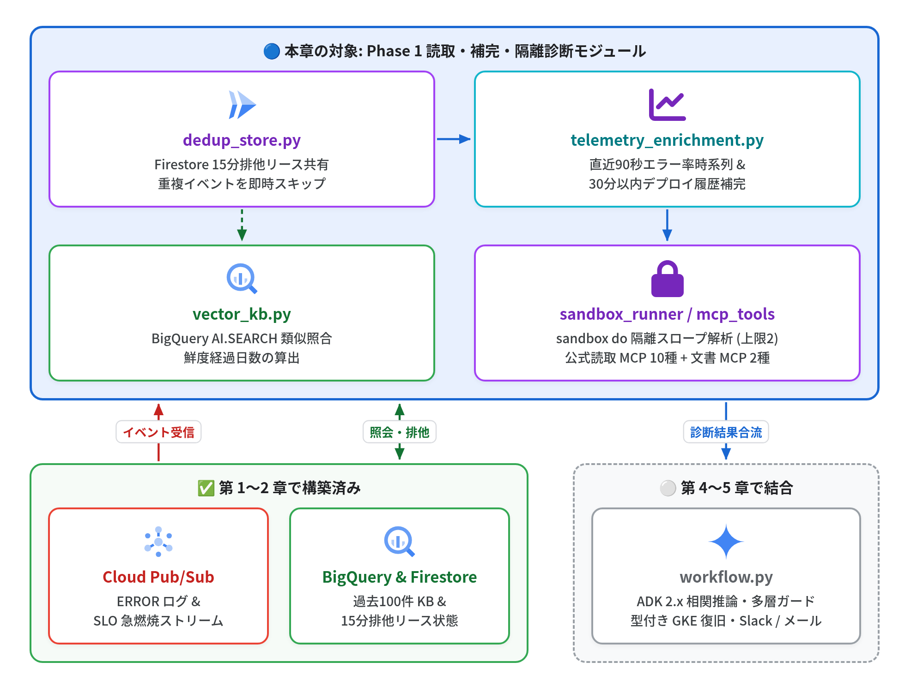
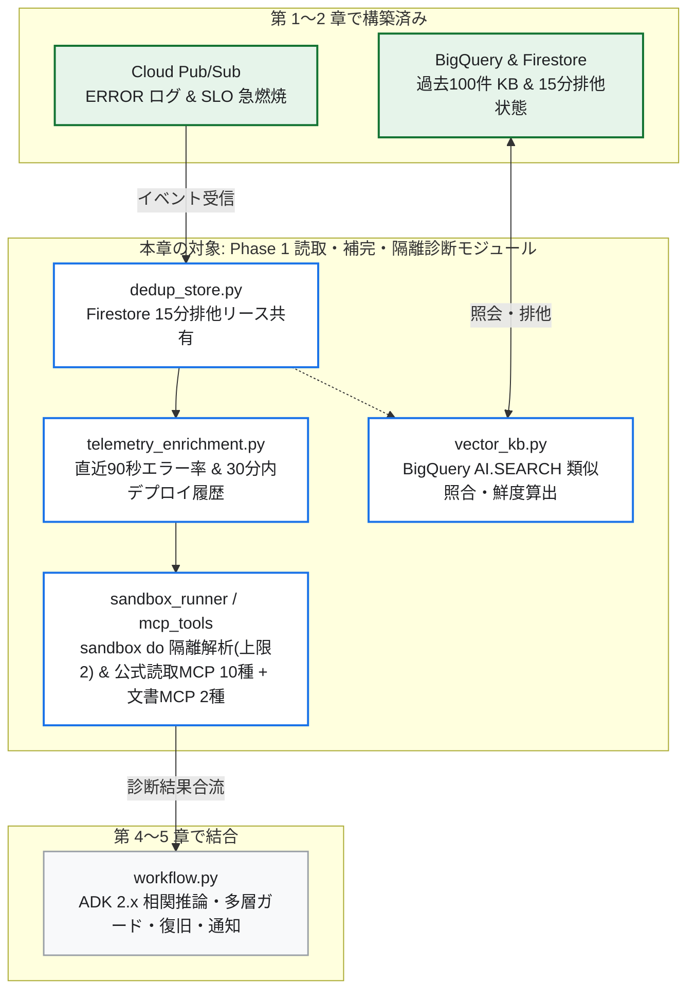
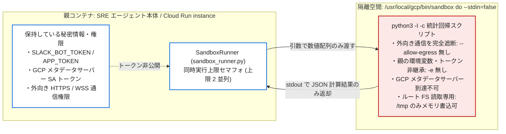

# 第 3 章：公式リモート MCP 並列調査と Cloud Run sandboxes 隔離解析 (`03-diagnostic-agent-and-sandbox.md`)

**所要時間**: 約 35 分  
**到達目標**: エージェントの「読み取り診断フェーズ（Phase 1）」として、重複排除プリフィルタ、Google Cloud 公式リモート MCP サーバーの厳選接続、および Cloud Run sandboxes（`/usr/local/gcp/bin/sandbox do`）による隔離統計解析の仕組みを確認・検証する。

---

## 1. この章で確認する場所（現在地マップ）

**重複排除・テレメトリ補完・公式リモート MCP 読み取り・Cloud Run sandboxes 隔離解析** の各モジュールを確認します。



<details>
<summary>詳細: Mermaid ソースを表示</summary>



</details>

---

## 2. 決定論的プリフィルタ（重複排除とクールダウン）

[sre-agent/agent_app/dedup_store.py](../sre-agent/agent_app/dedup_store.py) は、LLM を呼び出す前にアラートの `namespace + service_name + error_code` から 16 文字の SHA-256 ハッシュ（`fingerprint`）を算出し、排他ロック付きで処理権を取得します。

* 直近 15 分以内（`COOLDOWN_MINUTES=15`）に同一 `fingerprint` が処理中または処理済みであれば、**LLM を 1 トークンも呼ばずに即スキップ**します。
* これにより、障害中に毎分エラーログが流入し続けても、調査・復旧・通知は初回の 1 回だけ正確に実行されます。

---

## 3. Google Cloud 公式リモート MCP サーバーの厳選接続

[sre-agent/agent_app/mcp_tools.py](../sre-agent/agent_app/mcp_tools.py) では、自前の MCP コンテナを運用する代わりに、Google が提供するリモート MCP エンドポイントへ接続します。用途に応じて「環境の観測（必須 3 エンドポイント・10 ツール）」と「公式ドキュメント検索（補助 1 エンドポイント・2 ツール）」に分けています。

| 区分 | 接続先サービス | エンドポイント URL | `tool_filter` で公開するツール |
|---|---|---|---|
| **環境の観測（必須）** | **Cloud Monitoring** | `https://monitoring.googleapis.com/mcp` | `list_timeseries`, `query_range`, `list_alerts` |
| **環境の観測（必須）** | **Cloud Logging** | `https://logging.googleapis.com/mcp` | `list_log_entries` |
| **環境の観測（必須）** | **GKE (Read-Only)** | `https://container.googleapis.com/mcp/read-only` | `get_cluster`, `get_k8s_resource`, `describe_k8s_resource`, `list_k8s_events`, `get_k8s_rollout_status`, `get_k8s_logs` |
| **公式文書検索（補助）** | **Developer Knowledge** | `https://developerknowledge.googleapis.com/mcp` | `search_documents`, `get_documents` |

* **GKE は `/mcp/read-only` を指定**: 変更系ツール（リソース削除・パッチ等）がエンドポイント自体に存在しないため、調査フェーズでの誤変更を構造的に遮断できます。
* **`tool_filter` で公開ツールを厳選**: 不要な汎用ツールや日次割り当ての小さい `answer_query` を隠すことで、モデルのツール選択迷いとトークン消費を抑えます。
* **初見エラー時のみ・固有情報を含めずに検索**: 公式ドキュメント検索は類似度 `0.85` 未満の初見エラーに限り、一般的な英語技術キーワード 2〜5 語で最大 2 回まで呼び出すようプロンプトで制約しています（ログ本文・ホスト名・ID は検索語に含めません）。
* **補助接続の Fail-Open 設計**: Developer Knowledge は `OptionalMcpToolset`（接続・読み取りタイムアウト 10 秒）で包んでおり、API 未有効やネットワーク制約で到達できない場合も警告ログを 1 行出して観測 10 ツールのみでトリアージを継続します。環境変数 `ENABLE_DEVELOPER_KNOWLEDGE_MCP="false"` で明示的に無効化することも可能です。VPC Service Controls 環境での注意点は [第 6 章](06-optional-hardening-and-cleanup.md) を参照してください。

---

## 4. Cloud Run sandboxes による隔離コード実行の境界

時系列エラー率の減衰傾き（線形回帰スロープ）などの数値解析コードを親コンテナ上で直接動かすと、親プロセスが保持する Slack トークンやメタデータサーバー認証情報に到達できてしまいます。そこで `sandboxLauncher: true` 有効時に利用できる `/usr/local/gcp/bin/sandbox do` で完全隔離空間を起動します。


<details>
<summary>詳細: Mermaid ソースを表示</summary>



</details>

[sre-agent/agent_app/sandbox_runner.py](../sre-agent/agent_app/sandbox_runner.py) は最小二乗法による傾き計算をこの隔離空間で実行し、`linear_slope < -0.02` かつ最新エラー率がピークの半分以下・5% 未満であれば `is_naturally_decaying = True`（自然減衰中＝静観候補）と判定します。

---

## 5. ローカル仮想環境での単体テスト検証

重複排除・デプロイ履歴判定・サンドボックス隔離フラグ・100 件知識ベース照合の単体テストを実行します。

```bash
source .venv/bin/activate
pytest tests/test_dedup_and_guardrails.py tests/test_sandbox_runner.py -v
```

### 期待される出力（全 10 件 PASS）

```text
tests/test_dedup_and_guardrails.py::test_cooldown_deduplication PASSED
tests/test_dedup_and_guardrails.py::test_guardrail_downgrades_disallowed_namespace_and_circuit_breaker PASSED
tests/test_dedup_and_guardrails.py::test_pubsub_payload_normalization_and_target_app_modes PASSED
tests/test_dedup_and_guardrails.py::test_atomic_claim_and_log_binning_decay_detection PASSED
tests/test_dedup_and_guardrails.py::test_remediation_failure_returns_failed_outcome PASSED
tests/test_dedup_and_guardrails.py::test_has_recent_deployment_ignores_rolled_back_and_restarted_revisions PASSED
tests/test_sandbox_runner.py::test_sandbox_command_enforces_strict_isolation PASSED
tests/test_sandbox_runner.py::test_sandbox_series_analysis_distinguishes_decay_from_persistent_failure PASSED
tests/test_sandbox_runner.py::test_mcp_tool_filter_and_model_armor_plugin_configuration PASSED
tests/test_sandbox_runner.py::test_100_runbooks_dataset_integrity_and_retrieval PASSED
```

---

## 🤖 AI コーディングエージェントを使う場合の指示プロンプト

```markdown
`AGENTS.md` を読み込み、第3章（`docs/03-diagnostic-agent-and-sandbox.md`）の内容を確認・検証してください。
- `sre-agent/agent_app/dedup_store.py`、`mcp_tools.py`、`sandbox_runner.py`、`vector_kb.py` のセキュリティ境界（`--allow-egress` が付与されていないこと、GKE MCP が `read-only` であること）を確認すること。
- `.venv` 環境で `pytest tests/test_dedup_and_guardrails.py tests/test_sandbox_runner.py -v` を実行し、全 10 件の PASS を報告すること。
```

---

## Links and References

* [Code execution in Cloud Run](https://docs.cloud.google.com/run/docs/code-execution) — Cloud Run sandboxes のセキュリティ境界と `sandbox do` の仕様
* [Cloud Run sandbox CLI reference](https://docs.cloud.google.com/run/docs/reference/sandbox-cli) — `sandbox do` / `delete --force` のフラグ仕様
* [GKE MCP server reference](https://docs.cloud.google.com/kubernetes-engine/docs/reference/mcp) — `/mcp/read-only` ツールセットの仕様
* [Developer Knowledge MCP server](https://developers.google.com/knowledge/mcp) — Google 公式ドキュメント検索 MCP の仕様・割り当て・ネットワーク要件

次へ進む 👉 [第 4 章：ADK 2.x ワークフロー・型付き自動復旧・Slack 連携・Error Budget 効果計測](04-auto-remediation-and-slack-hitl.md)
