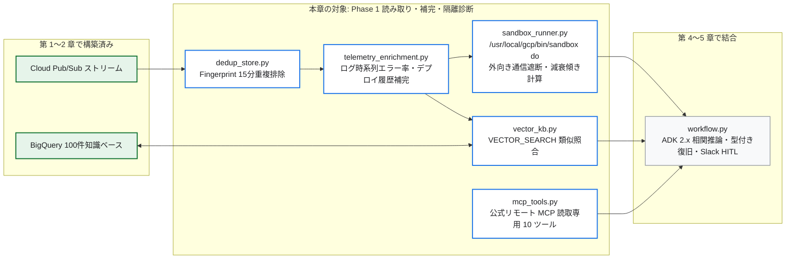
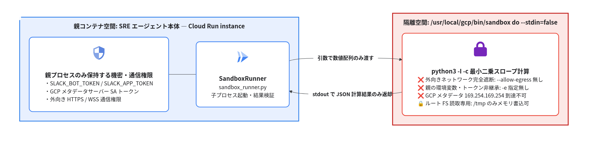
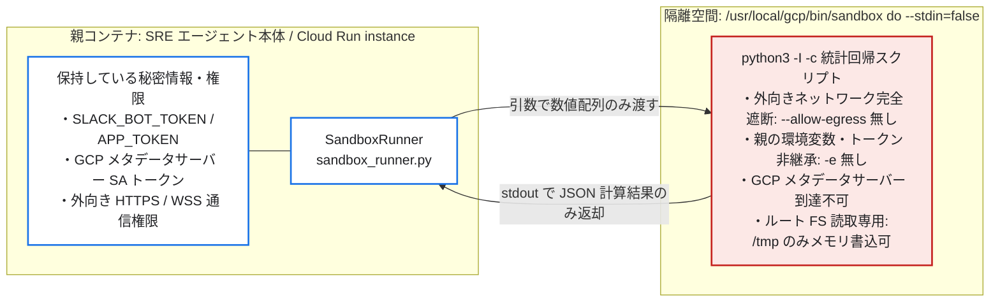

# 第 3 章：公式リモート MCP 並列調査と Cloud Run sandboxes 隔離解析 (`03-diagnostic-agent-and-sandbox.md`)

**所要時間**: 約 40 分  
**到達目標**: エージェントの「読み取り診断フェーズ（Phase 1）」として、Google Cloud 公式リモート MCP サーバーの厳選接続と、Cloud Run sandboxes（`/usr/local/gcp/bin/sandbox do`）を用いた完全隔離データ解析の仕組みを理解・検証する。

---

## 1. この章で作る場所（現在地マップ）

色が付いている **公式リモート MCP 読み取り層** と **Cloud Run sandboxes 隔離解析層** を確認・検証します。


<details>
<summary>詳細: Mermaid ソースを表示</summary>



</details>

---

## 2. 決定論的プリフィルタ（重複排除とクールダウン）の仕組み

[sre-agent/agent_app/dedup_store.py](../sre-agent/agent_app/dedup_store.py) は、LLM を呼び出す**前**にアラートの `namespace + service_name + error_code` から 16 文字の SHA-256 ハッシュ（`fingerprint`）を計算します。

* 直近 15 分以内（`COOLDOWN_MINUTES=15`）に同じ `fingerprint` のインシデントが既に処理されていれば、**LLM を 1 トークンも呼ばずに即座にスキップ**します。
* これにより、1 回の障害で 50 行のエラーログが連続流入しても、調査と通知は最初の 1 回だけ正確に実行されます。

---

## 3. Google Cloud 公式リモート MCP サーバーの安全な使い方

[sre-agent/agent_app/mcp_tools.py](../sre-agent/agent_app/mcp_tools.py) では、自前で MCP サーバーコンテナを立てる代わりに、Google Cloud が標準提供する 3 つのリモート MCP エンドポイントへ接続します。

| 接続先サービス | エンドポイント URL | `tool_filter` で公開する厳選ツール |
|---|---|---|
| **Cloud Monitoring** | `https://monitoring.googleapis.com/mcp` | `list_timeseries`, `query_range`, `list_alerts` |
| **Cloud Logging** | `https://logging.googleapis.com/mcp` | `list_log_entries` |
| **GKE (Read-Only)** | `https://container.googleapis.com/mcp/read-only` | `get_cluster`, `get_k8s_resource`, `describe_k8s_resource`, `list_k8s_events`, `get_k8s_rollout_status`, `get_k8s_logs` |

### 設計上の 2 つの急所
1. **GKE は `/mcp` ではなく必ず `/mcp/read-only` エンドポイントを指定する**: これにより `delete_k8s_resource` や `patch_k8s_resource` といった変更系 MCP ツールがエンドポイントレベルで除外され、調査フェーズでの誤変更を 100% 防止できます。
2. **`tool_filter` でツール数を 10 個に絞る**: 30 個以上の汎用ツールをそのままモデルに見せると、どのツールを使うべきか迷ってレイテンシとトークンが増大します。必要なツールだけに絞ることで推論が一発で収束します。

---

## 4. Cloud Run sandboxes による隔離コード実行のセキュリティ境界

一過性エラーか持続的障害かを見極めるには、時系列エラー率の線形回帰傾き（スロープ）などの数値計算が有効です。しかし、エージェントが生成・実行する解析コードを親コンテナ上で直接動かすと、親コンテナが持つ Slack トークンや Google Cloud メタデータサーバー認証情報にアクセスできてしまいます。

Cloud Run instances で `sandboxLauncher: true` を有効にすると利用できる `/usr/local/gcp/bin/sandbox do` は、同一インスタンス内に以下の厳格な隔離境界を持つサンドボックスを即座に立ち上げます。



<details>
<summary>詳細: Mermaid ソースを表示</summary>



</details>

[sre-agent/agent_app/sandbox_runner.py](../sre-agent/agent_app/sandbox_runner.py) では、最小二乗法による時系列エラー率の傾き計算をこの隔離空間で実行し、`slope < -0.02` かつ直近エラー率がピークの半分以下・5% 未満であれば `is_naturally_decaying = True`（自然減衰中＝静観候補）と判定します。

---

## 5. ローカル仮想環境での単体テスト検証

ここまでの重複排除・サンドボックス隔離フラグ・100 件知識ベース照合が正しく動作することをテストで確認します。

```bash
python3 -m venv .venv
source .venv/bin/activate
pip install -e ".[dev]"

pytest tests/test_dedup_and_guardrails.py tests/test_sandbox_runner.py -v
```

### 期待される出力

```text
tests/test_dedup_and_guardrails.py::test_cooldown_deduplication PASSED
tests/test_dedup_and_guardrails.py::test_guardrail_downgrades_disallowed_namespace_and_circuit_breaker PASSED
tests/test_dedup_and_guardrails.py::test_pubsub_payload_normalization_and_target_app_modes PASSED
tests/test_dedup_and_guardrails.py::test_atomic_claim_and_log_binning_decay_detection PASSED
tests/test_dedup_and_guardrails.py::test_remediation_failure_returns_failed_outcome PASSED
tests/test_sandbox_runner.py::test_sandbox_command_enforces_strict_isolation PASSED
tests/test_sandbox_runner.py::test_sandbox_series_analysis_distinguishes_decay_from_persistent_failure PASSED
tests/test_sandbox_runner.py::test_mcp_tool_filter_and_model_armor_plugin_configuration PASSED
tests/test_sandbox_runner.py::test_100_runbooks_dataset_integrity_and_retrieval PASSED
```

---

## 🤖 AI コーディングエージェントを使う場合の指示プロンプト

```markdown
`AGENTS.md` を読み込み、第3章（`docs/03-diagnostic-agent-and-sandbox.md`）の内容を確認・検証してください。
- `sre-agent/agent_app/dedup_store.py`、`mcp_tools.py`、`sandbox_runner.py`、`vector_kb.py` のセキュリティ境界（`--allow-egress` が付与されていないこと、GKE MCP が `read-only` であること）を確認すること。
- `.venv` 環境で `pytest tests/test_dedup_and_guardrails.py tests/test_sandbox_runner.py -v` を実行し、全テストの PASS を報告すること。
```

---

## Links and References

* [Code execution in Cloud Run](https://docs.cloud.google.com/run/docs/code-execution) — Cloud Run sandboxes のセキュリティ境界と `sandbox do` の仕様
* [Cloud Run sandbox CLI reference](https://docs.cloud.google.com/run/docs/reference/sandbox-cli) — `sandbox do` / `delete --force` の全フラグ一覧
* [GKE MCP server reference](https://docs.cloud.google.com/kubernetes-engine/docs/reference/mcp) — `/mcp/read-only` ツールセットの仕様

次へ進む 👉 [第 4 章：ADK 2.x ワークフロー・型付き GKE 自動復旧・Slack Socket Mode 承認連携](04-auto-remediation-and-slack-hitl.md)
