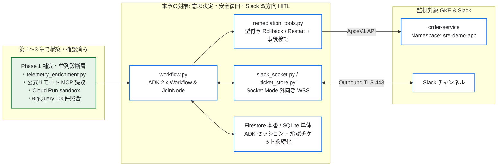
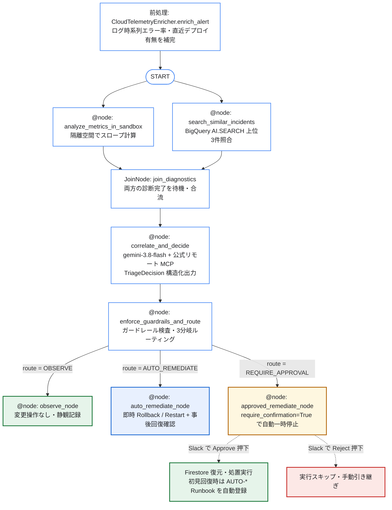
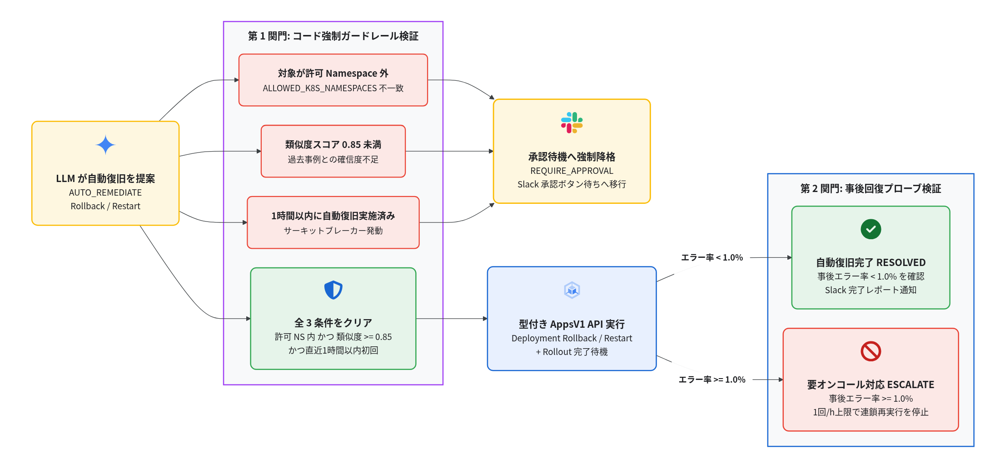
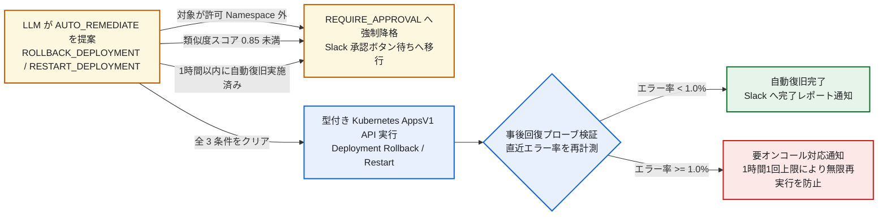
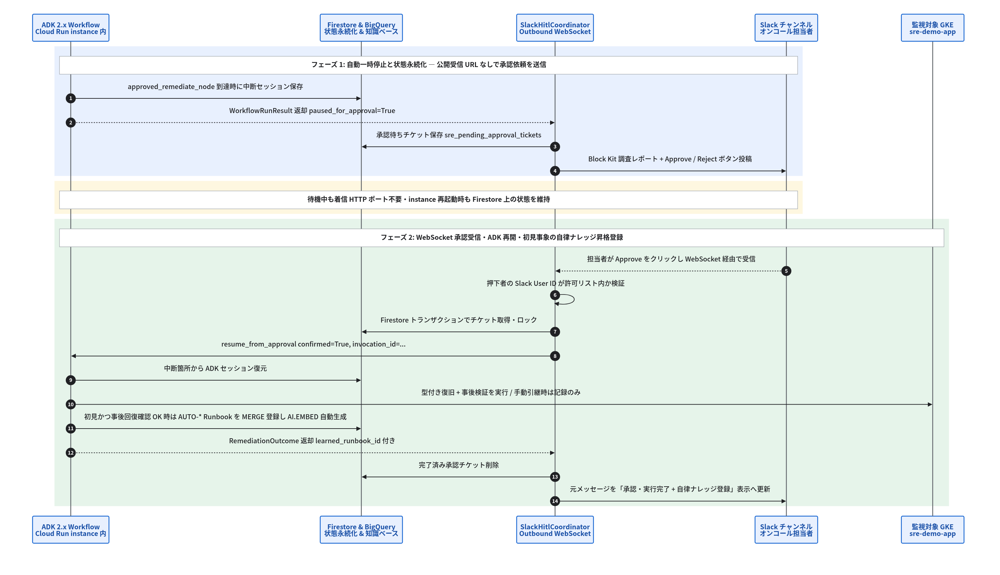
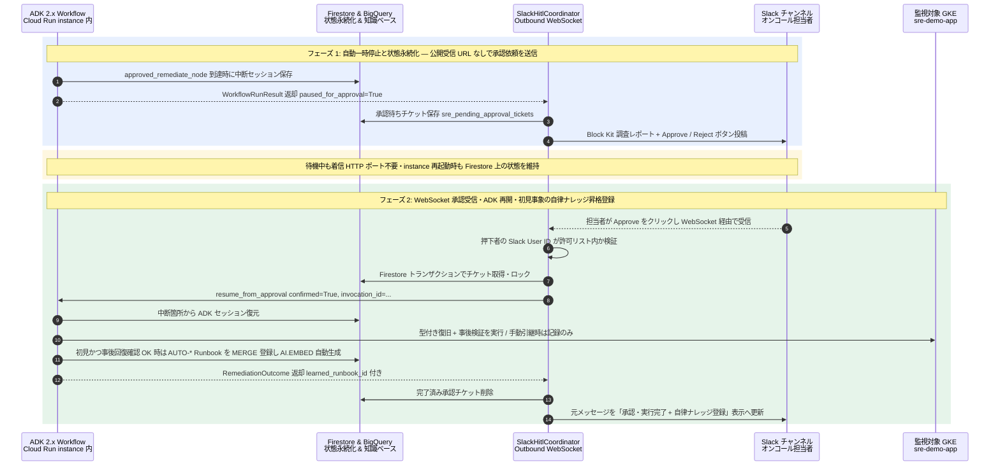

# 第 4 章：ADK 2.x ワークフロー・型付き GKE 自動復旧・Slack Socket Mode 承認連携 (`04-auto-remediation-and-slack-hitl.md`)

**所要時間**: 約 45 分  
**到達目標**: ADK Python 2.x のグラフワークフロー（`Workflow` / `JoinNode` / `@node(require_confirmation=True)`）による 3 分岐制御、安全な型付き GKE 復旧と事後検証、公開 URL を一切開けない Slack Socket Mode 双方向承認、および**承認解決した初見インシデントを次回から自動復旧へ昇格させる自律学習機構**を理解し、Slack App を準備する。

---

## 1. この章で作る場所（現在地マップ）

色が付いている **ADK 2.x ワークフロー制御層**、**型付き GKE 復旧層**、および **Slack Socket Mode 連携層** を確認・設定します。


<details>
<summary>詳細: Mermaid ソースを表示</summary>



</details>

---

## 2. ADK 2.x グラフワークフローの構造 (`workflow.py`)

従来の対話型エージェントのように「次の手順を毎回すべて LLM の自由裁量に任せる」構造にすると、手順飛ばしや無限ループが起きやすくなります。[sre-agent/agent_app/workflow.py](../sre-agent/agent_app/workflow.py) では、ADK 2.x の `Workflow` を使って**処理順序と分岐条件をコードの有向グラフとして明示固定**しています。


<details>
<summary>詳細: Mermaid ソースを表示</summary>



</details>

### 安全ガードレールによる自動降格（サーキットブレーカー）

LLM が仮に `AUTO_REMEDIATE` を提案した場合でも、`enforce_guardrails_and_route` ノード内の決定論的チェックが以下の状態遷移に従って安全側（`REQUIRE_APPROVAL`）へ強制降格させます。



<details>
<summary>詳細: Mermaid ソースを表示</summary>



</details>

### 事後検証でエラー率が 1.0% 未満に回復しなかった場合（フェイルセーフ）

直前リビジョンへのロールバック後もエラー率が `1.0%` 未満へ下がらない場合、原因はアプリ直近変更ではなく **DB 状態・外部依存・データ不整合** である可能性が高いため、エージェントは追加の連鎖ロールバックや再起動ループを行わず人間へ引き継ぎます。

1. **連鎖操作を行わない**: `verification_passed=False` として 1 回の変更で終了し、さらなる過去リビジョンへの自動巻き戻しによる二次障害を防ぎます。
2. **Slack 警告エスカレーションと監査記録**: ヘッダを `🚨 自動復旧未回復・要オンコール対応 (事後検証 NG)` に切り替え、BigQuery `incident_events` へ `verification_passed=false` を追記します。
3. **サーキットブレーカーによる再試行遮断**: 当該実行が「直近 1 時間に 1 回の上限」にカウントされるため、障害継続で後続アラートが届いても強制的に `REQUIRE_APPROVAL` へ降格して停止します。

---

## 3. なぜ自由な `kubectl` 生成を禁止し「型付き復旧関数」にするのか？

[sre-agent/agent_app/remediation_tools.py](../sre-agent/agent_app/remediation_tools.py) には、任意のシェルコマンドを実行する関数は存在しません。用意されているのは以下の 2 つの型付きメソッドのみです。

1. `rollback_deployment(namespace, deployment_name)`: Kubernetes `AppsV1Api` で ReplicaSet のリビジョン履歴を取得し、1 つ前のリビジョンの PodTemplate で Deployment をパッチ更新します。
2. `restart_deployment(namespace, deployment_name)`: PodTemplate に `kubectl.kubernetes.io/restartedAt` アノテーションを付与し、ゼロダウンタイムのローリング再起動を開始します。

さらに `SafeRemediationService.execute_and_verify` は、API 呼び出し成功後にエラー率プローブを確認し、**実際にエラー率が 1% 未満へ下がったかを検証してから結果を返す**ため、「コマンドは投げたが障害が直っていないのに『復旧完了』と誤報する問題」を防ぎます。

---

## 4. Slack Socket Mode と Firestore 永続化による「公開 URL ゼロ＆再起動耐性」承認シーケンス

通常の HTTP Webhook で Slack のボタン操作を受け取ろうとすると、Slack サーバーは Google Cloud の IAM トークンを付与できないため、未認証でも到達できる公開 URL を用意する必要が生じます。  
本設計では常駐型の Cloud Run instance から **Slack Socket Mode（外向き TLS WebSocket）** を張ることで公開 URL を完全にゼロにし、さらに中断中の ADK セッション（`FirestoreSessionService`）と承認待ちチケット（[ticket_store.py](../sre-agent/agent_app/ticket_store.py) の `FirestoreApprovalTicketStore`）の両方を **Cloud Firestore** に保存します。

> [!IMPORTANT]
> **なぜローカルの `/tmp` SQLite ではなく Firestore を使うのか？**  
> Cloud Run instance のローカルディスク（`/tmp` 等）およびプロセス内メモリはエフェメラルであり、コンテナ再起動・停止・リビジョン更新時に消滅します。承認ボタン押下待ちの間にインスタンスが再起動しても途中から安全に再開（Resume）できるよう、本番デプロイ時（`SESSION_BACKEND=firestore`）は Firestore へ永続化し、ローカル開発やクラウド未接続の `pytest` 実行時のみ `SESSION_BACKEND=sqlite` で完結できるハイブリッド構造にしています。



<details>
<summary>詳細: Mermaid ソースを表示</summary>



</details>

### 承認解決時の自律ナレッジ昇格ルール（誤学習防止ガードレール）

運用を続けるほど人手を減らしていくため、[workflow.py](../sre-agent/agent_app/workflow.py) の `resume_from_approval` と [vector_kb.py](../sre-agent/agent_app/vector_kb.py) の `determine_promoted_action` では、以下の厳格な条件を満たした場合に限り新規 Runbook（`AUTO-<fingerprint先頭8文字>`）を合成して BigQuery `incident_runbooks` へ `MERGE` 登録します。

| 判定条件・復旧種別 | 知識ベースへの登録有無 | 次回発生時の `recommended_action` | 設計上の理由 |
|---|---|---|---|
| **Slack で `Reject` された場合、または処置後にエラー率 `1.0%` 未満へ回復しなかった場合** | **登録しない** | — | 誤判断や未解決の手順が知識ベースに混入して次回以降の自動復旧を汚染する事態を防ぐため |
| **初見（類似度 `0.85` 未満）かつ `Approve` 承認後に `ROLLBACK` / `RESTART` で回復確認できた場合** | **自動 `MERGE` 登録**（BigQuery `AI.EMBED` が裏側で自動ベクトル化） | **`AUTO_REMEDIATE` へ昇格** | 人間が承認し実環境で回復が実証された安全な型付き復旧であるため、2 回目以降はオンコール担当者を起こさず即座に自動復旧させるため |
| **初見かつ `Approve` されたが `MANUAL_INTERVENTION`［DB ロック調査等］である場合** | **自動 `MERGE` 登録** | **`REQUIRE_APPROVAL` を維持** | 原因分析や禁止事項の知見は蓄積して次回の調査を高速化しつつ、DB 操作等の高リスク手順が無断自動実行されるのを防ぐため |

---

## 5. Slack App の作成と Secret Manager へのトークン登録

Slack ワークスペースへの権限をお持ちの場合は、以下の **App Manifest** を使うことで 1 分で Socket Mode 対応アプリを作成できます（Slack 環境がない場合でも、エージェントは自動的にコンソール構造化ログ出力モードで動作するため第 5 章へ進めます）。

### Step 5.1 Slack App マニフェストの適用

1. [Slack API: Your Apps](https://api.slack.com/apps) を開き、**Create New App** → **From an app manifest** を選択します。
2. 対象ワークスペースを選び、YAML タブに以下を貼り付けて作成します。

```yaml
display_information:
  name: Autonomous SRE Agent
  description: Cloud Run instances + ADK 2.x Autonomous SRE Agent
features:
  bot_user:
    display_name: sre-agent
    always_online: true
oauth_config:
  scopes:
    bot:
      - chat:write
      - chat:write.public
settings:
  interactivity:
    is_enabled: true
  org_deploy_enabled: false
  socket_mode_enabled: true
  token_rotation_enabled: false
```

3. **Basic Information** → **App-Level Tokens** で `connections:write` スコープ付きのトークンを生成し、`xapp-...` で始まる **App Token** を控えます。
4. **Install to Workspace** を実行し、`xoxb-...` で始まる **Bot User OAuth Token** を控えます。
5. 通知先 Slack チャンネルで `/invite @sre-agent` を実行し、チャンネル詳細下部に表示されるチャンネル ID（`C...`）を `.env` の `SLACK_ALERT_CHANNEL_ID` に設定します。あわせて、承認を許可するご自身のプロフィール画面（その他 → メンバー ID をコピー）から `U...` 形式の User ID を取得し、`SLACK_ALLOWED_APPROVER_IDS` に設定します。

### Step 5.2 Secret Manager への安全な格納

トークン文字列をコンテナイメージやマニフェストに直書きしないよう、Secret Manager に登録します。

```bash
source .env

# Bot Token (xoxb-...) の登録
read -rsp "Slack Bot Token (xoxb-...) を入力: " INPUT_BOT_TOKEN && echo ""
printf "%s" "${INPUT_BOT_TOKEN}" | gcloud secrets create sre-slack-bot-token \
  --data-file=- \
  --replication-policy="automatic" \
  --project="${GOOGLE_CLOUD_PROJECT}"
unset INPUT_BOT_TOKEN

# App-Level Token (xapp-...) の登録
read -rsp "Slack App Token (xapp-...) を入力: " INPUT_APP_TOKEN && echo ""
printf "%s" "${INPUT_APP_TOKEN}" | gcloud secrets create sre-slack-app-token \
  --data-file=- \
  --replication-policy="automatic" \
  --project="${GOOGLE_CLOUD_PROJECT}"
unset INPUT_APP_TOKEN
```

---

## 6. ワークフロー 3 分岐と承認再開のローカルテスト確認

```bash
source .venv/bin/activate
pytest tests/test_workflow_routing.py tests/test_slack_hitl_resume.py -v
```

### 期待される出力

```text
tests/test_workflow_routing.py::test_workflow_three_scenarios_end_to_end PASSED
tests/test_slack_hitl_resume.py::test_slack_hitl_authorization_approve_and_reject_resume PASSED
tests/test_slack_hitl_resume.py::test_pass_hat_k_blocks_flaky_agent PASSED
tests/test_slack_hitl_resume.py::test_slack_report_highlights_failed_post_verification PASSED
tests/test_slack_hitl_resume.py::test_resume_survives_instance_restart_via_persistent_ticket_and_session PASSED
tests/test_slack_hitl_resume.py::test_build_session_service_rejects_unknown_backend PASSED
tests/test_slack_hitl_resume.py::test_build_session_service_firestore_returns_adk_service PASSED
tests/test_slack_hitl_resume.py::test_autonomous_kb_learning_promotes_novel_restart_to_auto_remediate PASSED
tests/test_slack_hitl_resume.py::test_autonomous_kb_learning_keeps_manual_intervention_as_require_approval PASSED
tests/test_slack_hitl_resume.py::test_bigquery_ai_search_and_autonomous_merge_queries PASSED
```

---

## 🤖 AI コーディングエージェントを使う場合の指示プロンプト

```markdown
`AGENTS.md` を読み込み、第4章（`docs/04-auto-remediation-and-slack-hitl.md`）のテスト検証を実行してください。
- `.venv` 環境で `pytest -v` を実行し、全 19 件のテスト（重複排除、サンドボックス隔離、100件検索、Workflow 3分岐、事後検証未回復時通知、Slack 承認者検証、インスタンス再起動後の Resume 復旧、および解決ナレッジ自律昇格）が PASS することを確認して報告すること。
- Secret Manager への Slack トークン登録は私が手元でトークンを入力して行うため、実行用コマンドのみ案内すること。
```

---

## Links and References

* [Human input for agent workflows (ADK)](https://adk.dev/graphs/human-input/) — ADK 2.x グラフワークフローにおける Human-in-the-Loop 一時停止・再開仕様
* [Slack Socket Mode documentation](https://api.slack.com/apis/connections/socket) — 外向き WebSocket によるイベント・Interactivity 受信仕様
* [Secret Manager overview](https://docs.cloud.google.com/secret-manager/docs/overview) — シークレットの安全な管理と Cloud Run 連携

次へ進む 👉 [第 5 章：Cloud Run instances への閉域常駐デプロイと 4 大障害訓練](05-deploy-cloud-run-instance-and-drills.md)
