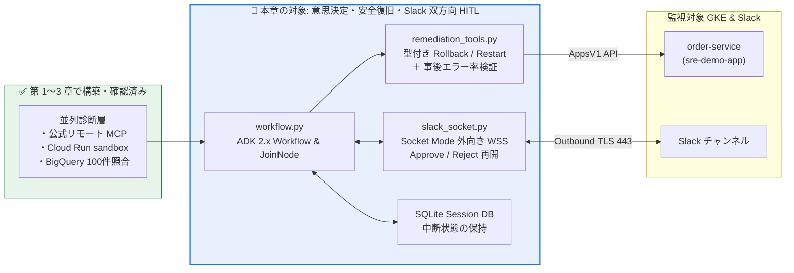
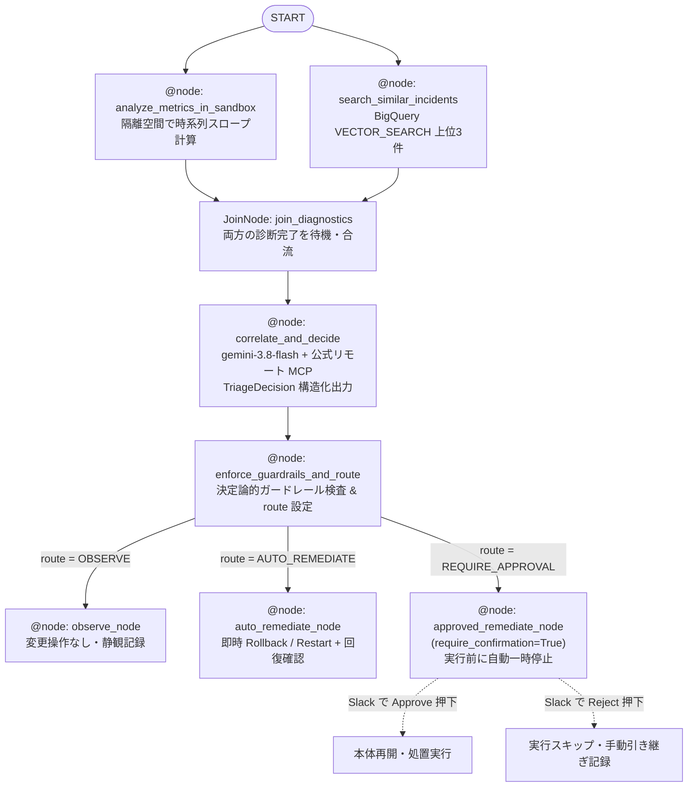
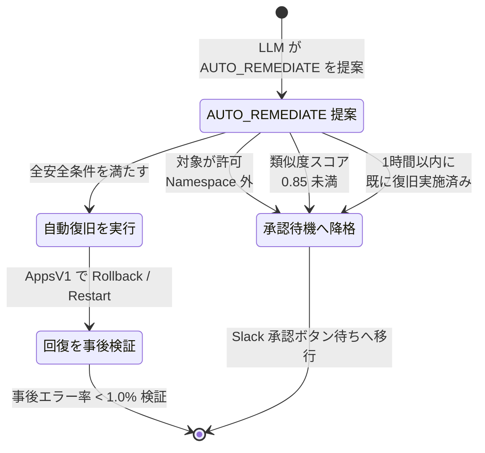
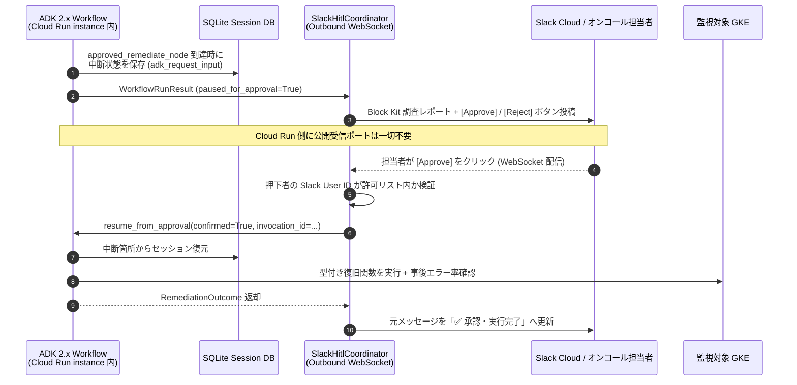

# 第 4 章：ADK 2.x ワークフロー・型付き GKE 自動復旧・Slack Socket Mode 承認連携 (`04-auto-remediation-and-slack-hitl.md`)

**所要時間**: 約 45 分  
**到達目標**: ADK Python 2.x のグラフワークフロー（`Workflow` / `JoinNode` / `@node(require_confirmation=True)`）による 3 分岐制御、安全な型付き GKE 復旧と事後検証、および公開 URL を一切開けない Slack Socket Mode 双方向承認の仕組みを理解し、Slack App を準備する。

---

## 1. この章で作る場所（現在地マップ）

色が付いている **ADK 2.x ワークフロー制御層**、**型付き GKE 復旧層**、および **Slack Socket Mode 連携層** を確認・設定します。



---

## 2. ADK 2.x グラフワークフローの構造 (`workflow.py`)

従来の対話型エージェントのように「次の手順を毎回すべて LLM の自由裁量に任せる」構造にすると、手順飛ばしや無限ループが起きやすくなります。[sre-agent/agent_app/workflow.py](../sre-agent/agent_app/workflow.py) では、ADK 2.x の `Workflow` を使って**処理順序と分岐条件をコードの有向グラフとして明示固定**しています。



### 安全ガードレールによる自動降格（サーキットブレーカー）

LLM が仮に `AUTO_REMEDIATE` を提案した場合でも、`enforce_guardrails_and_route` ノード内の決定論的チェックが以下の状態遷移に従って安全側（`REQUIRE_APPROVAL`）へ強制降格させます。



---

## 3. なぜ自由な `kubectl` 生成を禁止し「型付き復旧関数」にするのか？

[sre-agent/agent_app/remediation_tools.py](../sre-agent/agent_app/remediation_tools.py) には、任意のシェルコマンドを実行する関数は存在しません。用意されているのは以下の 2 つの型付きメソッドのみです。

1. `rollback_deployment(namespace, deployment_name)`: Kubernetes `AppsV1Api` で ReplicaSet のリビジョン履歴を取得し、1 つ前のリビジョンの PodTemplate で Deployment をパッチ更新します。
2. `restart_deployment(namespace, deployment_name)`: PodTemplate に `kubectl.kubernetes.io/restartedAt` アノテーションを付与し、ゼロダウンタイムのローリング再起動を開始します。

さらに `SafeRemediationService.execute_and_verify` は、API 呼び出し成功後にエラー率プローブを確認し、**実際にエラー率が 1% 未満へ下がったかを検証してから結果を返す**ため、「コマンドは投げたが障害が直っていないのに『復旧完了』と誤報する問題」を防ぎます。

---

## 4. Slack Socket Mode による「公開 URL ゼロ」の承認再開シーケンス

通常の HTTP Webhook で Slack のボタン操作を受け取ろうとすると、Slack サーバーは Google Cloud の IAM トークンを付与できないため、未認証でも到達できる公開 URL を用意する必要が生じます。  
本設計では常駐型の Cloud Run instance から **Slack Socket Mode（外向き TLS WebSocket）** を張ることで、公開 URL を完全にゼロにしたまま双方向承認を実現します。



---

## 5. Slack App の作成と Secret Manager へのトークン登録

Slack ワークスペースへの権限をお持ちの場合は、以下の **App Manifest** を使うことで 1 分で Socket Mode 対応アプリを作成できます（Slack 環境がない場合でも、エージェントは自動的にコンソール構造化ログ出力モードで動作するため第 5 章へ進めます）。

### Step 5.1 Slack App マニフェストの適用

1. [Slack API: Your Apps](https://api.slack.com/apps) を開き、**Create New App** → **From an app manifest** を選択します。
2. 対象ワークスペースを選び、YAML タブに以下を貼り付けて作成します。

```yaml
display_information:
  name: Autonomous SRE Agent
  description: Cloud Run instances + ADK 2.x Autonomous SRE Agent
features:
  bot_user:
    display_name: sre-agent
    always_online: true
oauth_config:
  scopes:
    bot:
      - chat:write
      - chat:write.public
settings:
  interactivity:
    is_enabled: true
  org_deploy_enabled: false
  socket_mode_enabled: true
  token_rotation_enabled: false
```

3. **Basic Information** → **App-Level Tokens** で `connections:write` スコープ付きのトークンを生成し、`xapp-...` で始まる **App Token** を控えます。
4. **Install to Workspace** を実行し、`xoxb-...` で始まる **Bot User OAuth Token** を控えます。
5. 通知先 Slack チャンネルで `/invite @sre-agent` を実行し、チャンネル詳細下部に表示されるチャンネル ID（`C...`）を `.env` の `SLACK_ALERT_CHANNEL_ID` に設定します。あわせて、承認を許可するご自身のプロフィール画面（その他 → メンバー ID をコピー）から `U...` 形式の User ID を取得し、`SLACK_ALLOWED_APPROVER_IDS` に設定します。

### Step 5.2 Secret Manager への安全な格納

トークン文字列をコンテナイメージやマニフェストに直書きしないよう、Secret Manager に登録します。

```bash
source .env

# Bot Token (xoxb-...) の登録
read -rsp "Slack Bot Token (xoxb-...) を入力: " INPUT_BOT_TOKEN && echo ""
printf "%s" "${INPUT_BOT_TOKEN}" | gcloud secrets create sre-slack-bot-token \
  --data-file=- \
  --replication-policy="automatic" \
  --project="${GOOGLE_CLOUD_PROJECT}"
unset INPUT_BOT_TOKEN

# App-Level Token (xapp-...) の登録
read -rsp "Slack App Token (xapp-...) を入力: " INPUT_APP_TOKEN && echo ""
printf "%s" "${INPUT_APP_TOKEN}" | gcloud secrets create sre-slack-app-token \
  --data-file=- \
  --replication-policy="automatic" \
  --project="${GOOGLE_CLOUD_PROJECT}"
unset INPUT_APP_TOKEN
```

---

## 6. ワークフロー 3 分岐と承認再開のローカルテスト確認

```bash
source .venv/bin/activate
pytest tests/test_workflow_routing.py tests/test_slack_hitl_resume.py -v
```

### 期待される出力

```text
tests/test_workflow_routing.py::test_workflow_three_scenarios_end_to_end PASSED
tests/test_slack_hitl_resume.py::test_slack_hitl_authorization_approve_and_reject_resume PASSED
tests/test_slack_hitl_resume.py::test_pass_hat_k_blocks_flaky_agent PASSED
```

---

## 🤖 AI コーディングエージェントを使う場合の指示プロンプト

```markdown
`AGENTS.md` を読み込み、第4章（`docs/04-auto-remediation-and-slack-hitl.md`）のテスト検証を実行してください。
- `.venv` 環境で `pytest -v` を実行し、全 10 件のテスト（重複排除、サンドボックス隔離、100件検索、Workflow 3分岐、非対称回復検証、Slack 承認者検証と Resume）が PASS することを確認して報告すること。
- Secret Manager への Slack トークン登録は私が手元でトークンを入力して行うため、実行用コマンドのみ案内すること。
```

---

## Links and References

* [ADK Graph Workflows & Human Input](https://adk.dev/) — ADK 2.x における `Workflow`・`JoinNode`・確認付きノードの仕様
* [Slack Socket Mode documentation](https://api.slack.com/apis/connections/socket) — 外向き WebSocket によるイベント・Interactivity 受信仕様
* [Secret Manager overview](https://docs.cloud.google.com/secret-manager/docs/overview) — シークレットの安全な管理と Cloud Run 連携

次へ進む 👉 [第 5 章：Cloud Run instances への閉域常駐デプロイと 3 大障害訓練](05-deploy-cloud-run-instance-and-drills.md)
