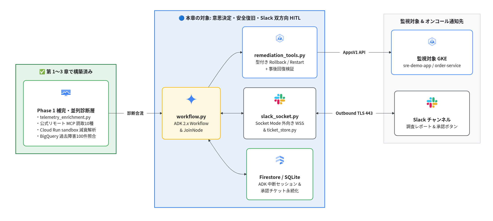
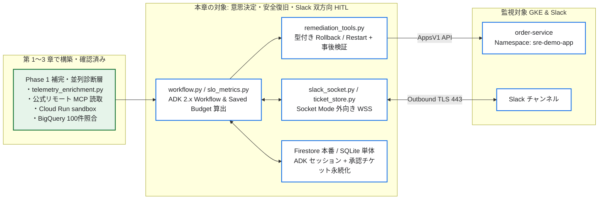
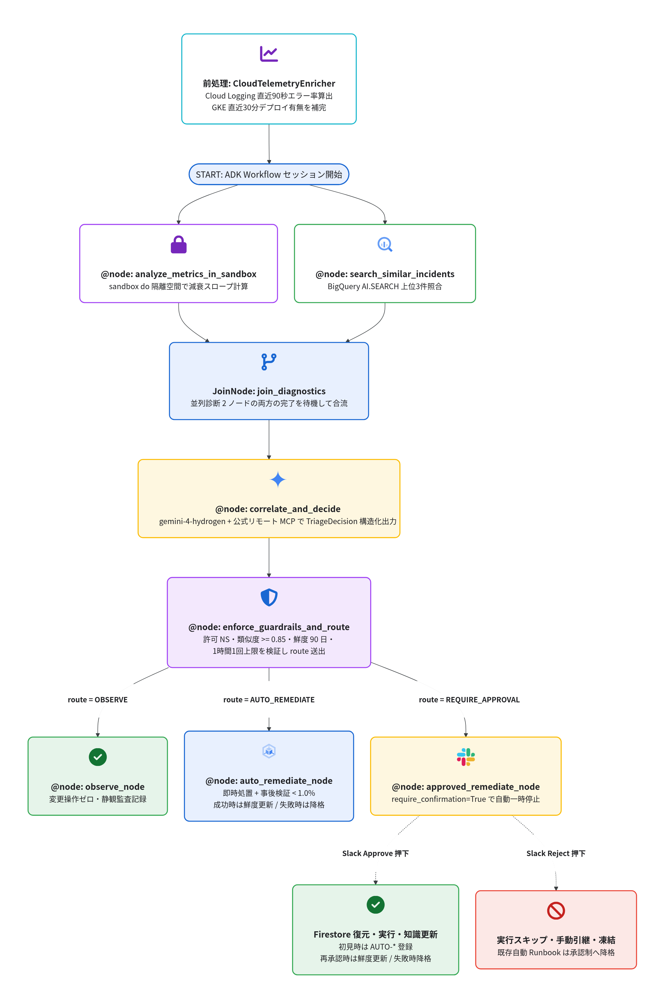
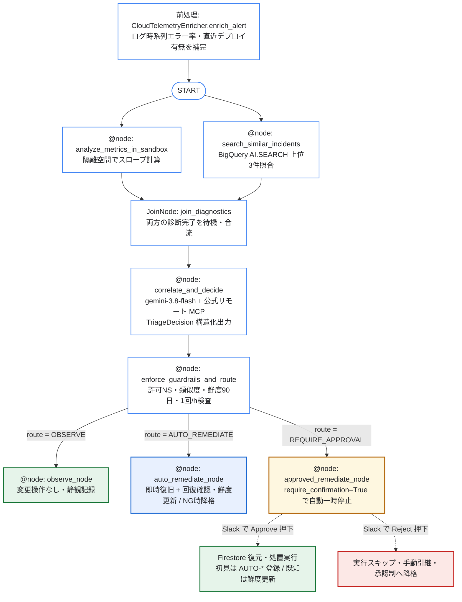
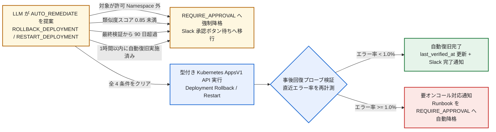
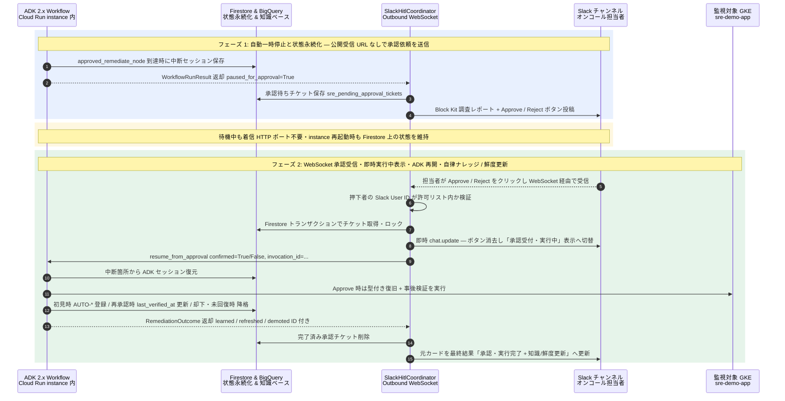
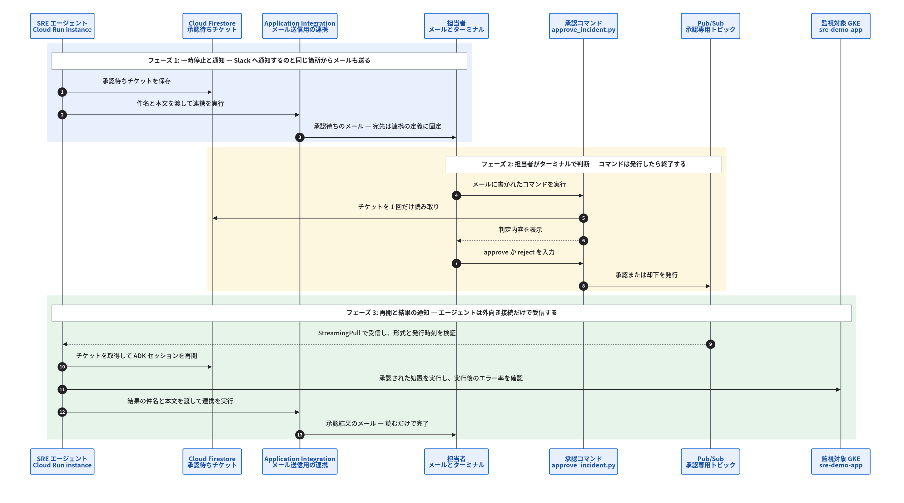
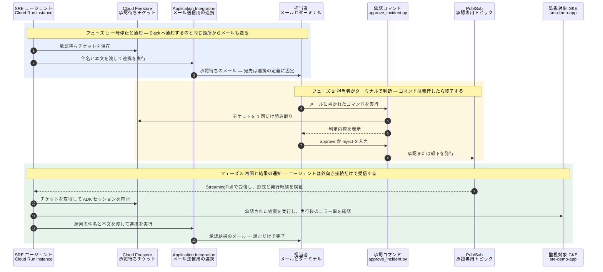

# 第 4 章：ADK 2.x ワークフロー・型付き自動復旧・Slack 連携・Error Budget 効果計測 (`04-auto-remediation-and-slack-hitl.md`)

**所要時間**: 約 45 分  
**到達目標**: ADK Python 2.x のグラフワークフロー（`Workflow` / `JoinNode` / `@node(require_confirmation=True)`）による 3 分岐制御、型付き GKE 復旧と事後検証、公開 URL ゼロの Slack Socket Mode 双方向承認、Runbook 鮮度ライフサイクル、および **Saved Error Budget（温存エラーバジェット）算出ロジック**を理解し、通知と承認の経路を準備する。Slack を使えない場合は、メール通知と承認コマンドの代替ルートを選べる。

---

## 1. この章で確認・設定する場所（現在地マップ）

**ADK 2.x グラフ制御層**、**型付き GKE 復旧・SLO 効果算出層**、および **Slack Socket Mode 連携層** を確認・設定します。



<details>
<summary>詳細: Mermaid ソースを表示</summary>



</details>

---

## 2. ADK 2.x グラフワークフローと 5 重の安全ガードレール (`workflow.py`)

手順の進行をすべて LLM の自由裁量に任せると手順飛ばしや再起動ループが起きるため、[sre-agent/agent_app/workflow.py](../sre-agent/agent_app/workflow.py) では ADK 2.x の `Workflow` で実行順序と分岐条件を有向グラフとして明示固定しています。



<details>
<summary>詳細: Mermaid ソースを表示</summary>



</details>

### 安全ガードレールによる自動降格と事後回復プローブ

LLM が `AUTO_REMEDIATE` を提案しても、`enforce_guardrails_and_route` が以下の 5 条件を決定論的に検証し、1 つでも外れれば `REQUIRE_APPROVAL`（人間承認待ち）へ強制降格します。

1. **許可 Namespace 境界**: `ALLOWED_K8S_NAMESPACES`（既定：`sre-demo-app`）以外は変更不可。
2. **類似度下限**: コサイン類似度が `AUTO_REMEDIATE_SIMILARITY_THRESHOLD`（既定：`0.85`）未満なら降格。
3. **型付き操作限定**: [remediation_tools.py](../sre-agent/agent_app/remediation_tools.py) の `rollback_deployment` と `restart_deployment` 以外は自動実行不可。
4. **Runbook 鮮度有効期限**: 最終検証日（`last_verified_at`）から `RUNBOOK_FRESHNESS_TTL_DAYS`（既定：`90` 日）を超過した手順は再評価のため降格。
5. **1 時間あたり回数上限**: `MAX_AUTO_ACTIONS_PER_HOUR`（既定：`1` 回）を超える連続実行を遮断。


<details>
<summary>詳細: Mermaid ソースを表示</summary>



</details>

さらに処置後は `SafeRemediationService.execute_and_verify` が新リビジョン Ready 到達後のエラー率を実測し、**`1.0%` 未満への回復を確認できた場合のみ成功と判定**します。未回復時は連鎖操作を行わず、該当 Runbook を承認制へ自動降格したうえでオンコール担当者へ警告通知します。

---

## 3. Error Budget 温存効果（Saved Error Budget）の定量算出 (`slo_metrics.py`)

[sre-agent/agent_app/slo_metrics.py](../sre-agent/agent_app/slo_metrics.py) は、異常ログ発生時刻（`alert.observed_at`）から事後回復プローブ完了時刻までの実測所要時間 $\text{MTTR}_{\text{actual}}$（分）を計測し、Cloud Monitoring API から現在の日次 99.0% / 月次 99.9% SLO 残量を読み取って Slack 完了カードと BigQuery `incident_events` へ記録します。

$$\text{Saved Budget (min)} = \max\left(0,\; \text{MTTR}_{\text{manual}} - \text{MTTR}_{\text{actual}}\right), \qquad \text{Monthly 99.9\% Saved (\%)} = \frac{\text{Saved Budget (min)}}{43.2} \times 100$$

* **誠実な計上ルール**: `Saved Budget` と実測 `mttr_seconds` は、**型付き復旧（Rollback / Restart）を実行して事後エラー率 `< 1.0%` への回復が実証されたケースのみ計上**します。一過性エラーの静観（`OBSERVE`）や、オンコール担当者へ手動調査を引き継いだケース（`MANUAL_INTERVENTION`）では、架空の短縮分数を計上せず二次障害回避として区別記録します。

---

## 4. Slack Socket Mode・即時 UX 更新・Runbook 鮮度ライフサイクル

常駐 Cloud Run instance から **Slack Socket Mode（外向き TLS WebSocket）** で接続することで公開 URL をゼロにし、中断セッションと承認チケットを **Cloud Firestore** に保存してインスタンス再起動耐性を確保します。また、担当者がボタンを押した直後（0.5 秒以内）にボタンを消去して **`⏳ 承認受付・実行中...`** へ切り替える 2 段階更新により、GKE ロールアウト待機中の二度押しを防ぎます。


<details>
<summary>詳細: Mermaid ソースを表示</summary>



</details>

### 自律ナレッジ昇格と鮮度ライフサイクル遷移表

| 判定・処置ケース | `incident_runbooks` の更新 | 次回発生時の挙動 |
|---|---|---|
| **初見（類似度 `< 0.85`）で `Approve` 後に型付き復旧で回復確認** | 新規 `AUTO-*` を `MERGE` 登録・`verified_count = 1` | **`AUTO_REMEDIATE` へ昇格**［今後 90 日間有効］ |
| **初見で `Approve` されたが `MANUAL_INTERVENTION` 種別** | 新規 `AUTO-*` を `MERGE` 登録 | **`REQUIRE_APPROVAL` を維持**［DB 等の無断操作を抑止］ |
| **鮮度内の自動復旧成功、または 90 日超過手順の再 `Approve` 回復成功** | `last_verified_at = NOW`・`verified_count + 1`［ベクトル再計算なし］ | **さらに 90 日間 `AUTO_REMEDIATE` 資格を継続・復活** |
| **既存 `AUTO_REMEDIATE` 手順が `Reject` された、または事後検証 NG** | `recommended_action = 'REQUIRE_APPROVAL'` へ更新 | **以後の無断自動実行を恒久凍結**［毎回承認を要求］ |

---

## 5. 通知と承認の経路の準備

エージェントは判定のたびに通知を送り、承認待ちのときだけ人の操作を待ちます。経路は次の 2 つで、片方だけでも、両方を同時にでも使えます。

| 経路 | 通知の届き方 | 承認と却下の操作 | 準備手順 |
|---|---|---|---|
| **標準: Slack** | Slack チャンネルへの投稿 | 投稿されたカードのボタン | 5.1 |
| **代替: メール通知と承認コマンド** | エージェントが送るメール | Cloud Shell またはローカル PC のターミナル | 5.2 |

Slack ワークスペースへアプリを追加できる場合は 5.1 を、追加できない場合は 5.2 を実施します。どちらも設定しない場合は、通知の内容が Cloud Logging へ出力されるだけで、訓練 3 と訓練 4 の承認操作はできません。

### 5.1 標準ルート：Slack App の作成と Secret Manager へのトークン登録

以下の App Manifest で Socket Mode 対応アプリを作成します。

1. [Slack API: Your Apps](https://api.slack.com/apps) → **Create New App** → **From an app manifest** で以下を貼り付けます。

```yaml
display_information:
  name: Autonomous SRE Agent
  description: Cloud Run instances + ADK 2.x Autonomous SRE Agent
features:
  bot_user:
    display_name: sre-agent
    always_online: true
oauth_config:
  scopes:
    bot:
      - chat:write
      - chat:write.public
settings:
  interactivity:
    is_enabled: true
  org_deploy_enabled: false
  socket_mode_enabled: true
  token_rotation_enabled: false
```

2. **Basic Information** → **App-Level Tokens** で `connections:write` スコープのトークン（`xapp-...`）を発行し、**Install to Workspace** で Bot Token（`xoxb-...`）を取得します。
3. 対象チャンネルで `/invite @sre-agent` を実行し、チャンネル ID（`C...`）を `.env` の `SLACK_ALERT_CHANNEL_ID` に、ご自身のメンバー ID（`U...`）を `SLACK_ALLOWED_APPROVER_IDS` に設定してから Secret Manager へ格納します。

```bash
source .env

read -rsp "Slack Bot Token (xoxb-...) を入力: " INPUT_BOT_TOKEN && echo ""
printf "%s" "${INPUT_BOT_TOKEN}" | gcloud secrets create sre-slack-bot-token \
  --data-file=- \
  --replication-policy="automatic" \
  --project="${GOOGLE_CLOUD_PROJECT}"
unset INPUT_BOT_TOKEN

read -rsp "Slack App Token (xapp-...) を入力: " INPUT_APP_TOKEN && echo ""
printf "%s" "${INPUT_APP_TOKEN}" | gcloud secrets create sre-slack-app-token \
  --data-file=- \
  --replication-policy="automatic" \
  --project="${GOOGLE_CLOUD_PROJECT}"
unset INPUT_APP_TOKEN
```

### 5.2 代替ルート：メール通知と承認コマンド

エージェントは、Slack へ通知するのと同じ箇所から **Application Integration** のメール送信タスクを実行して通知メールを送ります。承認と却下だけを、ターミナルの承認コマンド [approve_incident.py](../target-app/scripts/approve_incident.py) で行います。外部サービスのアカウントは不要で、エージェントの着信 URL も開けません。



<details>
<summary>詳細: Mermaid ソースを表示</summary>



</details>

メールが届いた後に必要な操作は、通知の種類で決まります。

| 通知の種類 | メールが届いた後の操作 |
|---|---|
| 静観の報告 | なし |
| 自動復旧の結果 | なし |
| 承認待ち | メールに書かれたコマンドを実行し、判定内容を確認して `approve` か `reject` を入力 |
| 承認結果 | なし |

Slack は承認待ちのカードを結果へ書き換えますが、メールは書き換えられないため、承認待ちと承認結果は別のメールで届きます。

#### セットアップ

API を有効化し、承認専用の Pub/Sub トピックとサブスクリプションを作成します。

```bash
source .env

gcloud services enable integrations.googleapis.com --project="${GOOGLE_CLOUD_PROJECT}"

gcloud pubsub topics create sre-approval-decisions --project="${GOOGLE_CLOUD_PROJECT}"

gcloud pubsub subscriptions create sre-approval-decisions-sub \
  --topic=sre-approval-decisions \
  --ack-deadline=60 \
  --message-retention-duration=10m \
  --project="${GOOGLE_CLOUD_PROJECT}"
```

`.env` の次の 3 項目に値を設定します。`NOTIFY_EMAIL_TO` には通知を受け取るメールアドレスを書きます。

```bash
EMAIL_NOTIFY_INTEGRATION="sre-notify-email"
NOTIFY_EMAIL_TO="you@example.com"
APPROVAL_PUBSUB_SUBSCRIPTION="sre-approval-decisions-sub"
```

メール送信用の連携を登録し、エージェントのサービスアカウントへ連携の実行権限を付与します。

```bash
source .env
source .venv/bin/activate

python3 ./target-app/scripts/setup_email_notification.py --send-test

gcloud projects add-iam-policy-binding "${GOOGLE_CLOUD_PROJECT}" \
  --member="serviceAccount:sre-autonomous-agent-sa@${GOOGLE_CLOUD_PROJECT}.iam.gserviceaccount.com" \
  --role="roles/integrations.integrationInvoker" \
  --condition=None \
  --quiet
```

件名 `[SRE Agent] テスト: 通知メールの設定確認` のメールが届けば準備完了です。[setup_email_notification.py](../target-app/scripts/setup_email_notification.py) は次のことを行います。

* **リージョンの有効化**: 初回だけ行います。このとき Google Cloud が、サービス エージェントへのロール付与と `ExecuteConnection` という連携の作成を自動で行います。
* **連携の登録と公開**: 登録済みの定義と同じなら何もしないため、再実行しても重複しません。宛先を変える場合は `NOTIFY_EMAIL_TO` を書き換えて再実行します。
* **送信上限の表示**: メールの 1 日あたりの送信上限はプロジェクトによって異なります。訓練 1 周で送るメールは 9 通です。

#### 権限の境界と失敗時の扱い

* **宛先は連携の定義に固定**: エージェントが渡すのは件名と本文だけです。エージェントが誤動作しても、決めた宛先以外へは送れません。
* **承認専用トピックを分ける理由**: アラート用の `sre-alert-stream` には監視対象アプリのログが流れます。同じトピックで承認を受け付けると、監視対象アプリがログを 1 行出すだけで承認を偽装できてしまいます。
* **承認できる人**: 承認専用トピックへの発行権限 `roles/pubsub.publisher` を持つ人です。Pub/Sub は発行者を証明しないため、コマンドが記録する操作者名は自己申告の監査記録として扱います。
* **承認は 1 チケット 1 回限り**: 形式が違うイベント、発行から 5 分を超えたイベント、処理済みのチケットへの承認は実行しません。再開に失敗した場合は自動で再試行せず、チケットを承認待ちへ戻して、エラーの内容を添えた承認待ちメールを送り直します。
* **通知が失敗した場合**: Slack とメールは送信先ごとに独立して送ります。失敗はエラーログ `event="notification_failed"` に記録するだけで、判定・復旧・承認の処理は止めず、再送もしません。承認待ちチケットは通知より先に保存されるため、メールが届かなくても、引数なしの承認コマンドで一覧を確認できます。
* **検知できる失敗の範囲**: メールの失敗として検知できるのは、API がエラーを返した場合だけです。API が受け付けた後に届かなかった場合は、エージェントからは分かりません。
* **エージェントの実行権限の範囲**: `roles/integrations.integrationInvoker` はプロジェクト内のすべての連携を実行できます。対象を 1 つの連携に絞る場合は IAM Conditions を使えます（本教材では未検証）。

本教材の検証は、組織に属するプロジェクトで行いました。組織に属さないプロジェクトでの動作は未確認です。

---

## 6. 全テストスイート（51 件）のローカル実行確認

ワークフロー 3 分岐、Slack 再開・即時状態更新、鮮度ライフサイクル、Error Budget 温存計算、メール通知と承認コマンドを含む全 51 件のテストを実行します。

```bash
source .venv/bin/activate
pytest -v
```

### 期待される出力（全 51 件 PASS）

```text
tests/test_dedup_and_guardrails.py ........... (6 passed)
tests/test_email_and_approval_command.py ..... (25 passed)
tests/test_sandbox_runner.py ................. (4 passed)
tests/test_slack_hitl_resume.py .............. (11 passed)
tests/test_slo_metrics.py .................... (4 passed)
tests/test_workflow_routing.py ............... (1 passed)
============================== 51 passed ==============================
```

---

## 🤖 AI コーディングエージェントを使う場合の指示プロンプト

```markdown
`AGENTS.md` を読み込み、第4章（`docs/04-auto-remediation-and-slack-hitl.md`）のテスト検証を実行してください。
- `.venv` 環境で `pytest -v` を実行し、全 51 件のテスト（重複排除、サンドボックス隔離、Workflow 3分岐、Slack 再開と即時状態更新、自律ナレッジ昇格、鮮度管理、Error Budget 温存計算、メール通知と承認コマンド）が PASS することを確認して報告すること。
- Secret Manager への Slack トークン登録は私が手元で入力するため、コマンドのみ案内すること。
- 代替ルートを使う場合、API 有効化・Pub/Sub 作成・`setup_email_notification.py`・IAM 付与は、実行前に提示して私の `y` 承認を得てから実行すること。
```

---

## Links and References

* [Human input for agent workflows (ADK)](https://adk.dev/graphs/human-input/) — ADK 2.x グラフワークフローにおける Human-in-the-Loop 一時停止・再開仕様
* [Retrieving SLO data with time-series selectors](https://docs.cloud.google.com/stackdriver/docs/solutions/slo-monitoring/api/timeseries-selectors) — `select_slo_budget_fraction`・`select_slo_burn_rate` の公式仕様
* [Slack Socket Mode documentation](https://api.slack.com/apis/connections/socket) — 外向き WebSocket による Interactivity 受信仕様
* [Secret Manager overview](https://docs.cloud.google.com/secret-manager/docs/overview) — シークレットの安全な管理と Cloud Run 連携
* [Send Email task (Application Integration)](https://docs.cloud.google.com/application-integration/docs/configure-send-email-task) — メール送信タスクの宛先・件名・本文の設定
* [API trigger (Application Integration)](https://docs.cloud.google.com/application-integration/docs/configure-api-trigger) — アプリケーションから連携を実行する方法
* [Add IAM conditions (Application Integration)](https://docs.cloud.google.com/application-integration/docs/add-iam-conditions) — 連携ごとにアクセスを絞る IAM Conditions の設定

次へ進む 👉 [第 5 章：閉域常駐デプロイ・4 大障害訓練・Error Budget 温存効果の実測](05-deploy-cloud-run-instance-and-drills.md)
