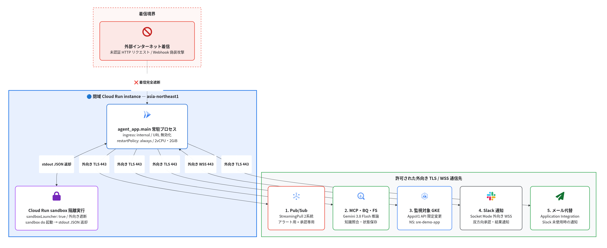
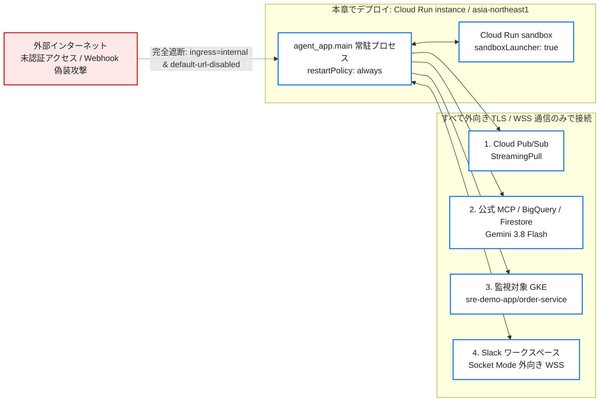
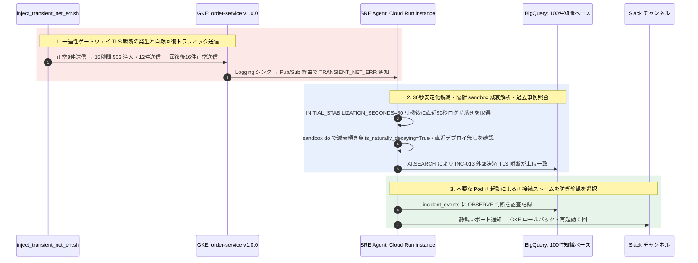
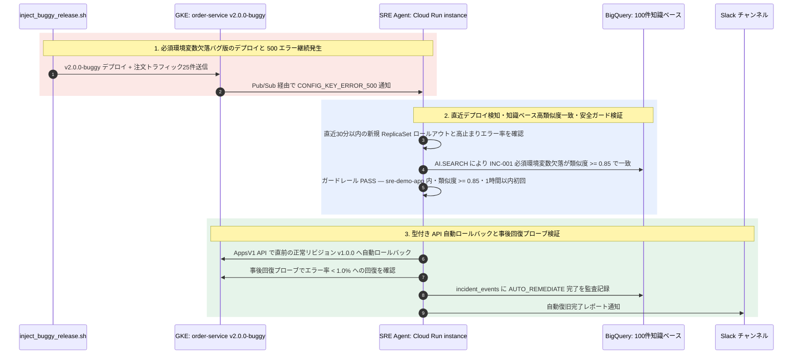
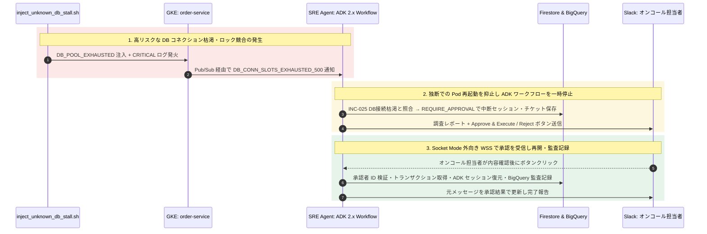
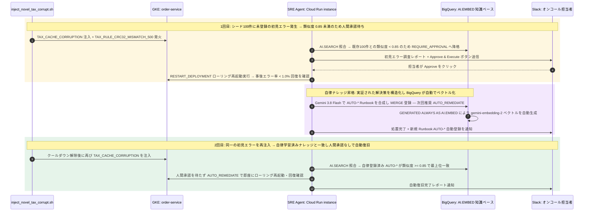

# 第 5 章：Cloud Run instances への閉域常駐デプロイと 4 大障害訓練 (`05-deploy-cloud-run-instance-and-drills.md`)

**所要時間**: 約 45 分  
**到達目標**: 常駐 SRE エージェントを **Cloud Run instances**（`--sandbox-launcher --ingress internal --no-default-url`）へデプロイし、GKE 上の監視対象アプリに 4 種類の本番想定障害を注入して「静観」「自動ロールバック＋回復確認」「高リスク DB 障害の人間承認」「初見障害の自律ナレッジ学習と 2 回目の全自動復旧」を一気通貫で検証する。

---

## 1. この章で作る場所と通信境界（現在地マップ）

ついにすべての部品を結合し、**Cloud Run instances 上の完全閉域・常駐エージェント** を本稼働させます。



<details>
<summary>詳細: Mermaid ソースを表示</summary>



</details>

### なぜ Cloud Run Services ではなく Cloud Run instances なのか？

* **Cloud Run Services** は着信 HTTP リクエストに応じてオートスケール・スケールトゥゼロする設計のため、リクエストが来ない夜間などにバックグラウンドの WebSocket（Slack Socket Mode）や StreamingPull を維持し続けるシングルトン常駐プロセスには向きません。
* **Cloud Run instances** はサーバーレスの運用手軽さを保ったまま、軽量 VM のように `create` / `stop` / `start` で単一コンテナを常時稼働でき、さらに `--sandbox-launcher` によって隔離サブサンドボックスをミリ秒起動できます。

> [!WARNING]
> Cloud Run instances は `us-central1`・`us-east1`・`europe-west1` では利用できません。必ず `.env` の `GOOGLE_CLOUD_REGION` が `asia-northeast1` などの対応リージョンになっていることを確認してください。

---

## 2. SRE エージェントのコンテナビルドと Cloud Run instance 作成

### Step 2.1 コンテナイメージのビルド

リポジトリルートから [sre-agent/cloudbuild.yaml](../sre-agent/cloudbuild.yaml) と [sre-agent/Dockerfile](../sre-agent/Dockerfile) を使ってビルドし、Artifact Registry へ登録します（`.gcloudignore` により `.venv` や `.env` はアップロードから自動除外されます）。

```bash
source .env

export SRE_AGENT_SA_EMAIL="sre-autonomous-agent-sa@${GOOGLE_CLOUD_PROJECT}.iam.gserviceaccount.com"
export SRE_AGENT_IMAGE_URI="${GOOGLE_CLOUD_REGION}-docker.pkg.dev/${GOOGLE_CLOUD_PROJECT}/sre-handson/sre-autonomous-agent"

gcloud builds submit . \
  --config=./sre-agent/cloudbuild.yaml \
  --substitutions="_IMAGE_URI=${SRE_AGENT_IMAGE_URI}:latest" \
  --project="${GOOGLE_CLOUD_PROJECT}"
```

### Step 2.2 完全閉域・サンドボックス有効化設定でのインスタンス起動

`--sandbox-launcher`、`--ingress internal`、`--no-default-url` をすべて指定してインスタンスを作成します（`gcloud beta` コンポーネントが未導入の場合は事前に `gcloud components install beta --quiet` を実行してください）。

> [!NOTE]
> Cloud Run instances の仕様上、`--ingress=internal` を指定する場合はコンテナに待受ポート（`--port=8080`）が必須となるため、`agent_app/main.py` にはコマンド実行や変更機能を持たない読み取り専用の `/healthz` 応答エンドポイントのみを最小実装しています。

```bash
# Slack トークンを Secret Manager に登録済みの場合は --set-secrets を付与します
SLACK_SECRET_FLAGS=()
if gcloud secrets describe sre-slack-bot-token --project="${GOOGLE_CLOUD_PROJECT}" >/dev/null 2>&1; then
  SLACK_SECRET_FLAGS=(
    "--set-secrets=SLACK_BOT_TOKEN=sre-slack-bot-token:latest,SLACK_APP_TOKEN=sre-slack-app-token:latest"
  )
fi

gcloud beta run instances deploy sre-autonomous-agent \
  --image="${SRE_AGENT_IMAGE_URI}:latest" \
  --region="${GOOGLE_CLOUD_REGION}" \
  --service-account="${SRE_AGENT_SA_EMAIL}" \
  --restart-policy=always \
  --port=8080 \
  --cpu=2 \
  --memory=2Gi \
  --sandbox-launcher \
  --ingress=internal \
  --no-default-url \
  --set-env-vars="^@^GOOGLE_CLOUD_PROJECT=${GOOGLE_CLOUD_PROJECT}@GOOGLE_CLOUD_REGION=${GOOGLE_CLOUD_REGION}@GOOGLE_CLOUD_LOCATION=global@GOOGLE_GENAI_USE_ENTERPRISE=True@SRE_TRIAGE_MODEL=${SRE_TRIAGE_MODEL}@SRE_EMBEDDING_MODEL=${SRE_EMBEDDING_MODEL}@ADK_CAPTURE_MESSAGE_CONTENT_IN_SPANS=false@ALERT_PUBSUB_SUBSCRIPTION=${ALERT_PUBSUB_SUBSCRIPTION}@BQ_DATASET=${BQ_DATASET}@BQ_CONNECTION_ID=${BQ_CONNECTION_ID:-sre_genai_conn}@ENABLE_AUTONOMOUS_KB_LEARNING=${ENABLE_AUTONOMOUS_KB_LEARNING:-true}@ALLOW_DRILL_COOLDOWN_RESET=true@GKE_CLUSTER_NAME=${GKE_CLUSTER_NAME}@GKE_CLUSTER_LOCATION=${GKE_CLUSTER_LOCATION}@ALLOWED_K8S_NAMESPACES=${ALLOWED_K8S_NAMESPACES}@SANDBOX_MODE=cloud_run@INITIAL_STABILIZATION_SECONDS=30@SESSION_BACKEND=firestore@FIRESTORE_DATABASE=(default)@SLACK_ALERT_CHANNEL_ID=${SLACK_ALERT_CHANNEL_ID}@SLACK_ALLOWED_APPROVER_IDS=${SLACK_ALLOWED_APPROVER_IDS:-}" \
  ${SLACK_SECRET_FLAGS[@]+"${SLACK_SECRET_FLAGS[@]}"} \
  --project="${GOOGLE_CLOUD_PROJECT}"
```

> [!TIP]
> `INITIAL_STABILIZATION_SECONDS=30` を設定することで、単発のエラーログが Pub/Sub に到着した直後に即断せず、30 秒間の観測ウィンドウで直近のエラー率バケット推移を集計して「一時的スパイクの自然減衰」と「持続障害」を高精度に区別します。また、ハンズオン訓練で同一シナリオを待たずに連続再検証できるよう `ALLOW_DRILL_COOLDOWN_RESET=true` を有効化しています（本番環境では既定値 `false` に戻してください）。

### デプロイ設定の確認（Verification）

以下のコマンドで、`sandboxLauncher: true` が有効化され、かつ公開 URL が無効化されていることを確認します。

```bash
gcloud beta run instances describe sre-autonomous-agent \
  --region="${GOOGLE_CLOUD_REGION}" \
  --project="${GOOGLE_CLOUD_PROJECT}"
```

また、別ターミナルでエージェントの構造化ログを表示しておくと、以降の障害訓練の動きをリアルタイムに追跡できます。

```bash
gcloud logging read \
  'resource.labels.instance_name="sre-autonomous-agent" AND NOT jsonPayload.message:"重複排除スキップ"' \
  --limit=25 \
  --project="${GOOGLE_CLOUD_PROJECT}" \
  --format='table(timestamp,severity,jsonPayload.incident_id,jsonPayload.decision,jsonPayload.matched_runbook_id,jsonPayload.message,textPayload)'
```

> [!NOTE]
> `agent_app/main.py` と `workflow.py` はステップ経過を標準出力（JSON 構造化ログ）へ出力するため、`gcloud beta run instances logs read` のデフォルト表示では `jsonPayload` 行が空行に見えることがあります。上記の `gcloud logging read` を使うと、判定結果や Runbook 一致情報を一覧で確認できます。

---

## 3. 実戦障害訓練（4 大シナリオの検証）

### 訓練 1：一時的な下流ネットワーク瞬断 → 「静観（OBSERVE）」の検証

事前ベースラインリクエストの後、15 秒間だけ下流決済ゲートウェイの TLS 瞬断（`UPSTREAM_CONN_RESET_503`）を発生させ、自然回復を確認するシナリオを注入します。


<details>
<summary>詳細: Mermaid ソースを表示</summary>



</details>

```bash
./target-app/scripts/inject_transient_net_err.sh
```

**確認ポイント**:
* Slack（または Cloud Logging）に `decision: "OBSERVE"`・類似事例 `INC-013` のレポートが出力されること。
* `kubectl rollout history deployment/order-service -n sre-demo-app` のリビジョンが変わっておらず、無駄な再起動が行われていないこと。

---

### 訓練 2：既知の設定欠落バグを含む `v2` デプロイ → 「自動ロールバック＋回復確認」の検証

必須環境変数 `PAYMENT_CURRENCY_PRECISION` が漏れた `v2.0.0-buggy` を GKE にロールアウトし、HTTP 500（`CONFIG_KEY_ERROR_500`）を発生させます。


<details>
<summary>詳細: Mermaid ソースを表示</summary>



</details>

```bash
export TARGET_APP_IMAGE_URI="${GOOGLE_CLOUD_REGION}-docker.pkg.dev/${GOOGLE_CLOUD_PROJECT}/sre-handson/order-service"
./target-app/scripts/inject_buggy_release.sh
```

**確認ポイント**:
* 約 30〜60 秒後に `kubectl get pods -n sre-demo-app -L version` を実行すると、エージェントによって自動的に `version=v1.0.0` の正常 Pod へロールバックされていること！
* BigQuery の監査テーブルにも記録が残っていることを確認します。

```bash
bq query --project_id="${GOOGLE_CLOUD_PROJECT}" --location="${GOOGLE_CLOUD_REGION}" --use_legacy_sql=false \
  'SELECT created_at, incident_id, error_code, decision, remediation_type, matched_runbook_id, ROUND(similarity_score, 3) AS sim, verification_passed FROM `sre_agent_ops.incident_events` ORDER BY created_at DESC LIMIT 5'
```

---

### 訓練 3：未知・高リスクの DB ロック競合 → 「一時停止 ＆ Slack 承認ボタン連携」の検証

DB コネクションスロット枯渇と行ロック待ち（`DB_CONN_SLOTS_EXHAUSTED_500`）を注入します。アプリを勝手に再起動すると DB がダウンする危険な事象です。


<details>
<summary>詳細: Mermaid ソースを表示</summary>



</details>

```bash
./target-app/scripts/inject_unknown_db_stall.sh
```

**確認ポイント**:
* エージェントが勝手に Deployment を変更せず一時停止し、Firestore の `adk-session` と `sre_pending_approval_tickets` へ中断状態が永続化されること（待機中にインスタンスを再起動しても途中再開可能）。
* Slack 上に `[Approve & Execute]` と `[Reject (Manual Triage)]` ボタンが届き、許可されたユーザー ID がボタンを押すと即座に ADK セッションが再開されてメッセージが `✅ 承認・実行完了` へ更新されること（なお `INC-025` は `MANUAL_INTERVENTION` 種別の DB 障害であるため GKE への無断再起動は行わず、オンコール担当者の手動調査引き継ぎ確認として記録されます。中リスクの Deployment 再起動等であれば承認後に型付き復旧が実行されます）。
* BigQuery `sre_agent_ops.incident_events` に `REQUIRE_APPROVAL` に続いて `APPROVED_EXECUTED` の監査行が追記されること。

```bash
bq query --project_id="${GOOGLE_CLOUD_PROJECT}" --location="${GOOGLE_CLOUD_REGION}" --use_legacy_sql=false \
  'SELECT created_at, incident_id, error_code, decision, remediation_type, matched_runbook_id, ROUND(similarity_score, 3) AS sim, verification_passed FROM `sre_agent_ops.incident_events` ORDER BY created_at DESC LIMIT 6'
```

* 訓練 3 の確認が完了したら、擬似障害フラグを正常状態へ戻します。

```bash
./target-app/scripts/reset_fault.sh
```

---

### 訓練 4：初見のインメモリ税率テーブル破損 → 「1 回目 Slack 承認＆自律ナレッジ登録 → 2 回目全自動復旧」の検証

最後に、初期シード 100 件には存在しない**まったく初見の障害**（インメモリ消費税ルックアップテーブルの CRC32 チェックサム破損：`TAX_RULE_CRC32_MISMATCH_500`）を注入し、**人間が 1 度承認して解決した障害をエージェントが自律学習し、2 回目から人間介入ゼロで自動復旧させる自己成長ループ**を検証します。

> [!IMPORTANT]
> 訓練 4 では Slack の `[Approve & Execute]` ボタン押下をトリガーとして再開・ナレッジ昇格を行うため、第 4 章 Step 5 の Slack App 連携が設定済みであることを前提とします。


<details>
<summary>詳細: Mermaid ソースを表示</summary>



</details>

#### ステップ A：1 回目の注入（初見エラーのため Slack 承認待ち → ローリング再起動 → 自律ナレッジ登録）

```bash
./target-app/scripts/inject_novel_tax_corrupt.sh
```

1. 既存 100 件との類似度スコアが `0.85` 未満となるため、安全ガードレールが自動的に `REQUIRE_APPROVAL` へ振り分け、Slack に調査レポートと `[Approve & Execute]` ボタンを投稿します。
2. Slack で **`[Approve & Execute]`** をクリックすると、エージェントは `RESTART_DEPLOYMENT`（ゼロダウンタイムのローリング再起動）を実行して破損したインメモリキャッシュをクリアし、事後エラー率が `1.0%` 未満へ回復したことを確認します。
3. 回復確認の直後、エージェントが自動的に `AUTO-*` ID の構造化 Runbook を BigQuery `incident_runbooks` へ `MERGE` 登録し、Slack メッセージ末尾に `🧠 自律ナレッジ登録完了` と表示されます。

#### ステップ B：BigQuery `AI.EMBED` バックグラウンド埋め込み完了の確認とクールダウン解除

新規追加された `AUTO-*` レコードに対して、BigQuery の自動埋め込み生成が完了（`embedding.status = ''`）したことを確認してから、連続検証用にクールダウンを解除します。

```bash
# 1. 自律登録された AUTO-* Runbook と AI.EMBED ベクトル生成完了（embedded = true）の確認（約 15〜45 秒）
for i in $(seq 1 8); do
  bq query --project_id="${GOOGLE_CLOUD_PROJECT}" --location="${GOOGLE_CLOUD_REGION}" --use_legacy_sql=false \
    'SELECT
       runbook_id,
       recommended_action,
       remediation_type,
       (embedding IS NOT NULL AND embedding.status = "") AS embedded,
       SUBSTR(title, 1, 45) AS title_preview
     FROM `sre_agent_ops.incident_runbooks`
     WHERE STARTS_WITH(runbook_id, "AUTO-")'
  sleep 8
done

# 2. embedded = true になったことを確認したら、訓練用の 15 分クールダウン・1 時間上限を即時解除
./target-app/scripts/reset_fault.sh --reset-cooldown
```

#### ステップ C：2 回目の同一障害注入（人間承認ゼロでの `AUTO_REMEDIATE` 自動復旧を確認）

```bash
./target-app/scripts/inject_novel_tax_corrupt.sh
```

**確認ポイント**:
* 今度は BigQuery `AI.SEARCH` が先ほど自律登録された `AUTO-*` Runbook を類似度 `0.85` 以上で最上位ヒットさせるため、**Slack の承認ボタンを待たずに `AUTO_REMEDIATE` ルートへ直行**し、自動的に Pod がローリング再起動されて回復すること！
* `incident_events` 監査テーブルで、1 回目の `REQUIRE_APPROVAL` → `APPROVED_EXECUTED` から、2 回目の `AUTO_REMEDIATE`（`matched_runbook_id = "AUTO-..."`）へ進化した履歴を確認します。

```bash
bq query --project_id="${GOOGLE_CLOUD_PROJECT}" --location="${GOOGLE_CLOUD_REGION}" --use_legacy_sql=false \
  'SELECT created_at, incident_id, error_code, decision, remediation_type, matched_runbook_id, ROUND(similarity_score, 3) AS sim, verification_passed FROM `sre_agent_ops.incident_events` ORDER BY created_at DESC LIMIT 8'
```

### 💡 トラブルシューティングのヒント

* **単発の `McpError: Server returned an error response` がログに出る場合**: LLM がリモート MCP ツールのフィルタ引数を初回試行で誤り、サーバーが入力補正エラーを返すことがあります。ADK のツール機構がエラーメッセージをモデルへ返して自動リトライするため、後続ステップで `Gemini トリアージ推論を完了しました` と記録されていれば正常動作です。全ツール呼び出しが連続失敗する場合のみ、`roles/mcp.toolUser` と `roles/serviceusage.serviceUsageConsumer` の付与を確認してください。
* **訓練直後に同じ訓練をすぐ再実行したい場合**: `ALLOW_DRILL_COOLDOWN_RESET=true` を設定した検証環境では `./target-app/scripts/reset_fault.sh --reset-cooldown` を実行することで、15 分間のクールダウンと 1 時間 1 回上限を即時リセットできます。

---

## 🤖 AI コーディングエージェントを使う場合の指示プロンプト

```markdown
`AGENTS.md` と `.env` を読み込み、第5章（`docs/05-deploy-cloud-run-instance-and-drills.md`）のデプロイと 4 つの障害訓練を順番に実行してください。
- `sre-autonomous-agent` イメージのビルドと `gcloud beta run instances deploy` はコマンド全文を提示し、私の `y` 承認後に実行すること。
- 訓練 1・訓練 2・訓練 3・訓練 4 は 1 つずつ実行し、各訓練の後に `kubectl get pods -n sre-demo-app -L version` と BigQuery `incident_events` / `incident_runbooks` テーブルの記録結果を確認して報告すること。
```

---

## Links and References

* [Configure sandboxes for instances (Cloud Run)](https://docs.cloud.google.com/run/docs/configuring/instances/sandboxes) — `--sandbox-launcher` 設定ガイド
* [Restrict network endpoint ingress for Cloud Run](https://docs.cloud.google.com/run/docs/securing/ingress) — `--ingress=internal` と `--no-default-url` の組み合わせ仕様

次へ進む 👉 [第 6 章：【任意ステップアップ】GKE Sandbox (microVM)・Model Armor・反復評価とクリーンアップ](06-optional-hardening-and-cleanup.md)
