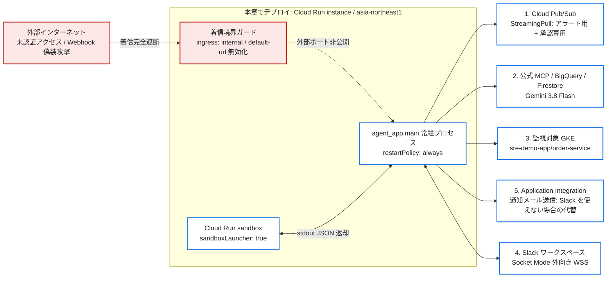
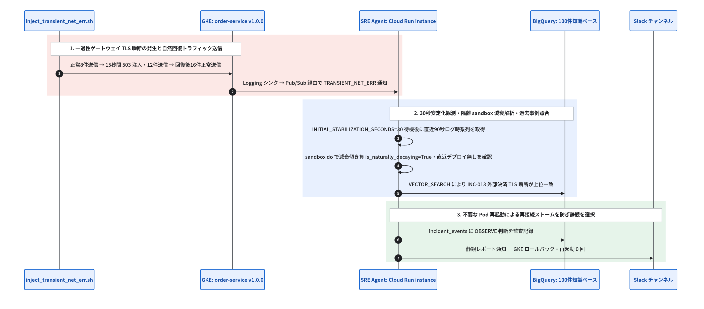
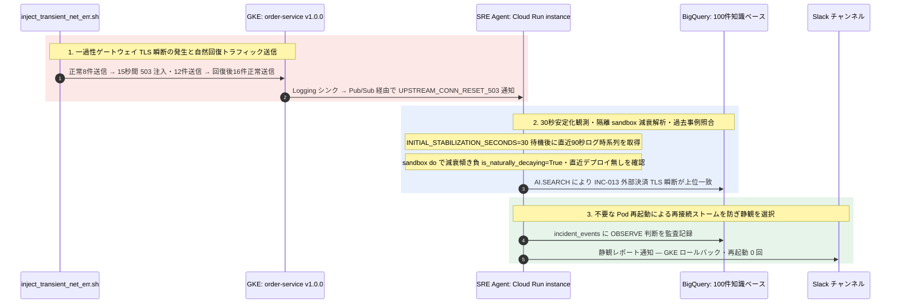
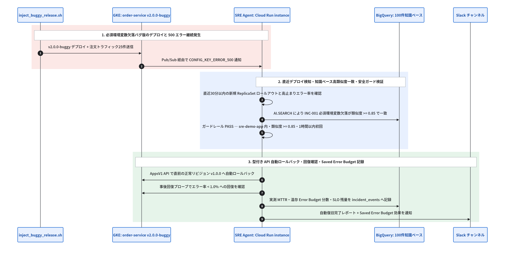
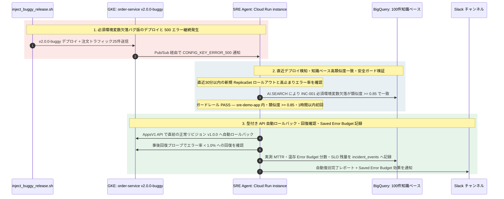
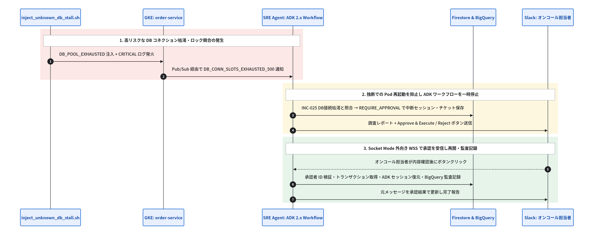
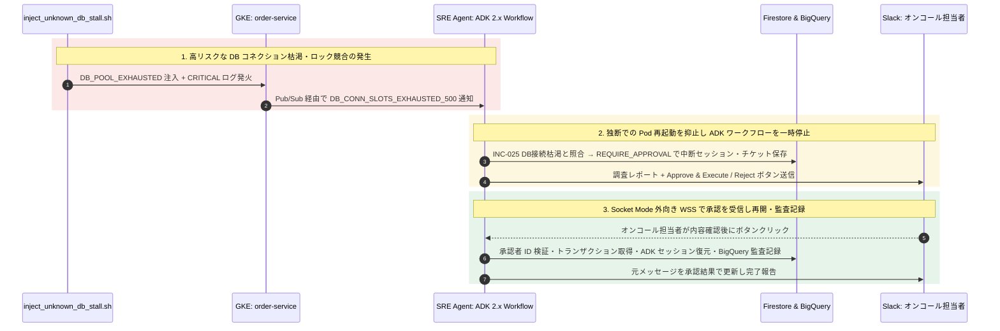
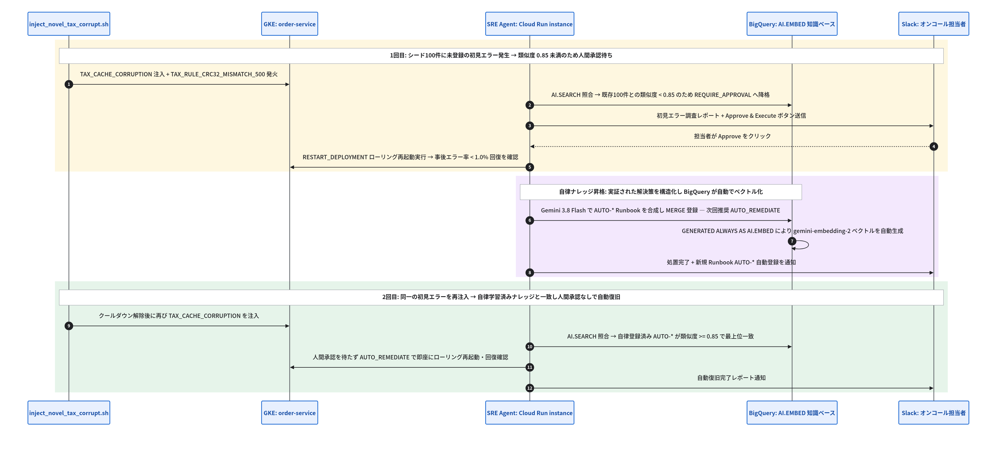
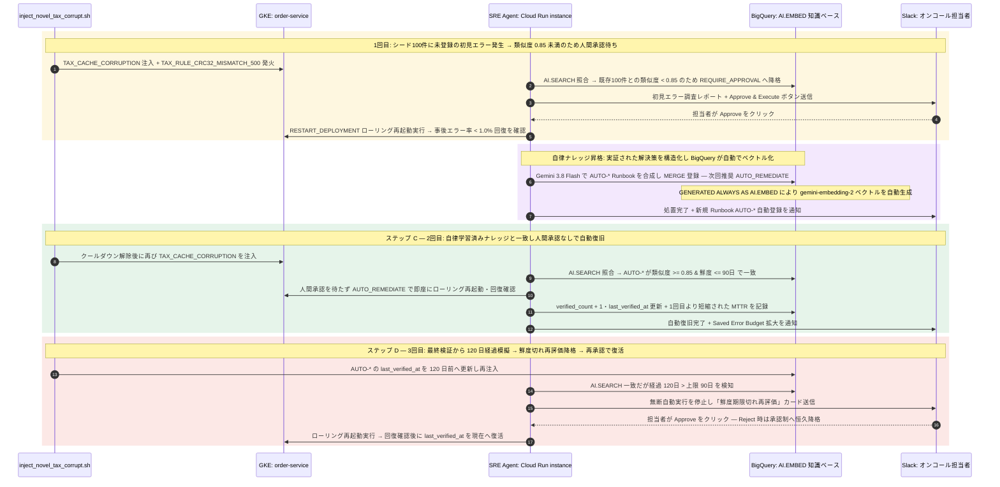

# 第 5 章：閉域常駐デプロイ・4 大障害訓練・Error Budget 温存効果の実測 (`05-deploy-cloud-run-instance-and-drills.md`)

**所要時間**: 約 50 分  
**到達目標**: 常駐 SRE エージェントを **Cloud Run instances**（`--sandbox-launcher --ingress internal --no-default-url`）へデプロイし、4 種類の本番想定障害を通して「静観」「自動ロールバック」「高リスク DB 障害の人間承認引継」「初見障害の自律学習と鮮度再評価」、および**訓練前後の Error Budget 消費比較と温存効果の定量証明**を一気通貫で検証する。

---

## 1. この章で作る場所と通信境界（現在地マップ）

すべての構成要素を結合し、**公開 URL を一切持たない閉域・常駐エージェント**を稼働させます。


<details>
<summary>詳細: Mermaid ソースを表示</summary>



</details>

* **なぜ Cloud Run Services ではなく Cloud Run instances なのか**: リクエスト駆動でスケールトゥゼロする Cloud Run Services と異なり、Cloud Run instances は単一コンテナを常時稼働させて Pub/Sub StreamingPull と Slack Socket Mode WebSocket を維持でき、さらに `--sandbox-launcher` で隔離サンドボックスを即起動できます。
* **共有 CPU 特性とサンドボックス並列制御**: Cloud Run instances は共有 CPU モデル（1 vCPU あたり定常 6.25%・最大 500 CPU 秒バースト）であり、隔離サンドボックスも同じ CPU・メモリ枠を共有します。本エージェントの処理時間の 98% 以上はネットワーク待機で CPU 消費は 1 件あたり約 1 秒未満ですが、複数アラート同時着信時の瞬間負荷を抑えるため `MAX_CONCURRENT_SANDBOXES=2` のセマフォでサンドボックスの同時起動数を制限しています。重い統計解析を常時回す場合は第 6 章の GKE Standard `microVM` 構成を選択してください。
* **代替ルートも外向き通信だけで成立**: 通知メールの送信は Application Integration の API 呼び出し、承認コマンドからの承認は承認専用サブスクリプションの StreamingPull で受け取るため、着信 URL は不要です。
* **閉域 GKE コントロールプレーンへの接続補足**: 本手順の GKE はプライベートノード構成（コントロールプレーン外部到達有効）のためそのまま到達できます。コントロールプレーンの外部エンドポイントも閉じた GKE に接続する場合は、Cloud Run instance に Direct VPC Egress（`--network` / `--subnet`）を付与するか GKE の DNS ベースエンドポイントを使用します。

---

## 2. SRE エージェントのコンテナビルドと閉域インスタンス起動

### Step 2.1 コンテナイメージのビルド

リポジトリルートから [sre-agent/cloudbuild.yaml](../sre-agent/cloudbuild.yaml) でビルドし、Artifact Registry へ登録します。

```bash
source .env

export SRE_BUILD_SA_EMAIL="sre-cloudbuild-sa@${GOOGLE_CLOUD_PROJECT}.iam.gserviceaccount.com"
export SRE_AGENT_SA_EMAIL="sre-autonomous-agent-sa@${GOOGLE_CLOUD_PROJECT}.iam.gserviceaccount.com"
export SRE_AGENT_IMAGE_URI="${GOOGLE_CLOUD_REGION}-docker.pkg.dev/${GOOGLE_CLOUD_PROJECT}/sre-handson/sre-autonomous-agent"

gcloud builds submit . \
  --config=./sre-agent/cloudbuild.yaml \
  --substitutions="_IMAGE_URI=${SRE_AGENT_IMAGE_URI}:latest" \
  --service-account="projects/${GOOGLE_CLOUD_PROJECT}/serviceAccounts/${SRE_BUILD_SA_EMAIL}" \
  --project="${GOOGLE_CLOUD_PROJECT}"
```

### Step 2.2 閉域・サンドボックス有効化設定でのインスタンスデプロイ

`--sandbox-launcher`・`--ingress=internal`・`--no-default-url` を指定して起動します。`INITIAL_STABILIZATION_SECONDS=30` により一過性スパイクと持続障害を正確に識別し、訓練の連続実行用に `ALLOW_DRILL_COOLDOWN_RESET=true` を有効化します（本番運用時は `false` に戻してください）。

第 4 章で準備した通知と承認の経路は、このコマンドがそのまま反映します。Slack のシークレットがあれば Slack 連携が、`.env` に `EMAIL_NOTIFY_INTEGRATION` と `APPROVAL_PUBSUB_SUBSCRIPTION` があればメール通知と承認コマンドが有効になります。

```bash
SLACK_SECRET_FLAGS=()
if gcloud secrets describe sre-slack-bot-token --project="${GOOGLE_CLOUD_PROJECT}" >/dev/null 2>&1; then
  SLACK_SECRET_FLAGS=(
    "--set-secrets=SLACK_BOT_TOKEN=sre-slack-bot-token:latest,SLACK_APP_TOKEN=sre-slack-app-token:latest"
  )
fi

gcloud beta run instances deploy sre-autonomous-agent \
  --image="${SRE_AGENT_IMAGE_URI}:latest" \
  --region="${GOOGLE_CLOUD_REGION}" \
  --service-account="${SRE_AGENT_SA_EMAIL}" \
  --restart-policy=always \
  --port=8080 \
  --cpu=2 \
  --memory=2Gi \
  --sandbox-launcher \
  --ingress=internal \
  --no-default-url \
  --set-env-vars="^@^GOOGLE_CLOUD_PROJECT=${GOOGLE_CLOUD_PROJECT}@GOOGLE_CLOUD_REGION=${GOOGLE_CLOUD_REGION}@GOOGLE_CLOUD_LOCATION=global@GOOGLE_GENAI_USE_ENTERPRISE=True@SRE_TRIAGE_MODEL=${SRE_TRIAGE_MODEL}@SRE_EMBEDDING_MODEL=${SRE_EMBEDDING_MODEL}@ADK_CAPTURE_MESSAGE_CONTENT_IN_SPANS=false@ALERT_PUBSUB_SUBSCRIPTION=${ALERT_PUBSUB_SUBSCRIPTION}@BQ_DATASET=${BQ_DATASET}@BQ_CONNECTION_ID=${BQ_CONNECTION_ID:-sre_genai_conn}@ENABLE_AUTONOMOUS_KB_LEARNING=${ENABLE_AUTONOMOUS_KB_LEARNING:-true}@RUNBOOK_FRESHNESS_TTL_DAYS=${RUNBOOK_FRESHNESS_TTL_DAYS:-90}@ALLOW_DRILL_COOLDOWN_RESET=true@GKE_CLUSTER_NAME=${GKE_CLUSTER_NAME}@GKE_CLUSTER_LOCATION=${GKE_CLUSTER_LOCATION}@ALLOWED_K8S_NAMESPACES=${ALLOWED_K8S_NAMESPACES}@SANDBOX_MODE=cloud_run@INITIAL_STABILIZATION_SECONDS=30@SLO_SERVICE_ID=${SLO_SERVICE_ID:-order-service-slo}@SLO_DAILY_ID=${SLO_DAILY_ID:-order-availability-daily-99}@SLO_MONTHLY_ID=${SLO_MONTHLY_ID:-order-availability-monthly-999}@MANUAL_BASELINE_MTTR_MINUTES=${MANUAL_BASELINE_MTTR_MINUTES:-30.0}@SESSION_BACKEND=firestore@FIRESTORE_DATABASE=(default)@SLACK_ALERT_CHANNEL_ID=${SLACK_ALERT_CHANNEL_ID}@SLACK_ALLOWED_APPROVER_IDS=${SLACK_ALLOWED_APPROVER_IDS:-}@EMAIL_NOTIFY_INTEGRATION=${EMAIL_NOTIFY_INTEGRATION:-}@APPROVAL_PUBSUB_SUBSCRIPTION=${APPROVAL_PUBSUB_SUBSCRIPTION:-}" \
  ${SLACK_SECRET_FLAGS[@]+"${SLACK_SECRET_FLAGS[@]}"} \
  --project="${GOOGLE_CLOUD_PROJECT}"
```

### デプロイとエージェント構造化ログの確認

```bash
gcloud beta run instances describe sre-autonomous-agent \
  --region="${GOOGLE_CLOUD_REGION}" \
  --project="${GOOGLE_CLOUD_PROJECT}"

# 有効になった通知と承認の経路を確認するコマンド（Slack・メール通知・承認コマンドの順に True / False を表示）
gcloud logging read \
  'resource.labels.instance_name="sre-autonomous-agent" AND jsonPayload.message:"通知と承認の経路"' \
  --limit=1 \
  --project="${GOOGLE_CLOUD_PROJECT}" \
  --format='value(jsonPayload.slack_enabled,jsonPayload.email_enabled,jsonPayload.approval_command_enabled)'

# 判定ステップの構造化 JSON ログを確認するコマンド
gcloud logging read \
  'resource.labels.instance_name="sre-autonomous-agent" AND NOT jsonPayload.message:"重複排除スキップ"' \
  --limit=20 \
  --project="${GOOGLE_CLOUD_PROJECT}" \
  --format='table(timestamp,severity,jsonPayload.incident_id,jsonPayload.decision,jsonPayload.matched_runbook_id,jsonPayload.message)'
```

---

## 3. 実戦障害訓練（4 大シナリオと Error Budget 前後比較）

### Step 3.0 訓練開始前の SLO・Error Budget ベースライン保存

第 1 章で起動した定常トラフィックにより健全なベースライン（Error Budget 残量 `100.00%`）が形成されていることを確認し、スナップショットを保存します。あわせて Google Cloud コンソールの **Monitoring → Services → `Order Service`** 画面を開いておくと、以降の訓練中の V 字回復グラフをリアルタイムで観察できます。

```bash
source .env
source .venv/bin/activate
python3 ./target-app/scripts/check_slo_budget.py --save-baseline /tmp/slo_before_drills.json
```

### 承認待ちへの対応方法（訓練 3 と訓練 4 で使用）

承認待ちの通知が届いたら、準備した経路で承認または却下します。

| 経路 | 操作 |
|---|---|
| Slack | 届いたカードの `[Approve & Execute]` または `[Reject]` を押す |
| メール通知と承認コマンド | 承認待ちのメールに書かれたコマンドを実行し、判定内容を確認して `approve` か `reject` を入力する |

```bash
# 承認コマンドの場合。インシデント ID は承認待ちのメールに記載されています
python3 ./target-app/scripts/approve_incident.py <INCIDENT_ID>

# メールが届かない場合は、引数なしで実行すると承認待ちの一覧を表示します
python3 ./target-app/scripts/approve_incident.py
```

承認コマンドを実行した際の対話表示例は以下の通りです。

```text
========================================================================
承認待ちインシデント [a1b2c3d4e5f6g7h8]
  対象         : sre-demo-app/order-service
  操作種別     : RESTART_DEPLOYMENT
  類似過去事例 : INC-001 (類似度 0.72)
  根本原因仮説 : 税率テーブルのインメモリキャッシュ CRC32 破損による 500 エラー継続
  提案内容     : Deployment のローリング再起動を実施し、エラー率 1.0% 未満への回復を確認
========================================================================
実行を承認する場合は approve、手動対応へ切り替える場合は reject を入力してください: approve
承認イベントを sre-approval-decisions へ発行しました（操作者: you@example.com）。結果は通知メールで確認してください。
```

承認コマンドは承認または却下を発行したら終了し、結果は承認結果のメールで届きます。結果が届かない場合は、エージェントが承認をどう処理したかをログで確認します。`STATUS` が `applied` 以外の承認は実行されていません。

```bash
gcloud logging read \
  'resource.labels.instance_name="sre-autonomous-agent" AND jsonPayload.message:"承認コマンドからの承認・却下を処理しました"' \
  --limit=3 \
  --project="${GOOGLE_CLOUD_PROJECT}" \
  --format='table(timestamp,jsonPayload.incident_id,jsonPayload.status,jsonPayload.detail)'
```

---

### 訓練 1：一時的な下流ネットワーク瞬断 → 「静観（OBSERVE）」の検証

15 秒間だけ下流決済ゲートウェイの TLS 瞬断（`UPSTREAM_CONN_RESET_503`）を注入します。



<details>
<summary>詳細: Mermaid ソースを表示</summary>



</details>

```bash
./target-app/scripts/inject_transient_net_err.sh
```

**確認ポイント**:
* Slack またはメールに `OBSERVE`（類似事例 `INC-013`）と「不要な Pod 再起動による二次障害・追加バジェット流出を防止」のレポートが届き、Deployment リビジョンが変化していないこと。

届くレポート通知の実例は以下の通りです。

```text
SRE Agent Report [5m4fmm6attxchacf]
判定結果: 🟢 静観 (OBSERVE - 一過性エラーのため変更なし)
対象: sre-demo-app/order-service  |  類似過去事例: INC-013 (類似度 0.89 / 最終検証 7日前)
操作種別: NONE
根本原因の推定: 外部決済事業者のエッジロードバランサ切り替え等に伴う一時的な TLS ハンドシェイク接続リセット。
判断根拠: 実トラフィック上のエラー率が既に 0.0% へ自然減衰（is_naturally_decaying=True）しており、過去事例 INC-013 の推奨アクションも OBSERVE であるため静観とする。
📊 SLO & Error Budget 効果: 自然減衰を 58秒 で確認し静観 — 不要な Pod 再起動による再接続ストームと追加の Error Budget 流出を防止
⚠️ 回避した誤対応: この状態で Pod を一斉再起動すると確立済みの正常な TLS コネクションプールまで破棄され、再ハンドシェイク嵐で障害が長引く。
```

---

### 訓練 2：バグ入り `v2` デプロイ → 「自動ロールバック ＆ Error Budget 温存効果」の検証

必須環境変数 `PAYMENT_CURRENCY_PRECISION` が欠落した `v2.0.0-buggy` をデプロイし、持続的な HTTP 500（`CONFIG_KEY_ERROR_500`）を発生させます。



<details>
<summary>詳細: Mermaid ソースを表示</summary>



</details>

```bash
export TARGET_APP_IMAGE_URI="${GOOGLE_CLOUD_REGION}-docker.pkg.dev/${GOOGLE_CLOUD_PROJECT}/sre-handson/order-service"
./target-app/scripts/inject_buggy_release.sh

# 自動ロールバック完了と Cloud Monitoring の 1 分集計窓反映を待ってから前後比較を実行
sleep 90
kubectl get pods -n sre-demo-app -L version
python3 ./target-app/scripts/check_slo_budget.py --compare-baseline /tmp/slo_before_drills.json
```

**確認ポイント**:
* `order-service` が自動的に `version=v1.0.0` へロールバックされ、実測 MTTR 約 70〜90 秒（約 1.3 分）で回復していること。
* `check_slo_budget.py --compare-baseline` と自動復旧完了の通知において、**手動対応 30 分なら月次 99.9% バジェット（43.2 分）の約 70% を失っていたところを数 % の消費に抑え、約 27〜28 分の Error Budget を温存できたこと**が確認できること。

`check_slo_budget.py --compare-baseline` の実測出力例は以下の通りです。

```text
=== Service Monitoring SLO & Error Budget 前後比較レポート ===
対象サービス : order-service-slo
  [日次 99.0% 可用性 SLO] 残量: 100.00% -> 79.17% (消費 20.83 pt / 許容停止枠 14.4分)
  [月次 99.9% 可用性 SLO] 残量: 100.00% -> 93.06% (消費  6.94 pt / 許容停止枠 43.2分)
  ※ 自動ロールバック (MTTR 約 82.1 秒) により、手動対応 30.0 分想定と比べて月次バジェット約 +28.63 分を温存
```

---

### 訓練 3：高リスク DB ロック競合 → 「自動一時停止 ＆ 人間承認引継」の検証

DB コネクションスロット枯渇と行ロック待ち（`DB_CONN_SLOTS_EXHAUSTED_500`）を注入します。



<details>
<summary>詳細: Mermaid ソースを表示</summary>



</details>

```bash
./target-app/scripts/inject_unknown_db_stall.sh
```

**確認ポイント**:
* エージェントが無断再起動を行わず一時停止し、承認待ちの通知が届くこと。
* **Slack で承認した場合**: `[Approve & Execute]` を押した瞬間に `⏳ 承認受付・実行中...` → `✅ 承認・実行完了` へ更新されること。
* **承認コマンドで承認した場合**: `approve` を入力した数秒後に、件名 `承認・手動対応へ引き継ぎ` のメールが届くこと。
* `MANUAL_INTERVENTION` のため架空の復旧時間は計上せず、手動調査引継として記録されること。
* 確認後、擬似障害を解除します。

```bash
./target-app/scripts/reset_fault.sh
```

---

### 訓練 4：初見の税率キャッシュ破損 → 「1 回目承認学習 → 2 回目全自動復旧 → 鮮度再評価」の検証

初期シード 100 件に未登録の初見障害（`TAX_RULE_CRC32_MISMATCH_500`）を注入し、**1 回目の人間承認解決から自律学習して 2 回目に MTTR と Error Budget 消費をさらに短縮する進化**と、**90 日超過時の安全降格**を検証します。



<details>
<summary>詳細: Mermaid ソースを表示</summary>



</details>

#### ステップ A：1 回目の注入（承認 → ローリング再起動 → `AUTO-*` 自律登録）

```bash
./target-app/scripts/inject_novel_tax_corrupt.sh
# 承認待ちの通知が届いたら承認します（Slack のボタン、または承認コマンド）
```

#### ステップ B：`AI.EMBED` 自動埋め込み完了の確認とクールダウン解除

ステップ A のローリング再起動によってインメモリの破損状態はすでに初期化されています。ここでは自動登録された `AUTO-*` 手順のベクトル生成完了を確認し、連続訓練用にクールダウン制限を解除します。

```bash
for i in $(seq 1 8); do
  OUT=$(bq query --project_id="${GOOGLE_CLOUD_PROJECT}" --location="${GOOGLE_CLOUD_REGION}" --use_legacy_sql=false --format=pretty \
    'SELECT runbook_id, recommended_action, (embedding IS NOT NULL AND embedding.status = "") AS embedded, verified_count FROM `sre_agent_ops.incident_runbooks` WHERE STARTS_WITH(runbook_id, "AUTO-")')
  echo "${OUT}"
  [[ "${OUT}" == *"true"* ]] && break
  sleep 8
done

./target-app/scripts/reset_fault.sh --reset-cooldown
```

#### ステップ C：2 回目の同一障害注入（人間待ちゼロで `AUTO_REMEDIATE` ＆ MTTR さらなる短縮）

```bash
python3 ./target-app/scripts/check_slo_budget.py --save-baseline /tmp/slo_before_drill4_auto.json
./target-app/scripts/inject_novel_tax_corrupt.sh
sleep 90
python3 ./target-app/scripts/check_slo_budget.py --compare-baseline /tmp/slo_before_drill4_auto.json
```

#### ステップ D：Runbook 鮮度期限切れ（120 日経過）模擬と再承認リフレッシュ

```bash
bq query --project_id="${GOOGLE_CLOUD_PROJECT}" --location="${GOOGLE_CLOUD_REGION}" --use_legacy_sql=false \
  'UPDATE `sre_agent_ops.incident_runbooks`
   SET last_verified_at = TIMESTAMP_SUB(CURRENT_TIMESTAMP(), INTERVAL 120 DAY)
   WHERE STARTS_WITH(runbook_id, "AUTO-")'

./target-app/scripts/reset_fault.sh --reset-cooldown
sleep 8
./target-app/scripts/inject_novel_tax_corrupt.sh
# 「鮮度期限切れの再評価」の承認待ち通知が届くことを確認し、承認して鮮度を復活させます
```

* **ワンポイント確認（`Reject` による自動実行の恒久凍結）**: ステップ D の承認待ちで `Reject`（却下）を選んだ場合は、`incident_runbooks` 内の該当 `AUTO-*` 行の `recommended_action` が自動的に `REQUIRE_APPROVAL` へ書き換えられ、以後の無断自動実行が恒久的に凍結されます。以下のクエリで状態を確認できます。

```bash
bq query --project_id="${GOOGLE_CLOUD_PROJECT}" --location="${GOOGLE_CLOUD_REGION}" --use_legacy_sql=false \
  'SELECT runbook_id, recommended_action, verified_count, last_verified_at FROM `sre_agent_ops.incident_runbooks` WHERE STARTS_WITH(runbook_id, "AUTO-")'
```

---

## 4. 全訓練を通じた Error Budget 温存効果の総括集計（BigQuery 監査 SQL）

最後に、BigQuery `incident_events` に蓄積された全インシデントの実測 MTTR と温存できた合計 Error Budget 分数（Saved Error Budget）を集計します。

```bash
bq query --project_id="${GOOGLE_CLOUD_PROJECT}" --location="${GOOGLE_CLOUD_REGION}" --use_legacy_sql=false \
  'SELECT
     created_at,
     incident_id,
     error_code,
     decision,
     matched_runbook_id,
     ROUND(mttr_seconds, 1) AS mttr_sec,
     ROUND(saved_error_budget_minutes, 2) AS saved_budget_min,
     ROUND(slo_budget_remaining_pct, 1) AS daily_slo_rem_pct
   FROM `sre_agent_ops.incident_events`
   WHERE decision != "ADMIN_RESET"
   ORDER BY created_at ASC'
```

期待される監査記録の推移例（訓練 1〜4 ステップ D まで実施した場合の 9 行）は以下の通りです。`TAX_RULE_CRC32_MISMATCH_500` が 1 回目の承認解決を経て 2 回目に `AUTO-*` で自動復旧へ進化し、120 日経過模擬では再び承認待ちへ安全降格していることが一目で確認できます。

| 訓練 | `error_code` | `decision` | `matched_runbook_id` | `mttr_sec` | `saved_budget_min` |
|---|---|---|---|---:|---:|
| 訓練 1 | `UPSTREAM_CONN_RESET_503` | `OBSERVE` | `INC-013` | 55.6 | 0.00 |
| 訓練 2 | `CONFIG_KEY_ERROR_500` | `AUTO_REMEDIATE` | `INC-001` | 82.1 | 28.63 |
| 訓練 3 | `DB_CONN_SLOTS_EXHAUSTED_500` | `REQUIRE_APPROVAL` | `INC-025` | NULL | NULL |
| 訓練 3 | `DB_CONN_SLOTS_EXHAUSTED_500` | `APPROVED_EXECUTED` | `INC-025` | NULL | NULL |
| 訓練 4-A | `TAX_RULE_CRC32_MISMATCH_500` | `REQUIRE_APPROVAL` | `INC-001` | NULL | NULL |
| 訓練 4-A | `TAX_RULE_CRC32_MISMATCH_500` | `APPROVED_EXECUTED` | `INC-001` | 124.1 | 27.93 |
| 訓練 4-C | `TAX_RULE_CRC32_MISMATCH_500` | `AUTO_REMEDIATE` | `AUTO-AC0B8750` | 97.2 | 28.38 |
| 訓練 4-D | `TAX_RULE_CRC32_MISMATCH_500` | `REQUIRE_APPROVAL` | `AUTO-AC0B8750` | NULL | NULL |
| 訓練 4-D | `TAX_RULE_CRC32_MISMATCH_500` | `APPROVED_EXECUTED` | `AUTO-AC0B8750` | 118.4 | 28.03 |

---

## 🤖 AI コーディングエージェントを使う場合の指示プロンプト

```markdown
`AGENTS.md` と `.env` を読み込み、第5章（`docs/05-deploy-cloud-run-instance-and-drills.md`）のデプロイ・4 大障害訓練・Error Budget 比較を順番に実行してください。
- ビルドと `gcloud beta run instances deploy` はコマンド全文を提示し、私の `y` 承認後に実行すること。
- 訓練開始前に `check_slo_budget.py --save-baseline` を実行し、訓練 1〜4 の実施後に `--compare-baseline` の実測差分と BigQuery `incident_events` の `mttr_sec`・`saved_budget_min` 一覧を表形式で報告すること。
- 承認待ちへの承認と却下は私が行うため、Slack のボタン操作や `approve_incident.py` への `approve`・`reject` の入力を代行しないこと。
```

---

## Links and References

* [Configure sandboxes for instances (Cloud Run)](https://docs.cloud.google.com/run/docs/configuring/instances/sandboxes) — `--sandbox-launcher` 設定ガイド
* [Restrict network endpoint ingress for Cloud Run](https://docs.cloud.google.com/run/docs/securing/ingress) — `--ingress=internal` と `--no-default-url` の組み合わせ仕様
* [Alerting on your burn rate (Cloud Monitoring)](https://docs.cloud.google.com/stackdriver/docs/solutions/slo-monitoring/alerting-on-budget-burn-rate) — Error Budget 燃焼率の評価と運用ガイド

次へ進む 👉 [第 6 章：【任意ステップアップ】GKE Sandbox (microVM)・Model Armor・反復評価とクリーンアップ](06-optional-hardening-and-cleanup.md)
