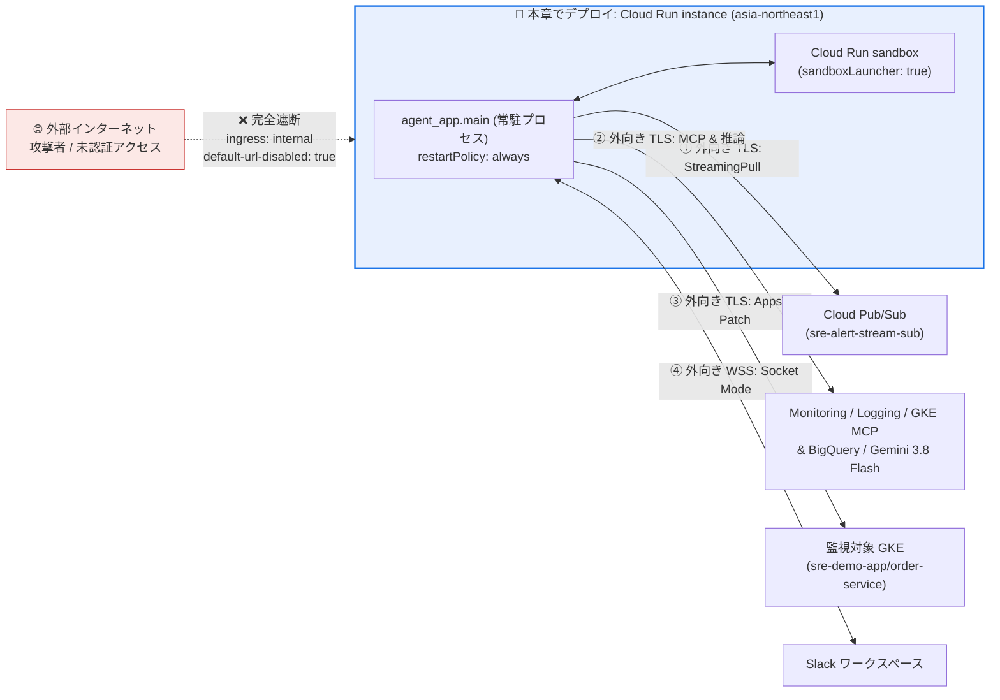
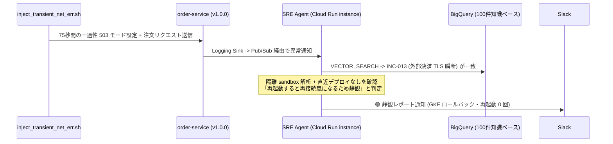
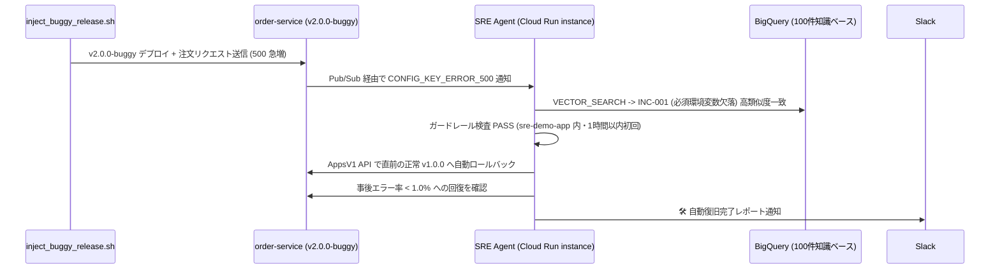
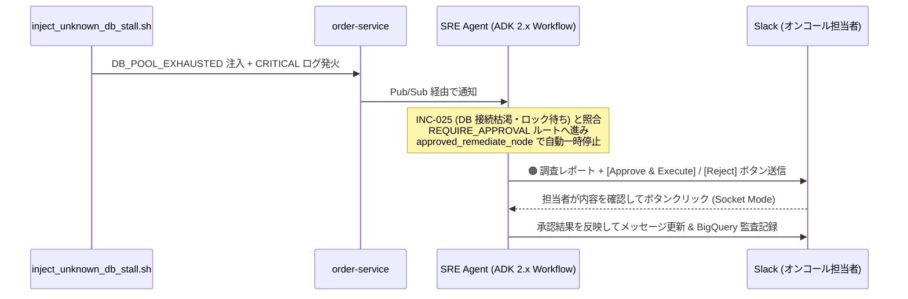

# 第 5 章：Cloud Run instances への閉域常駐デプロイと 3 大障害訓練 (`05-deploy-cloud-run-instance-and-drills.md`)

**所要時間**: 約 45 分  
**到達目標**: 常駐 SRE エージェントを **Cloud Run instances**（`--sandbox-launcher --ingress internal --no-default-url`）へデプロイし、GKE 上の監視対象アプリに 3 種類の本番想定障害を注入して「静観」「自動ロールバック＋回復確認」「人間承認待ち→再開」を一気通貫で検証する。

---

## 1. この章で作る場所と通信境界（現在地マップ）

ついにすべての部品を結合し、**Cloud Run instances 上の完全閉域・常駐エージェント** を本稼働させます。



### なぜ Cloud Run Services ではなく Cloud Run instances なのか？

* **Cloud Run Services** は着信 HTTP リクエストに応じてオートスケール・スケールトゥゼロする設計のため、リクエストが来ない夜間などにバックグラウンドの WebSocket（Slack Socket Mode）や StreamingPull を維持し続けるシングルトン常駐プロセスには向きません。
* **Cloud Run instances** はサーバーレスの運用手軽さを保ったまま、軽量 VM のように `create` / `stop` / `start` で単一コンテナを常時稼働でき、さらに `--sandbox-launcher` によって隔離サブサンドボックスをミリ秒起動できます。

> [!WARNING]
> Cloud Run instances は `us-central1`・`us-east1`・`europe-west1` では利用できません。必ず `.env` の `GOOGLE_CLOUD_REGION` が `asia-northeast1` などの対応リージョンになっていることを確認してください。

---

## 2. SRE エージェントのコンテナビルドと Cloud Run instance 作成

### Step 2.1 コンテナイメージのビルド

リポジトリルートから [sre-agent/Dockerfile](../sre-agent/Dockerfile) を使ってビルドし、Artifact Registry へ登録します。

```bash
source .env

export SRE_AGENT_SA_EMAIL="sre-autonomous-agent-sa@${GOOGLE_CLOUD_PROJECT}.iam.gserviceaccount.com"
export SRE_AGENT_IMAGE_URI="${GOOGLE_CLOUD_REGION}-docker.pkg.dev/${GOOGLE_CLOUD_PROJECT}/sre-handson/sre-autonomous-agent"

gcloud builds submit . \
  --file=./sre-agent/Dockerfile \
  --tag="${SRE_AGENT_IMAGE_URI}:latest" \
  --project="${GOOGLE_CLOUD_PROJECT}"
```

### Step 2.2 完全閉域・サンドボックス有効化設定でのインスタンス起動

`--sandbox-launcher`、`--ingress internal`、`--no-default-url` をすべて指定してインスタンスを作成します。

```bash
# Slack トークンを Secret Manager に登録済みの場合は --set-secrets を付与します
SLACK_SECRET_FLAGS=()
if gcloud secrets describe sre-slack-bot-token --project="${GOOGLE_CLOUD_PROJECT}" >/dev/null 2>&1; then
  SLACK_SECRET_FLAGS=(
    "--set-secrets=SLACK_BOT_TOKEN=sre-slack-bot-token:latest,SLACK_APP_TOKEN=sre-slack-app-token:latest"
  )
fi

gcloud beta run instances deploy sre-autonomous-agent \
  --image="${SRE_AGENT_IMAGE_URI}:latest" \
  --region="${GOOGLE_CLOUD_REGION}" \
  --service-account="${SRE_AGENT_SA_EMAIL}" \
  --cpu=2 \
  --memory=2Gi \
  --sandbox-launcher \
  --ingress=internal \
  --no-default-url \
  --set-env-vars="GOOGLE_CLOUD_PROJECT=${GOOGLE_CLOUD_PROJECT},GOOGLE_CLOUD_REGION=${GOOGLE_CLOUD_REGION},GOOGLE_CLOUD_LOCATION=global,GOOGLE_GENAI_USE_VERTEXAI=True,GOOGLE_GENAI_USE_ENTERPRISE=True,SRE_TRIAGE_MODEL=${SRE_TRIAGE_MODEL},SRE_EMBEDDING_MODEL=${SRE_EMBEDDING_MODEL},ADK_CAPTURE_MESSAGE_CONTENT_IN_SPANS=false,ALERT_PUBSUB_SUBSCRIPTION=${ALERT_PUBSUB_SUBSCRIPTION},BQ_DATASET=${BQ_DATASET},GKE_CLUSTER_NAME=${GKE_CLUSTER_NAME},GKE_CLUSTER_LOCATION=${GKE_CLUSTER_LOCATION},ALLOWED_K8S_NAMESPACES=${ALLOWED_K8S_NAMESPACES},SANDBOX_MODE=cloud_run,SLACK_ALERT_CHANNEL_ID=${SLACK_ALERT_CHANNEL_ID}" \
  "${SLACK_SECRET_FLAGS[@]}" \
  --project="${GOOGLE_CLOUD_PROJECT}"
```

### デプロイ設定の確認（Verification）

以下のコマンドで、`sandboxLauncher: true` が有効化され、かつ公開 URL が無効化されていることを確認します。

```bash
gcloud beta run instances describe sre-autonomous-agent \
  --region="${GOOGLE_CLOUD_REGION}" \
  --project="${GOOGLE_CLOUD_PROJECT}"
```

また、別ターミナルでエージェントの稼働ログを表示しておくと、以降の障害訓練の動きをリアルタイムに追跡できます。

```bash
gcloud logging read \
  'resource.type="cloud_run_instance" OR textPayload:"常駐自律型 SRE エージェント"' \
  --limit=10 \
  --project="${GOOGLE_CLOUD_PROJECT}"
```

---

## 3. 実戦障害訓練（3 大シナリオの検証）

### 訓練 1：一時的な下流ネットワーク瞬断 → 「静観（OBSERVE）」の検証

75 秒間だけ下流決済ゲートウェイの TLS 瞬断（`UPSTREAM_CONN_RESET_503`）を発生させ、その後自然回復するシナリオを注入します。



```bash
./target-app/scripts/inject_transient_net_err.sh
```

**確認ポイント**:
* Slack（または Cloud Logging）に `decision: "OBSERVE"`・類似事例 `INC-013` のレポートが出力されること。
* `kubectl rollout history deployment/order-service -n sre-demo-app` のリビジョンが変わっておらず、無駄な再起動が行われていないこと。

---

### 訓練 2：既知の設定欠落バグを含む `v2` デプロイ → 「自動ロールバック＋回復確認」の検証

必須環境変数 `PAYMENT_CURRENCY_PRECISION` が漏れた `v2.0.0-buggy` を GKE にロールアウトし、HTTP 500（`CONFIG_KEY_ERROR_500`）を発生させます。



```bash
export TARGET_APP_IMAGE_URI="${GOOGLE_CLOUD_REGION}-docker.pkg.dev/${GOOGLE_CLOUD_PROJECT}/sre-handson/order-service"
./target-app/scripts/inject_buggy_release.sh
```

**確認ポイント**:
* 約 30〜60 秒後に `kubectl get pods -n sre-demo-app -L version` を実行すると、エージェントによって自動的に `version=v1.0.0` の正常 Pod へロールバックされていること！
* BigQuery の監査テーブルにも記録が残っていることを確認します。

```bash
bq query --project_id="${GOOGLE_CLOUD_PROJECT}" --location="${GOOGLE_CLOUD_REGION}" --use_legacy_sql=false \
  'SELECT created_at, incident_id, error_code, decision, remediation_type, matched_runbook_id, ROUND(similarity_score, 3) AS sim, verification_passed FROM `sre_agent_ops.incident_events` ORDER BY created_at DESC LIMIT 5'
```

---

### 訓練 3：未知・高リスクの DB ロック競合 → 「一時停止 ＆ Slack 承認ボタン連携」の検証

DB コネクションスロット枯渇と行ロック待ち（`DB_CONN_SLOTS_EXHAUSTED_500`）を注入します。アプリを勝手に再起動すると DB がダウンする危険な事象です。



```bash
./target-app/scripts/inject_unknown_db_stall.sh
```

**確認ポイント**:
* エージェントが勝手に Deployment を変更せず一時停止すること。
* Slack 上に `[Approve & Execute]` と `[Reject (Manual Triage)]` ボタンが届き、ボタンを押すと即座に ADK セッションが再開されてメッセージが更新されること。

---

## 🤖 AI コーディングエージェントを使う場合の指示プロンプト

```markdown
`AGENTS.md` と `.env` を読み込み、第5章（`docs/05-deploy-cloud-run-instance-and-drills.md`）のデプロイと 3 つの障害訓練を順番に実行してください。
- `sre-autonomous-agent` イメージのビルドと `gcloud beta run instances deploy` はコマンド全文を提示し、私の `y` 承認後に実行すること。
- 訓練 1・訓練 2・訓練 3 は 1 つずつ実行し、各訓練の後に `kubectl get pods -n sre-demo-app -L version` と BigQuery `incident_events` テーブルの記録結果を確認して報告すること。
```

---

## Links and References

* [Configure sandboxes for instances (Cloud Run)](https://docs.cloud.google.com/run/docs/configuring/instances/sandboxes) — `--sandbox-launcher` 設定ガイド
* [Restrict network endpoint ingress for Cloud Run](https://docs.cloud.google.com/run/docs/securing/ingress) — `--ingress=internal` と `--no-default-url` の組み合わせ仕様

次へ進む 👉 [第 6 章：【任意ステップアップ】GKE Sandbox (microVM)・Model Armor・反復評価とクリーンアップ](06-optional-hardening-and-cleanup.md)
