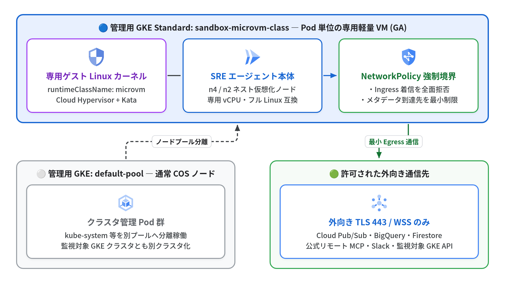
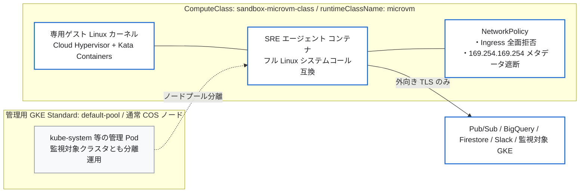
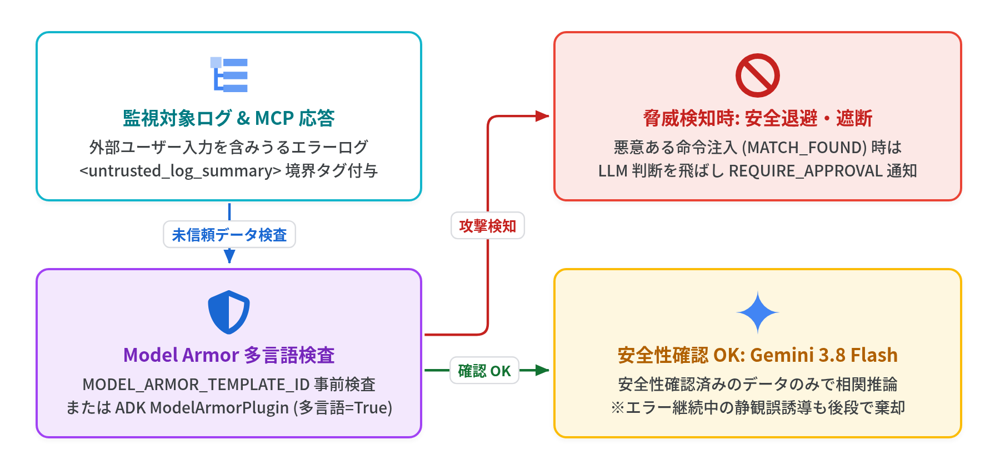
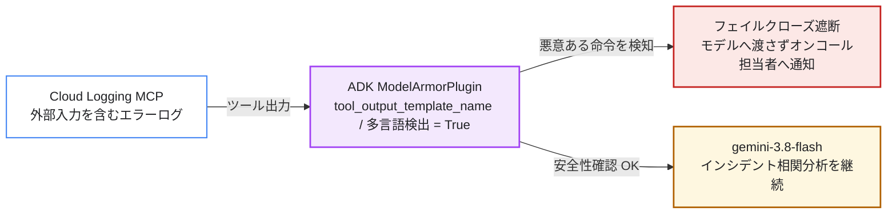

# 第 6 章：【任意ステップアップ】GKE Sandbox (microVM)・Model Armor・反復評価とクリーンアップ (`06-optional-hardening-and-cleanup.md`)

**所要時間**: 約 20 分（クリーンアップのみの場合は 5 分）  
**到達目標**: 本番要件に応じて選択できる 3 つの発展構成（① GKE Standard `microVM` 実行基盤、② Model Armor によるログ内プロンプトインジェクション遮断、③ `pass^3` 信頼性評価ゲート）を確認し、終了後に検証リソースを漏れなく削除する。

---

## 1. オプション A：常駐エージェントを GKE Sandbox（`microVM`）で稼働させる構成

「Preview 機能を使わずすべて GA 基盤で統一したい」「フル Linux カーネル互換の診断バイナリを動かしたい」場合は、[appendix/gke-microvm/](../appendix/gke-microvm) のマニフェスト一式で管理用 GKE Standard クラスタ上にデプロイできます。



<details>
<summary>詳細: Mermaid ソースを表示</summary>



</details>

* **必須条件**: GKE Standard クラスタ（バージョン `1.37` 以降）かつ Nested Virtualization 対応の x86 マシンシリーズ（`n4` / `n2` / `c4` 等、`e2` や Autopilot は非対応）が必要です。またシステム Pod 用に通常ノードプールを最低 1 ノード残します。
* **通信境界とセキュリティ設定の注意点**:
  * [network-policy-metadata-deny.yaml](../appendix/gke-microvm/network-policy-metadata-deny.yaml) は着信を全面拒否し、外向き通信を DNS（53）・HTTPS（443）およびエージェント自身の Workload Identity 認証エンドポイント（`169.254.169.254:80` / `169.254.169.252:988`）のみに絞ります。未信頼コードを別 `microVM` ワーカー Pod へ分離実行する場合は、該当ワーカー側のメタデータ許可ブロックを削除して完全遮断してください。
  * GKE Sandbox Pod はハイパーバイザ境界で隔離されるため、ホスト側の Linux セキュリティモジュール設定（`seccompProfile` 等）は公式仕様上非サポートであり、[agent-deployment-microvm.yaml](../appendix/gke-microvm/agent-deployment-microvm.yaml) でも除外しています。

```bash
source .env
export SRE_AGENT_SA_EMAIL="sre-autonomous-agent-sa@${GOOGLE_CLOUD_PROJECT}.iam.gserviceaccount.com"
export SRE_AGENT_IMAGE_URI="${GOOGLE_CLOUD_REGION}-docker.pkg.dev/${GOOGLE_CLOUD_PROJECT}/sre-handson/sre-autonomous-agent"

gcloud iam service-accounts add-iam-policy-binding "${SRE_AGENT_SA_EMAIL}" \
  --role="roles/iam.workloadIdentityUser" \
  --member="serviceAccount:${GOOGLE_CLOUD_PROJECT}.svc.id.goog[sre-agent-system/sre-agent-ksa]" \
  --project="${GOOGLE_CLOUD_PROJECT}"

kubectl apply -f ./appendix/gke-microvm/compute-class-microvm.yaml

sed -e "s|SRE_AGENT_SA_EMAIL|${SRE_AGENT_SA_EMAIL}|g" \
    -e "s|SRE_AGENT_IMAGE_URI|${SRE_AGENT_IMAGE_URI}|g" \
    -e "s|YOUR_PROJECT_ID|${GOOGLE_CLOUD_PROJECT}|g" \
    -e "s|YOUR_SLACK_CHANNEL_ID|${SLACK_ALERT_CHANNEL_ID}|g" \
  ./appendix/gke-microvm/agent-deployment-microvm.yaml | kubectl apply -f -

kubectl apply -f ./appendix/gke-microvm/network-policy-metadata-deny.yaml
```

---

## 2. オプション B：Model Armor による間接プロンプトインジェクション防御

外部攻撃者が HTTP ヘッダ等に仕込んだ悪意ある命令文字列がエラーログ経由で LLM に入るのを防ぐため、[appendix/production-hardening/model_armor_guard.py](../appendix/production-hardening/model_armor_guard.py) で ADK の `ModelArmorPlugin` を組み込めます。



<details>
<summary>詳細: Mermaid ソースを表示</summary>



</details>

* 日本語の通常ログの誤検知を防ぐため、`enable_multi_language_detection = True` とリージョン固有エンドポイント（`modelarmor.<LOCATION>.rep.googleapis.com`）を設定します。

---

## 3. オプション C：`pass^3` 反復評価によるリリースゲート

プロンプトやツール定義を更新した際、同一シナリオを $n$ 回試行して $c$ 回成功したときに $k$ 回連続で誤判断なく動作する確率 $\text{pass}^k$ を [appendix/production-hardening/calc_pass_hat_k.py](../appendix/production-hardening/calc_pass_hat_k.py) で検証できます。

$$\text{pass}^k = \mathbb{E}_{\text{task}}\left[\frac{\binom{c}{k}}{\binom{n}{k}}\right]$$

```bash
cat << 'EOF' > /tmp/sample_eval_runs.json
{
  "scenario_1_transient_observe": [true, true, true, true, true],
  "scenario_2_known_bug_rollback": [true, true, true, true, true],
  "scenario_3_db_lock_require_approval": [true, true, true, true, true],
  "scenario_4_novel_self_learning": [true, true, true, true, true]
}
EOF

python3 ./appendix/production-hardening/calc_pass_hat_k.py \
  --input-json /tmp/sample_eval_runs.json \
  --k 3 \
  --threshold 0.85
```

---

## 4. 自社環境への段階導入チートシート（コード変更ゼロ・環境変数切替）

本ハンズオンで構築したエージェントは、コードを 1 行も変更せず環境変数と RBAC の組み合わせだけで、安全な「観測モード」から段階的に本番適用できます。

| 導入フェーズ | 環境変数と RBAC の設定値 | エージェントの実際の挙動 |
|---|---|---|
| **STEP 1: 観測・通知のみ**［1〜2 週間］ | `ALLOWED_K8S_NAMESPACES=""` / `ALLOW_DRILL_COOLDOWN_RESET="false"` / 対象 GKE の `RoleBinding` 未付与 | 変更権限ゼロで稼働。異常検知時は隔離解析・`AI.SEARCH` 照合を行い、根拠レポートのみを Slack またはメールへ送信 |
| **STEP 2: 人間承認＋自律学習**［2〜4 週間］ | `ALLOWED_K8S_NAMESPACES="対象NS"` / `MAX_AUTO_ACTIONS_PER_HOUR="0"` / `ALLOW_DRILL_COOLDOWN_RESET="false"` / `SLACK_ALLOWED_APPROVER_IDS` 指定 | すべての復旧候補が決定論的ガードレールで承認待ちへ移行。人間が承認して回復実証された手順だけが `AI.EMBED` 知識ベースへ自動蓄積 |
| **STEP 3: 限定自動復旧**［定着後］ | `ALLOWED_K8S_NAMESPACES="対象NS"` / `MAX_AUTO_ACTIONS_PER_HOUR="1"` / `ALLOW_DRILL_COOLDOWN_RESET="false"` / `RUNBOOK_FRESHNESS_TTL_DAYS="90"` | 類似度 `0.85` 以上かつ直近 90 日以内に実証済みの既知障害のみ 1 時間 1 回まで即時自動復旧。DB・未知・90 日超過手順は承認を維持 |

* **閉域 GKE コントロールプレーンへ接続する場合**: 本ハンズオンの GKE はプライベートノード構成（コントロールプレーン外部到達有効）ですが、本番でコントロールプレーンの外部エンドポイントも閉じている場合は、Cloud Run instance に Direct VPC Egress（`--network` / `--subnet`）を設定するか GKE の DNS ベースエンドポイントを使用してください。

---

<!-- phase: cleanup -->
## 5. クリーンアップ手順（継続課金の停止）

ハンズオン終了後、継続課金が発生しないよう以下の順番でリソースを削除します（新しいターミナルを開いた場合でもそのまま実行できるよう `.env` と `.venv` を最初に読み込みます）。

```bash
source .env
source .venv/bin/activate

# 1. 常駐 Cloud Run instance の削除
gcloud beta run instances delete sre-autonomous-agent \
  --region="${GOOGLE_CLOUD_REGION}" \
  --project="${GOOGLE_CLOUD_PROJECT}" \
  --quiet

# 2. SLO モニタリング・Service・ログベースメトリクスの削除
python3 ./target-app/scripts/setup_slo_monitoring.py --delete

# 3. 監視対象 GKE クラスタと専用 VPC・Cloud NAT の削除
gcloud container clusters delete "${GKE_CLUSTER_NAME}" \
  --region="${GKE_CLUSTER_LOCATION}" \
  --project="${GOOGLE_CLOUD_PROJECT}" \
  --quiet

gcloud compute routers nats delete sre-handson-nat \
  --router=sre-handson-router \
  --region="${GOOGLE_CLOUD_REGION}" \
  --project="${GOOGLE_CLOUD_PROJECT}" \
  --quiet

gcloud compute routers delete sre-handson-router \
  --region="${GOOGLE_CLOUD_REGION}" \
  --project="${GOOGLE_CLOUD_PROJECT}" \
  --quiet

# GKE が専用 VPC に残すことがあるファイアウォールルールを先に削除し、解放待ちを含めてサブネットと VPC を削除します
for FW_RULE in $(gcloud compute firewall-rules list \
  --project="${GOOGLE_CLOUD_PROJECT}" \
  --filter="network~/sre-handson-vpc$" \
  --format="value(name)"); do
  gcloud compute firewall-rules delete "${FW_RULE}" --project="${GOOGLE_CLOUD_PROJECT}" --quiet || true
done

for ATTEMPT in 1 2 3 4 5 6; do
  gcloud compute networks subnets delete sre-handson-subnet \
    --region="${GOOGLE_CLOUD_REGION}" \
    --project="${GOOGLE_CLOUD_PROJECT}" \
    --quiet && break
  sleep 20
done

for ATTEMPT in 1 2 3 4 5 6; do
  gcloud compute networks delete sre-handson-vpc \
    --project="${GOOGLE_CLOUD_PROJECT}" \
    --quiet && break
  sleep 20
done

# 4. Logging シンクと Pub/Sub の削除
gcloud logging sinks delete sre-gke-error-sink \
  --project="${GOOGLE_CLOUD_PROJECT}" \
  --quiet

gcloud pubsub subscriptions delete "${ALERT_PUBSUB_SUBSCRIPTION}" \
  --project="${GOOGLE_CLOUD_PROJECT}" \
  --quiet

gcloud pubsub topics delete sre-alert-stream \
  --project="${GOOGLE_CLOUD_PROJECT}" \
  --quiet

# 5. 代替ルートを設定した場合のみ: 承認専用の Pub/Sub とメール送信用の連携の削除
gcloud pubsub subscriptions delete sre-approval-decisions-sub \
  --project="${GOOGLE_CLOUD_PROJECT}" \
  --quiet || true

gcloud pubsub topics delete sre-approval-decisions \
  --project="${GOOGLE_CLOUD_PROJECT}" \
  --quiet || true

python3 ./target-app/scripts/setup_email_notification.py --delete || true

# 6. BigQuery データセット・Cloud Resource Connection・Artifact Registry の削除（任意）
if bq show --connection --location="${GOOGLE_CLOUD_REGION}" "${GOOGLE_CLOUD_PROJECT}.${GOOGLE_CLOUD_REGION}.${BQ_CONNECTION_ID:-sre_genai_conn}" >/dev/null 2>&1; then
  BQ_CONN_SA=$(bq show --format=json --connection \
    --location="${GOOGLE_CLOUD_REGION}" \
    "${GOOGLE_CLOUD_PROJECT}.${GOOGLE_CLOUD_REGION}.${BQ_CONNECTION_ID:-sre_genai_conn}" \
    | python3 -c "import sys, json; print(json.load(sys.stdin)['cloudResource']['serviceAccountId'])")
  gcloud projects remove-iam-policy-binding "${GOOGLE_CLOUD_PROJECT}" \
    --member="serviceAccount:${BQ_CONN_SA}" \
    --role="roles/aiplatform.user" \
    --condition=None \
    --quiet >/dev/null 2>&1 || true
fi
bq rm -r -f -d "${GOOGLE_CLOUD_PROJECT}:${BQ_DATASET}"
bq rm --connection --location="${GOOGLE_CLOUD_REGION}" --project_id="${GOOGLE_CLOUD_PROJECT}" -f "${BQ_CONNECTION_ID:-sre_genai_conn}" || true

gcloud artifacts repositories delete sre-handson \
  --location="${GOOGLE_CLOUD_REGION}" \
  --project="${GOOGLE_CLOUD_PROJECT}" \
  --quiet

# （任意）Secret Manager シークレットと 3 つの専用 SA を削除する場合
# IAM ポリシーに deleted:serviceAccount:... が残らないよう、先にロールを取り消してから削除します
gcloud secrets delete sre-slack-bot-token --project="${GOOGLE_CLOUD_PROJECT}" --quiet || true
gcloud secrets delete sre-slack-app-token --project="${GOOGLE_CLOUD_PROJECT}" --quiet || true

revoke_roles() {
  local sa_email="$1"
  shift
  for role in "$@"; do
    gcloud projects remove-iam-policy-binding "${GOOGLE_CLOUD_PROJECT}" \
      --member="serviceAccount:${sa_email}" \
      --role="${role}" \
      --condition=None \
      --quiet >/dev/null 2>&1 || true
  done
}

revoke_roles "sre-cloudbuild-sa@${GOOGLE_CLOUD_PROJECT}.iam.gserviceaccount.com" \
  roles/storage.objectViewer \
  roles/artifactregistry.writer \
  roles/logging.logWriter

revoke_roles "sre-gke-node-sa@${GOOGLE_CLOUD_PROJECT}.iam.gserviceaccount.com" \
  roles/container.defaultNodeServiceAccount \
  roles/artifactregistry.reader

revoke_roles "sre-autonomous-agent-sa@${GOOGLE_CLOUD_PROJECT}.iam.gserviceaccount.com" \
  roles/monitoring.viewer \
  roles/logging.viewer \
  roles/mcp.toolUser \
  roles/serviceusage.serviceUsageConsumer \
  roles/bigquery.dataEditor \
  roles/bigquery.jobUser \
  roles/bigquery.connectionUser \
  roles/datastore.user \
  roles/pubsub.subscriber \
  roles/aiplatform.user \
  roles/container.clusterViewer \
  roles/secretmanager.secretAccessor \
  roles/integrations.integrationInvoker

for SA_NAME in sre-autonomous-agent-sa sre-gke-node-sa sre-cloudbuild-sa; do
  gcloud iam service-accounts delete "${SA_NAME}@${GOOGLE_CLOUD_PROJECT}.iam.gserviceaccount.com" \
    --project="${GOOGLE_CLOUD_PROJECT}" \
    --quiet || true
done
```

代替ルートを設定した場合、Application Integration のリージョンの有効化と、有効化時に自動作成された連携 `ExecuteConnection` は残ります。Application Integration は使った分だけの従量課金のため、連携を実行しない限り料金は発生しません。

---

## Links and References

* [GKE Sandbox overview (microVMs vs gVisor)](https://docs.cloud.google.com/kubernetes-engine/docs/concepts/sandbox-pods) — GKE Sandbox の隔離方式比較と制限事項
* [Model Armor overview](https://docs.cloud.google.com/model-armor/overview) — プロンプトインジェクションおよび機密データ保護機能の概要
* [ADK Evaluation guide](https://adk.dev/evaluate/) — エージェントの軌跡と最終応答品質の自動評価ガイド
* [Application Integration pricing](https://cloud.google.com/application-integration/pricing) — 連携の実行回数に応じた従量課金と無料枠
