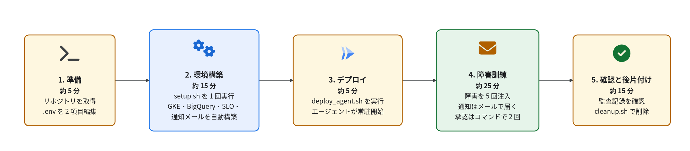
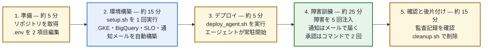
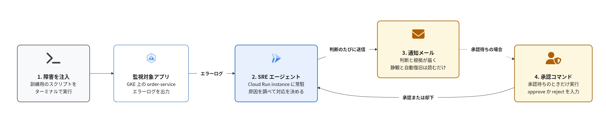
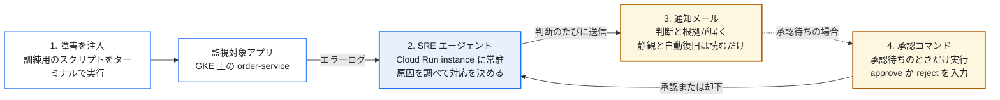

# クイックスタート：60〜90 分で常駐 SRE エージェントを動かす (`quickstart.md`)

**所要時間**: 目安 65 分。初めて触れる場合は 90 分を見込んでください  
**到達目標**: 環境構築をスクリプトに任せて常駐 SRE エージェントをデプロイし、5 回の障害注入を通して「静観」「自動復旧」「人の承認」「承認した対処を学習して次回から自動復旧」の 4 つの動きを自分の環境で確かめる。

---

## 1. このコースの位置づけ

このリポジトリには 2 つのコースがあります。できあがる環境の構成は同じで、違うのは自分で手を動かす範囲です。

| 比べる点 | クイックスタート（このページ） | フル版（第 0 章〜第 6 章） |
|---|---|---|
| 所要時間 | 目安 60〜90 分 | 約 4 時間 |
| 環境構築 | スクリプトを 1 回実行する | 章ごとにコマンドを実行し、仕組みを確かめながら進める |
| 通知と承認 | メール通知と承認コマンド | Slack が標準。メール通知と承認コマンドは代替 |
| 障害訓練 | 訓練 1〜3 と、訓練 4 の「学習して自動復旧」まで | さらに、長く検証されていない手順を人の承認へ戻す訓練 |
| コードの解説と単体テスト | 扱わない | 第 3 章と第 4 章で扱う |

まず動くものを見たい場合はこのページを進めてください。設計とコードを理解して自分の環境へ応用したい場合は、[第 0 章](00-overview-and-architecture.md) から始めるフル版が向いています。



<details>
<summary>詳細: Mermaid ソースを表示</summary>



</details>

### 所要時間の内訳

| 手順 | 行うこと | 目安 | うち、処理を待つ時間（実測） |
|---|---|---:|---:|
| 1. 準備 | リポジトリの取得、設定 2 項目の編集 | 5 分 | なし |
| 2. 環境構築 | `setup.sh` を実行し、待つ間に仕組みを読む | 15 分 | 約 13 分 |
| 3. デプロイ | `deploy_agent.sh` を実行する | 5 分 | 約 1 分 |
| 4. 障害訓練 | 障害を 5 回注入し、メールを読み、2 回承認する | 25 分 | 約 10 分 |
| 5. 確認と後片付け | 監査記録を確認し、`cleanup.sh` を実行する | 15 分 | 約 13 分 |
| 合計 | | 65 分 | 約 37 分 |

「処理を待つ時間」は検証環境でゼロから通しで計測した実測値です。コマンドを入力する時間とメールを読む時間は目安で、人によって変わります。

---

## 2. 始める前に用意するもの

| 用意するもの | 条件 |
|---|---|
| Google Cloud プロジェクト | 課金が有効な、検証専用のプロジェクト。本番環境や、他の人と共用しているプロジェクトは使わないでください |
| 権限 | そのプロジェクトのオーナー（`roles/owner`） |
| メールアドレス | 通知の受け取り用。訓練中にすぐ読めるもの |
| 実行環境 | Cloud Shell、または下記のコマンドを使えるローカルのターミナル |

ローカルのターミナルで必要なコマンドは次のとおりです。Cloud Shell には最初から入っています。

* `gcloud`: Google Cloud CLI。`beta` コンポーネント、`bq`、`gke-gcloud-auth-plugin` を含めます
* `kubectl`
* `python3`: バージョン 3.11 以上
* `git` と `bash`

ローカルのターミナルでは、最初に 2 種類のログインを行います。Cloud Shell では不要です。

```bash
gcloud auth login
gcloud auth application-default login
```

1 つ目は `gcloud` コマンド用です。2 つ目は、SLO の登録・通知メールの設定・承認コマンドを行う Python スクリプト用です。

**費用の目安**: 90 分で終えて後片付けまで行った場合、無料枠を差し引かない定価で約 \$0.4〜\$0.5 です。内訳は [README の料金表](../README.md) を参照してください。後片付けをしないと、GKE クラスタなどの課金が続きます。

**このコースの制約**:

* Cloud Run instances と Cloud Run sandboxes は Preview の機能です。このコースでは、対応リージョンである東京（`asia-northeast1`）を使います。
* メールの 1 日あたりの送信上限は、プロジェクトによって異なります。上限が足りないプロジェクトでは通知メールを使えないため、Slack を準備します。`setup.sh` が上限を確認し、足りない場合は画面で案内します。
* 動作を確認したのは、Linux のターミナル、プロジェクトのオーナー権限、組織に属するプロジェクトの組み合わせです。Cloud Shell、macOS、組織に属さないプロジェクトでの通しの動作は未確認です。

---

## 3. 手順 1：準備（約 5 分）

リポジトリを取得し、設定ファイルを作ります。

```bash
git clone "https://github.com/tyorikan/agentic-sre-handson.git"
cd agentic-sre-handson

cp .env.example .env
```

エディタで `.env` を開き、次の 2 項目だけを書き換えます。ほかの項目は変更不要です。

| 項目 | 設定する値 |
|---|---|
| `GOOGLE_CLOUD_PROJECT` | 検証専用プロジェクトの ID |
| `NOTIFY_EMAIL_TO` | 通知を受け取るメールアドレス |

---

## 4. 手順 2：環境を構築する（約 15 分）

フル版の第 0 章から第 2 章と、第 4 章の通知メールの準備にあたる環境を、1 回の実行で構築します。

```bash
./quickstart/setup.sh
```

最初に、対象のプロジェクトと作成するものの一覧が表示されます。内容を確かめて**プロジェクト ID を入力すると**構築が始まります。入力が一致しない場合は、何も変更せずに終了します。

* 一覧だけを見たい場合は `./quickstart/setup.sh --plan` を実行します。何も変更しません。
* 途中で失敗した場合は、失敗した段階とログの末尾が表示されます。原因を解消して同じコマンドをもう一度実行すると、作成済みのものを飛ばして続きから進みます。

実行中は、段階ごとに進み具合が表示されます。

```text
[10:00:05]  1/13 API を有効化
           完了（25 秒）
[10:00:30]  2/13 Firestore のデータベースを作成
           完了（12 秒）
...
[10:12:40] 13/13 可用性 SLO を登録（約 1 分）
           完了（55 秒）

環境構築が完了しました。段階ごとの所要時間:
...
通知メール: 設定済みです（宛先: you@example.com）。初回はテストメールが届きます。

次の手順: ./quickstart/deploy_agent.sh
```

スクリプトが作るものは次のとおりです。各段階のコマンドは、フル版のドキュメントに載っているものと同じです。

| 作るもの | 役割 | フル版の対応箇所 |
|---|---|---|
| サービスアカウント 3 つ | ビルド用、GKE のノード用、エージェント用に権限を分ける | 第 0 章 |
| GKE Autopilot クラスタと監視対象アプリ | 障害を注入する対象。注文 API `order-service` と、一定の間隔でリクエストを送る Pod | 第 1 章 |
| Log Sink と Pub/Sub | 監視対象アプリのエラーログだけをエージェントへ届ける | 第 1 章 |
| 可用性 SLO 2 本 | 日次 99.0% と月次 99.9%。復旧の効果を数値で測る | 第 1 章 |
| BigQuery の知識ベース | 過去の障害と対処 100 件。似た事例の検索に使う | 第 2 章 |
| 通知メール用の連携と承認専用の Pub/Sub | 通知メールの送信と、承認コマンドからの承認の受け取り | 第 4 章 5.2 |
| コンテナイメージ 2 つ | 監視対象アプリと、SRE エージェント | 第 1 章、第 5 章 |

### 待つ間に読む：エージェントは何をするのか

SRE エージェントは、監視対象アプリのエラーログを受け取るたびに、次の順で動きます。

1. **重複の確認**: 同じ障害の通知が 15 分以内に来ていれば、まとめて 1 件として扱います。
2. **状況の収集**: 直近 90 秒のエラー率と、直近のデプロイ履歴を集めます。
3. **並列の診断**: 隔離された実行環境である Cloud Run sandbox で、エラー率が自然に下がっているかを計算します。同時に、BigQuery の知識ベースから似た過去事例を検索します。
4. **対応の判断**: Gemini が、集めた情報から下の 3 つの対応のどれかを選びます。
5. **安全確認**: 自動復旧の条件を 1 つでも満たさない場合は、人の承認へ切り替えます。

| 対応 | 選ばれる場面 | エージェントが行うこと |
|---|---|---|
| 静観 | エラーが一時的で、すでに収まりつつある | 何も変更せず、根拠を通知する |
| 自動復旧 | 過去に対処が確立している障害と一致した | ロールバックまたは再起動を実行し、回復を確かめて通知する |
| 人の承認 | 初めて見る障害や、自動で触ると悪化しうる障害 | 何も変更せずに止まり、承認を待つ |

自動復旧が実行されるのは、次の条件をすべて満たすときだけです。

* 対象が、許可した Namespace `sre-demo-app` の中にある
* 過去事例との類似度が 0.85 以上である
* その対処手順が、直近 90 日以内に実際の復旧で検証されている
* 直近 1 時間に、ほかの自動復旧を実行していない

図で確認したい場合は、[第 0 章の意思決定フロー図](00-overview-and-architecture.md) を参照してください。図の中の Slack は、このコースではメールと承認コマンドに読み替えます。

### 構築が終わったら

件名 `[SRE Agent] テスト: 通知メールの設定確認` のメールが届いていることを確かめます。届いていない場合は、迷惑メールフォルダも確認してください。

---

## 5. 手順 3：エージェントをデプロイする（約 5 分）

SRE エージェントを Cloud Run instance としてデプロイします。Cloud Run instance は、1 つのコンテナを常に動かし続ける実行環境です。

```bash
./quickstart/deploy_agent.sh
```

完了すると、有効になった通知と承認の経路が表示されます。

```text
通知と承認の経路:
  メール通知   : 有効
  承認コマンド : 有効
  Slack        : 無効

次の手順: source ./quickstart/env.sh を実行してから、訓練 1 (./target-app/scripts/inject_transient_net_err.sh) へ進みます。
```

このデプロイでは、フル版と同じ 2 つの設定を付けています。

* **外部からの着信を受け付けない**: `--ingress=internal` と `--no-default-url` により、エージェントは公開 URL を持ちません。ログの受信、通知メールの送信、承認の受け取りは、すべてエージェントから外へ向かう通信で行います。
* **隔離された実行環境を使える**: `--sandbox-launcher` により、診断用の計算を Cloud Run sandbox の中で実行します。

---

## 6. 手順 4：障害訓練（約 25 分）

最初に、訓練で使う変数と Python の仮想環境を読み込みます。**新しいターミナルを開いたときは、毎回このコマンドを実行してください。**

```bash
source ./quickstart/env.sh
```

訓練は、次の流れの繰り返しです。人の操作が必要になるのは、承認待ちのメールが届いたときだけです。



<details>
<summary>詳細: Mermaid ソースを表示</summary>



</details>

| 訓練 | 注入する障害 | エージェントの対応 | 届くメールの件名 | あなたの操作 |
|---|---|---|---|---|
| 1 | 下流サービスとの通信が 15 秒だけ切れる | 静観 | `静観` | なし |
| 2 | 設定が欠けた新バージョンをデプロイする | 自動復旧 | `自動復旧完了` | なし |
| 3 | データベースの接続が枯渇する | 人の承認 | `承認待ち` → `承認・手動対応へ引き継ぎ` | 承認コマンド |
| 4-A | 知識ベースに無い障害、1 回目 | 人の承認 | `承認待ち` → `承認・実行完了` | 承認コマンド |
| 4-C | 同じ障害、2 回目 | 自動復旧 | `自動復旧完了` | なし |

メールは、環境構築時のテストメール 1 通と訓練中の通知 7 通を合わせて、合計 8 通届きます。障害を注入してからメールが届くまでの時間は、1〜2 分が目安です。

### 訓練 1：一時的な通信断 → 静観

下流の決済サービスとの通信が 15 秒だけ切れる状況を再現します。

```bash
./target-app/scripts/inject_transient_net_err.sh
```

エージェントは 30 秒待ってからエラー率の推移を調べ、すでに収まっていることと、似た過去事例 `INC-013` の対処が静観であることから、何も変更しないと判断します。

**確認すること**:

* 件名に `静観` を含むメールが届く。
* メールの「回避した誤対応」に、ここで Pod を再起動すると障害が長引く理由が書かれている。
* Pod が作り直されていない。次のコマンドで、`AGE` が訓練の前から続いていることを確かめます。作り直された場合は、`AGE` が 1〜2 分になります。

```bash
kubectl get pods -n sre-demo-app -l app=order-service
```

届くメールの抜粋例は次のとおりです。

```text
件名: [SRE Agent] 静観: sre-demo-app/order-service [5m4fmm6attxchacf]
判定結果: 静観 (OBSERVE)  /  類似した過去事例: INC-013 (類似度 0.89)
判断根拠: 実トラフィック上のエラー率が既に 0.0% へ自然減衰しており、過去事例 INC-013 の推奨アクションも OBSERVE であるため静観とする。
回避した誤対応: この状態で Pod を一斉再起動すると、確立済みの正常な TLS コネクションプールまで破棄され、再ハンドシェイク嵐で障害が長引く。
```

### 訓練 2：設定が欠けたリリース → 自動復旧

必須の設定 `PAYMENT_CURRENCY_PRECISION` が欠けたバージョン `v2.0.0-buggy` をデプロイし、HTTP 500 のエラーを発生させ続けます。

```bash
./target-app/scripts/inject_buggy_release.sh
```

エージェントは、直近にデプロイがあったことと、過去事例 `INC-001` との類似度が 0.85 以上であることから、自動復旧を選びます。1 つ前のバージョンへロールバックし、エラー率が 1% 未満に戻ったことを確かめてから通知します。

**確認すること**:

* 件名に `自動復旧完了` を含むメールが届く。
* メールの「SLO と Error Budget への効果」に、復旧までにかかった時間が書かれている。Error Budget は、可用性の目標を守ったうえで許されるエラーの量です。月次 99.9% の目標では、1 か月あたり約 43 分の停止に相当します。メールには、人が 30 分かけて対応した場合と比べて、この消費をどれだけ減らせたかが書かれています。
* アプリが 1 つ前のバージョンに戻っている。次のコマンドで `VERSION` が `v1.0.0` であることを確かめます。

```bash
kubectl get pods -n sre-demo-app -l app=order-service -L version
```

### 訓練 3：データベースの接続枯渇 → 人の承認

データベースの接続枠が埋まり、ロック待ちが続く状況を再現します。

```bash
./target-app/scripts/inject_unknown_db_stall.sh
```

この種の障害でアプリを再起動すると、再接続が集中してデータベース全体が止まるおそれがあります。エージェントは何も変更せずに止まり、件名に `承認待ち` を含むメールを送ります。

メールの末尾に書かれたコマンドを、リポジトリのルートで実行します。インシデント ID はメールごとに異なります。

```bash
python3 ./target-app/scripts/approve_incident.py <インシデント ID>
```

判定の内容が表示されるので、確かめてから `approve` と入力します。却下する場合は `reject` と入力します。

```text
========================================================================
承認待ちインシデント [9k3m8x2p7v4q1w5z]
  対象         : sre-demo-app/order-service
  操作種別     : MANUAL_INTERVENTION
  類似過去事例 : INC-025 (類似度 0.89)
  提案内容     : Pod の無断再起動を避け、オンコール担当者へ DB ロック調査を引き継ぐ
========================================================================
実行を承認する場合は approve、手動対応へ切り替える場合は reject を入力してください: approve
承認イベントを sre-approval-decisions へ発行しました（操作者: you@example.com）。結果は通知メールで確認してください。
```

* メールが届かない場合は、引数を付けずに `python3 ./target-app/scripts/approve_incident.py` を実行すると、承認待ちの一覧が表示されます。
* 承認コマンドは、承認または却下を送信したら終了します。結果は次のメールで届きます。

**確認すること**:

* 承認から数秒〜数十秒で、件名に `承認・手動対応へ引き継ぎ` を含むメールが届く。この障害では、承認してもエージェントは変更操作を行いません。担当者が手動で対処する前提で、調査結果を引き継ぎます。

確認が終わったら、再現した障害を解除します。

```bash
./target-app/scripts/reset_fault.sh
```

### 訓練 4：初めて見る障害 → 承認した対処を学習し、次回から自動復旧

知識ベースの 100 件に無い障害として、税率データの破損を再現します。

**ステップ A：1 回目は人の承認で復旧する**

```bash
./target-app/scripts/inject_novel_tax_corrupt.sh
```

似た過去事例が無く、類似度が 0.85 に届かないため、エージェントは自動復旧を行わずに承認を待ちます。`承認待ち` のメールが届いたら、訓練 3 と同じ手順で承認コマンドを実行し、`approve` と入力します。

エージェントは、承認された対処であるアプリの順次再起動を実行し、エラー率が戻ったことを確かめます。そのうえで、この対処を新しい手順として知識ベースへ登録します。

**確認すること**:

* 件名に `承認・実行完了` を含むメールが届く。
* メールの「Runbook の更新」に、新しく登録した手順の ID が `AUTO-` で始まる名前で書かれている。Runbook は、障害ごとの対処手順をまとめた記録です。

**ステップ B：登録された手順が検索できることを確かめ、訓練用に制限を解除する**

登録された手順は、BigQuery が検索用のベクトルを自動で生成すると、検索できるようになります。次のクエリの `embedded` が `true` であることを確かめます。`false` の場合は、30 秒ほど待ってからもう一度実行します。

```bash
bq query --project_id="${GOOGLE_CLOUD_PROJECT}" --location="${GOOGLE_CLOUD_REGION}" --use_legacy_sql=false \
  'SELECT runbook_id, recommended_action, (embedding IS NOT NULL AND embedding.status = "") AS embedded, verified_count FROM `sre_agent_ops.incident_runbooks` WHERE STARTS_WITH(runbook_id, "AUTO-")'
```

ステップ A の再起動によって税率データの破損自体はすでに解消しています。続けて、連続して訓練するための制限解除を行います。

```bash
./target-app/scripts/reset_fault.sh --reset-cooldown
```

`--reset-cooldown` は、「同じ障害の通知を 15 分間まとめる」「自動復旧は 1 時間に 1 回まで」という 2 つの安全上の制限を、訓練のために解除します。訓練 2 ですでに自動復旧を 1 回実行しているため、解除しないと次の自動復旧は人の承認へ切り替わります。この解除は訓練用の設定で、本番では無効にします。

**ステップ C：2 回目は承認なしで自動復旧する**

同じ障害をもう一度注入します。

```bash
./target-app/scripts/inject_novel_tax_corrupt.sh
```

今度は、ステップ A で登録された手順と一致するため、エージェントは承認を待たずに再起動を実行します。

**確認すること**:

* 件名に `自動復旧完了` を含むメールが届く。承認待ちのメールは届かない。
* メールの「類似した過去事例」に、ステップ A で登録された `AUTO-` で始まる ID が書かれている。

---

## 7. 手順 5：結果を確認する（約 5 分）

エージェントは、すべての判断を BigQuery の `incident_events` テーブルへ記録しています。訓練の結果を一覧で確かめます。

```bash
bq query --project_id="${GOOGLE_CLOUD_PROJECT}" --location="${GOOGLE_CLOUD_REGION}" --use_legacy_sql=false \
  'SELECT
     created_at,
     error_code,
     decision,
     matched_runbook_id,
     ROUND(mttr_seconds, 1) AS mttr_sec,
     ROUND(saved_error_budget_minutes, 2) AS saved_budget_min
   FROM `sre_agent_ops.incident_events`
   WHERE decision != "ADMIN_RESET"
   ORDER BY created_at'
```

| 列 | 意味 |
|---|---|
| `decision` | 記録の種類。`OBSERVE` は静観、`AUTO_REMEDIATE` は自動復旧、`REQUIRE_APPROVAL` は承認待ち、`APPROVED_EXECUTED` は承認を受けて対応した記録 |
| `matched_runbook_id` | 判断の根拠にした過去事例の ID |
| `mttr_sec` | 検知から復旧を確かめるまでの秒数 |
| `saved_budget_min` | 手動対応に 30 分かかると仮定した場合と比べて、減らせた Error Budget 消費の推定値。単位は分 |

記録は 7 行になります。承認が必要だった訓練 3 と訓練 4-A は、承認待ちと承認後の 2 行ずつです。

同じ障害 `TAX_RULE_CRC32_MISMATCH_500` が、1 回目は `REQUIRE_APPROVAL` と `APPROVED_EXECUTED`、2 回目は `AUTO_REMEDIATE` として記録されていることを確かめてください。人が一度承認した対処が、次回からは自動で実行されるようになったことを示しています。

実行結果の例（7 行）は次のとおりです。

| 訓練 | `error_code` | `decision` | `matched_runbook_id` | `mttr_sec` | `saved_budget_min` |
|---|---|---|---|---:|---:|
| 1 | `UPSTREAM_CONN_RESET_503` | `OBSERVE` | `INC-013` | 55.6 | 0.00 |
| 2 | `CONFIG_KEY_ERROR_500` | `AUTO_REMEDIATE` | `INC-001` | 82.1 | 28.63 |
| 3 | `DB_CONN_SLOTS_EXHAUSTED_500` | `REQUIRE_APPROVAL` | `INC-025` | NULL | NULL |
| 3 | `DB_CONN_SLOTS_EXHAUSTED_500` | `APPROVED_EXECUTED` | `INC-025` | NULL | NULL |
| 4-A | `TAX_RULE_CRC32_MISMATCH_500` | `REQUIRE_APPROVAL` | `INC-001` | NULL | NULL |
| 4-A | `TAX_RULE_CRC32_MISMATCH_500` | `APPROVED_EXECUTED` | `INC-001` | 124.1 | 27.93 |
| 4-C | `TAX_RULE_CRC32_MISMATCH_500` | `AUTO_REMEDIATE` | `AUTO-AC0B8750` | 97.2 | 28.38 |

---

## 8. 手順 6：後片付け（約 10〜15 分）

作成したリソースを削除し、課金を止めます。

```bash
./quickstart/cleanup.sh
```

最初に、削除するものの一覧が表示されます。内容を確かめて**プロジェクト ID を入力すると**削除が始まります。一覧だけを見たい場合は `./quickstart/cleanup.sh --plan` を実行します。

次のものは削除しません。

| 残るもの | 理由と、不要な場合の対処 |
|---|---|
| プロジェクトと、有効化した API | プロジェクトごと不要な場合は、Google Cloud コンソールの「IAM と管理」からシャットダウンします |
| Firestore のデータベース `(default)` | 削除すると、同じ名前では約 5 分間作り直せないためです。中に残るのは、訓練のセッションと承認の記録です |
| Application Integration のリージョンの有効化 | 課金は連携の実行回数などの利用量に対して発生するため、連携を実行しなければ費用はかかりません |
| Cloud Build の作業用バケットとビルドのログ | ソースコードの圧縮ファイルが残ります。不要な場合は Cloud Storage のバケット `<プロジェクト ID>_cloudbuild` を削除します |

---

## 9. 省いた内容と、フル版の対応箇所

後片付けの前であれば、クイックスタートの環境のまま、次の内容を続けて試せます。

| 省いた内容 | 試す方法 |
|---|---|
| Slack での通知と承認 | [第 4 章](04-auto-remediation-and-slack-hitl.md) の 5.1 で Slack アプリとシークレットを準備し、`.env` にチャンネル ID を設定してから、`./quickstart/deploy_agent.sh` をもう一度実行します。メール通知と同時に使えます |
| 長く検証されていない手順を人の承認へ戻す訓練 | [第 5 章](05-deploy-cloud-run-instance-and-drills.md) の訓練 4 ステップ D を実行します |
| 訓練の前後での Error Budget の比較 | [第 5 章](05-deploy-cloud-run-instance-and-drills.md) の Step 3.0 のコマンドを実行します |
| 単体テストと、エージェントのコードの解説 | [第 3 章](03-diagnostic-agent-and-sandbox.md) と [第 4 章](04-auto-remediation-and-slack-hitl.md) を参照します。テストの実行には `pip install -e ".[dev]"` が必要です |
| オーナー以外の最小限のロールでの実施 | [第 0 章](00-overview-and-architecture.md) の Step 2.0 を参照します。クイックスタートのスクリプトは、オーナーでの実行だけを確認しています |
| 本番へ向けた強化 | [第 6 章](06-optional-hardening-and-cleanup.md) を参照します |

---

## 10. うまくいかないとき

| 状況 | 対処 |
|---|---|
| `setup.sh` が途中で止まった | 画面に、失敗した段階とログの末尾が表示されます。原因を解消し、同じコマンドをもう一度実行します |
| 「通知メール: このプロジェクトでは使えません」と表示された | メールの送信上限が足りないプロジェクトです。[第 4 章](04-auto-remediation-and-slack-hitl.md) の 5.1 で Slack を準備し、`.env` にチャンネル ID を設定してから `deploy_agent.sh` を実行します |
| テストメールが届かない | 迷惑メールフォルダを確認します。宛先が違う場合は、`.env` の `NOTIFY_EMAIL_TO` を直して `setup.sh` をもう一度実行します |
| 訓練のメールが届かない | 同じ障害を 15 分以内に繰り返すと、重複として扱われます。`./target-app/scripts/reset_fault.sh --reset-cooldown` を実行してから、もう一度注入します |
| 承認コマンドが `ModuleNotFoundError` で止まる | 仮想環境が有効になっていません。`source ./quickstart/env.sh` を実行します |
| ターミナルを閉じた、または Cloud Shell が切断された | リポジトリのディレクトリへ移動し、`source ./quickstart/env.sh` を実行します。`setup.sh` の途中だった場合は、もう一度実行します |

エージェントの判断の経過は、次のコマンドで確認できます。

```bash
gcloud logging read \
  'resource.labels.instance_name="sre-autonomous-agent" AND NOT jsonPayload.message:"重複排除スキップ"' \
  --limit=20 \
  --project="${GOOGLE_CLOUD_PROJECT}" \
  --format='table(timestamp,severity,jsonPayload.incident_id,jsonPayload.decision,jsonPayload.message)'
```

---

## 🤖 AI コーディングエージェントを使う場合の指示プロンプト

```markdown
`AGENTS.md` と `docs/quickstart.md` を読み込み、クイックスタートを手順どおりに進めてください。
- `./quickstart/setup.sh --plan` と `./quickstart/cleanup.sh --plan` の出力を私に見せ、対象のプロジェクト ID と作成・削除するものを私が確認して `y` と答えてから、本実行すること。
- スクリプトが途中で止まった場合は、表示されたログの末尾と原因の見立てを報告し、私の指示を待つこと。
- 承認待ちへの承認と却下は私が行うため、`approve_incident.py` への `approve`・`reject` の入力を代行しないこと。
- 訓練が終わったら、BigQuery `incident_events` の判断結果を表にまとめて報告すること。
```

---

## Links and References

* [Create and manage Cloud Run instances](https://docs.cloud.google.com/run/docs/instances/create-and-manage-instances) — 常駐する実行環境 Cloud Run instances の作成と管理
* [Configure sandboxes for instances (Cloud Run)](https://docs.cloud.google.com/run/docs/configuring/instances/sandboxes) — 隔離された実行環境 Cloud Run sandboxes の有効化
* [Autonomous embedding generation in BigQuery](https://docs.cloud.google.com/bigquery/docs/autonomous-embedding-generation) — 知識ベースの検索用ベクトルを自動で生成する仕組み
* [Concepts in service monitoring (Cloud Monitoring)](https://docs.cloud.google.com/stackdriver/docs/solutions/slo-monitoring) — SLO と Error Budget の考え方
* [Send Email task (Application Integration)](https://docs.cloud.google.com/application-integration/docs/configure-send-email-task) — 通知メールを送るメール送信タスクの仕様
* [Set up ADC for a local development environment](https://docs.cloud.google.com/docs/authentication/set-up-adc-local-dev-environment) — ローカルのターミナルで `gcloud auth application-default login` が必要な理由
* [Cloud Shell quotas and limits](https://docs.cloud.google.com/shell/docs/quotas-limits) — Cloud Shell の利用時間の上限と、無操作時の切断
